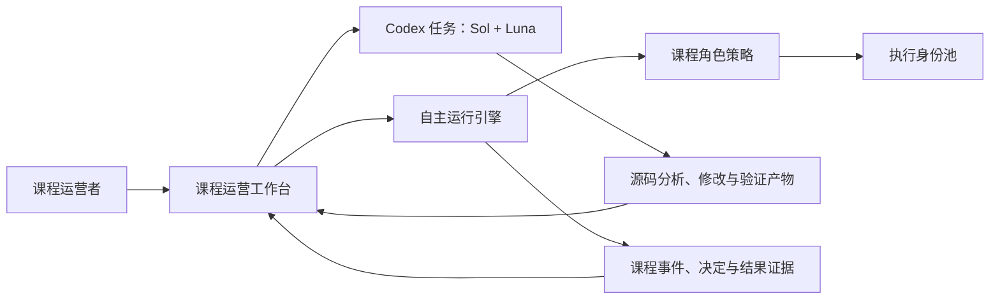
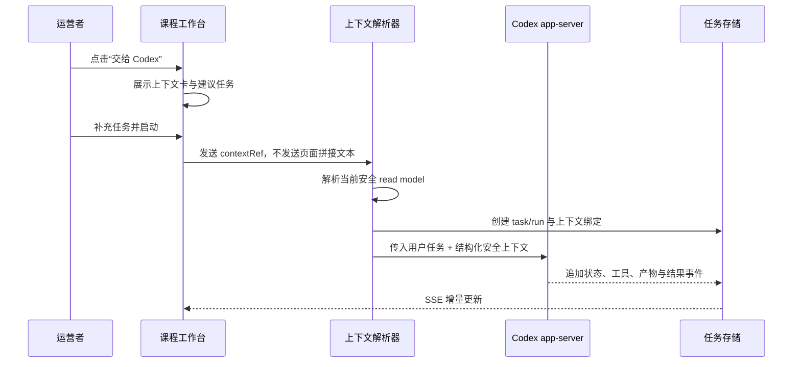
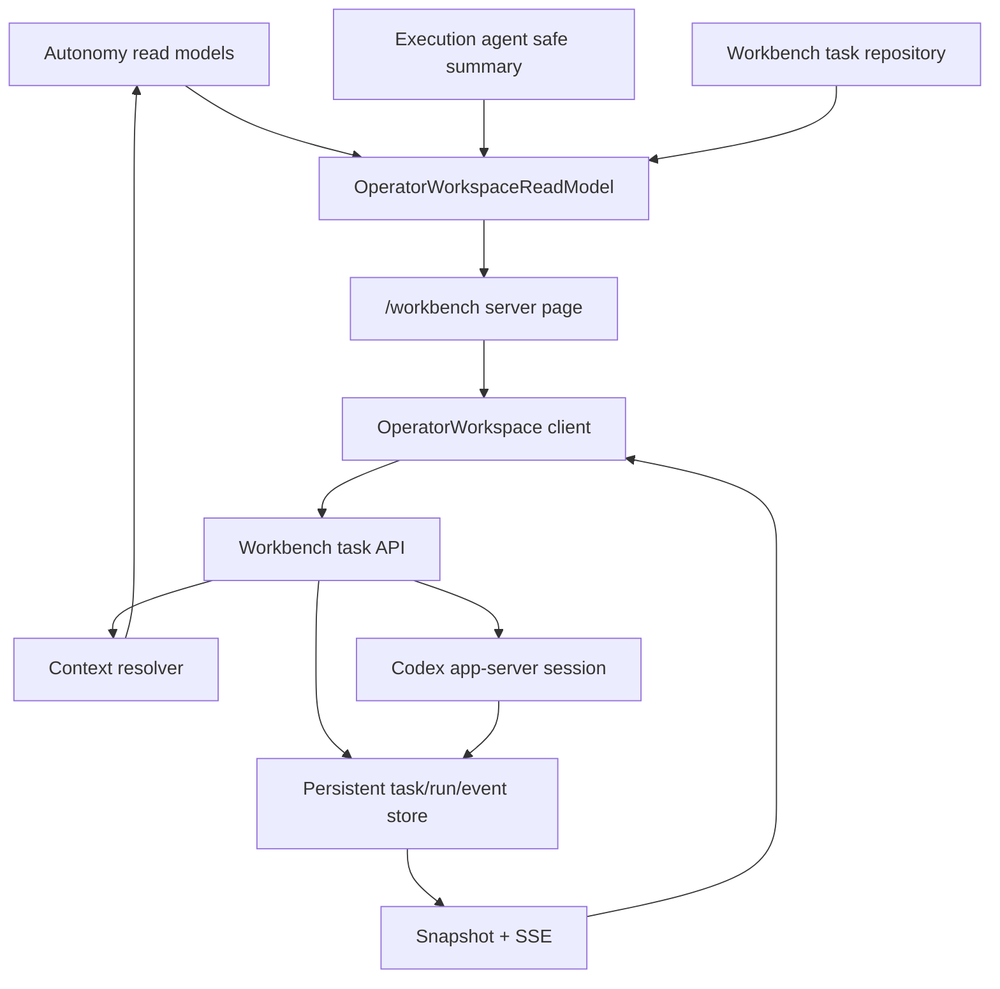

# Codex 连续型课程运营工作台：产品与开发蓝图

- 版本：`v0.1`
- 日期：`2026-08-10`
- 状态：`IMPLEMENTATION BLUEPRINT`
- 适用范围：cMOOC 自主课程促进产品、课程运行证据面、本机 Codex 工作台

## 0. 执行结论

产品下一阶段不应继续扩张“课程全景、智能体编队、Codex 工作台”三个彼此平行的展示面，
而应把它们收束为一个以任务为中心的 **课程运营工作台**：

```text
课程刚刚发生了什么
→ 系统为什么行动、等待、克制或让位
→ 运营者把一个具名证据包交给 Codex
→ Codex 在本机源码工作区完成分析或开发任务
→ 结果、产物和后续观察回到同一条可核验时间线
```

`/workbench` 成为第一工作面。课程世界、决定、运行、结果和治理继续保留为证据下钻页，
但不再与工作台争夺第一入口。多智能体通过真实任务中的分工、交接和结果出现；多账号通过
课程角色的可用性、轮换与执行来源出现，不再通过四张长期陈列的人格卡证明“多智能体”。

这次重构是产品结构重构，不是单纯换肤：

1. 从功能展板改为单一主任务；
2. 从页面并列改为上下文连续；
3. 从静态角色故事改为真实任务溯源；
4. 从内存演示工作台改为可恢复的任务工作台；
5. 从“AI 感”视觉语法改为安静、精确的课程研究仪器。

## 1. 产品命题

### 1.1 核心用户

第一用户是课程运营者、教师或研究团队成员。他们不负责逐条批准回复，而负责：

- 快速确认课程当前状态；
- 理解系统为何行动或让位；
- 发现需要诊断、修复或继续研究的异常；
- 将一个已经绑定证据的任务交给 Codex；
- 核对执行产物与课程运行事实是否闭环。

### 1.2 核心 Job-to-be-Done

> 当我打开产品时，我希望在 30 秒内知道课程发生了什么、系统作了什么决定、是否需要我
> 介入；需要继续处理时，我可以把当前证据直接交给 Codex，而不用重新描述背景或在多个
> 页面之间复制信息。

### 1.3 产品承诺

工作台必须同时做到：

- **可看懂**：事实、决定、行动和结果具有明确层级；
- **可继续**：每个值得处理的对象都有一个自然的下一步；
- **可核验**：上下文来自当前 read model 与 Decision Tape，不由界面重新发明；
- **不中断**：页面刷新或服务重启后仍能找到任务事实和已完成产物；
- **不表演**：不靠拟人卡片、霓虹装饰或抽象口号制造智能感。

### 1.4 明确非目标

- 不是通用聊天产品；
- 不是逐条帖子审批台；
- 不是让 Codex 绕过 autonomy policy 直接操作课程平台；
- 不是用四个角色名包装四个独立大模型；
- 不是把所有 Graph、指标、策略和研究结果塞入一个仪表盘；
- 不是在第一版加入任务队列、多人协作、云端 Codex 或跨课程批量操作。

### 1.5 原型推进原则

上下文不完整不是禁用 Codex 的理由。覆盖删失、页面失效或运行失败本身就是很有价值的
诊断任务来源；工作台应把边界清楚附在上下文卡上，并允许 Codex 继续分析和开发。只有
真实课程外部动作继续由 autonomy runtime 的既有策略与执行链负责。

因此第一版：

- 不增加新的逐任务审批；
- 不因 partial coverage 隐藏“交给 Codex”；
- 不为 safe local task 新增额外授权变量；
- 不把一个目标失败扩大成整个工作台不可用；
- 用明确状态和可恢复任务替代更多锁与确认弹窗。

## 2. 一个产品内的四种责任

产品必须在视觉和文案上区分四类容易混淆的对象：

| 对象 | 真实职责 | UI 名称 | 不应暗示 |
| --- | --- | --- | --- |
| Sol | 当前 Codex 任务的组织、判断和汇总 | 主智能体 | 课程公共账号 |
| Luna | 有界代码检查、实现和验证 | 协作智能体 | 独立课程人格 |
| 课程角色 | 引导、证据、反思、社群等促进功能 | 课程角色 | 独立推理模型 |
| 执行账号 | 受课程范围、额度和冷却约束的公开执行身份 | 执行身份 | 角色本身或智能体本身 |

推荐在产品内使用下列关系：



Codex 工作台与自主运行引擎共享课程上下文和证据引用，但保留执行边界：前者处理本机
源码任务，后者负责真实课程观察与受策略约束的课程动作。

## 3. 目标信息架构

### 3.1 主导航

主导航缩减为五个高频工作域：

1. **工作台**：课程现场 + Codex 任务；
2. **课程世界**：事件、线程、参与者和连接；
3. **运行记录**：巡检、决定和 Decision Tape；
4. **结果观察**：R24/R72 与描述性结果；
5. **治理**：运行策略、预算、执行身份和异常。

平台巡检、长期审核、研究证据进入“更多”或治理页的二级入口，不再占据第一层导航。

### 3.2 路由规划

```text
/workbench                         第一入口：课程运营工作台
/workbench/tasks/[taskId]          持久任务详情与结果
/autonomy/world                    课程世界下钻
/autonomy/decisions                决定列表与证据
/autonomy/runs/[invocationId]      单次运行 Decision Tape
/autonomy/outcomes                 近端结果
/autonomy/governance               治理总览
/autonomy/policy                   策略细节，作为治理子页
/platform                          平台诊断
/review/live                       长期异常审核
/evidence                          研究证据
```

兼容策略：

- `/agent-console` 继续重定向到 `/workbench`；
- `/autonomy` 重定向到 `/workbench`；
- 第一阶段保留 `/` 现有页面，第二阶段在新首页验收后将 `/` 重定向到 `/workbench`；
- 既有 `/autonomy/*` 深链和 API 不改名，避免破坏运行证据与测试。

## 4. 第一工作面

### 4.1 1440 × 1024 桌面布局

页面使用 12 栏网格，左右比例 `7 / 5`，栏间距 24px。第一屏必须同时看见课程事实和
Codex 操作，不需要滚动才能找到主要动作。

| 区域 | 尺寸与位置 | 内容 |
| --- | --- | --- |
| 全局头部 | 64px | 品牌、主导航、课程选择、任务历史入口 |
| 事实状态条 | 40px | SHADOW/AUTO、课程平台写入、本机工作区权限、最近巡检时间 |
| 左主栏 | 7 栏 | 本轮摘要、需要继续的机会、最新证据和关注项 |
| 右工作栏 | 5 栏，sticky | 上下文卡、Codex 输入、实时任务时间线、最终结果 |
| 下钻区 | 左主栏后续 | 世界、决定、结果和治理的轻量链接 |

第一屏结构：

```text
┌─────────────────────────────────────────────────────────────────────┐
│ 工作台  课程世界  运行记录  结果观察  治理      课程 / 任务历史     │
├─────────────────────────────────────────────────────────────────────┤
│ SHADOW · 课程平台写入 0 · 源码可改 · Codex 网络关闭 · 最近巡检     │
├───────────────────────────────────────┬─────────────────────────────┤
│ 课程现场                              │ Codex                        │
│ 最近巡检完成：发现 3 个可继续机会      │ [已附加：本轮决定 #…]        │
│                                       │                             │
│ 需要继续                              │ 你希望 Codex 完成什么？       │
│ ─ 机会 / 决定 / 理由 / 证据时间        │ [                         ] │
│ ─ 机会 / 决定 / 理由 / 证据时间        │ [启动 Codex] [演示]          │
│                                       │                             │
│ 最新事实                              │ 运行时间线 / 最终结果         │
│ ─ 覆盖、事件、讨论、删失、异常          │                             │
├───────────────────────────────────────┴─────────────────────────────┤
│ 世界 · 决定 · 结果 · 治理的证据下钻                                  │
└─────────────────────────────────────────────────────────────────────┘
```

### 4.2 右侧 Codex 工作栏

空闲态：

- 标题使用“Codex”，不使用“AI 助手”；
- 展示一个可移除的课程上下文卡；
- 输入框支持自由任务，也支持三个上下文动作：
  - “解释本轮决定”；
  - “诊断当前异常”；
  - “基于证据实现改动”；
- 主按钮为“启动 Codex”；次按钮为“演示预览”；
- 明示“源码可改 / 课程平台写入 0 / Codex 网络关闭”。

运行态：

- 输入框压缩为一行“追加引导”；
- 主体切换为运行时间线；
- Sol/Luna 只在真实参与任务时出现；
- 工具与产物以分组行显示，不再使用装饰性人物卡；
- “停止”保持可见，但不使用大面积危险色。

完成态：

- 首先显示结论和已完成事项；
- 其次显示产物路径与变更类型；
- 提供“查看产物”“基于结果继续”“回到课程证据”三个动作；
- 明确新建任务和继续当前任务的差异。

### 4.3 移动端 390 × 844

- 顶部压缩为课程名、运行状态和任务历史；
- 课程现场与 Codex 使用两个主标签，而不是强行并排；
- 浏览课程时底部固定“交给 Codex”按钮；
- 启动后自动切到 Codex 标签；
- 时间线取消内部滚动，随页面自然展开；
- 证据、决定和角色来源使用可展开行；
- 所有核心操作保持至少 44px 点击高度。

## 5. 核心流程

### 5.1 打开工作台

1. 服务端组合最新课程 read model、最新运行、决定摘要、结果窗、异常和执行身份摘要；
2. 页面先呈现事实状态条和本轮摘要；
3. 有可继续机会时按决策优先级列出，不以指标大小排序；
4. 没有机会时展示系统为何克制或让位，而不是空白“暂无数据”；
5. Codex 面板保持可用，允许发起独立源码任务。

成功标准：运营者不进入第二个页面即可回答“发生了什么、系统做了什么、接下来能做什么”。

### 5.2 把课程证据交给 Codex



上下文卡必须显示：对象类型、as-of 时间、决定状态、证据完整性和来源页。它不显示论坛正文、
自然人身份、凭据或平台原始 ID。

### 5.3 Codex 运行与追加引导

1. 启动后创建稳定的逻辑 task 和一次 run；
2. 当前进程存活时，“追加引导”继续同一 Codex thread；
3. SSE 只输出安全化时间线、工具类别、产物元数据和最终摘要；
4. 运营者停止任务时，先中断 turn，再关闭 app-server session；
5. 完成后可以明确选择“继续当前任务”或“新建任务”。

### 5.4 刷新与重启恢复

1. 页面刷新通过任务 ID 从数据库恢复任务事实与事件；
2. app-server session 仍存活时恢复实时订阅；
3. 服务重启后，把仍为 running 的 run 标为 `interrupted`；
4. UI 显示“任务已中断，可基于安全摘要重新开始”；
5. 重新开始创建新的 run，并保留 `parentRunId`，不伪装成恢复原 thread。

### 5.5 结果回到课程证据

Codex 结果不写入 Decision Tape，也不冒充课程运行事实。它通过任务上下文反向链接到原对象：

- 代码或文档产物进入 Workbench Artifact；
- 验证结果进入 Workbench Event；
- 原课程事件、决定、运行与结果继续由 autonomy read model 和 Decision Tape 负责；
- 如果改动改变产品行为，后续真实巡检自然形成新的运行证据。

## 6. 页面清单与优先级

| 优先级 | 页面/组件 | 第一版职责 |
| --- | --- | --- |
| P0 | `/workbench` | 课程现场、上下文交接、Codex 输入、实时任务、最终结果 |
| P0 | 工作台任务历史 | 最近任务、状态、上下文来源、新建/继续 |
| P0 | 课程证据上下文卡 | 从决定/运行/异常创建安全 contextRef |
| P1 | `/workbench/tasks/[id]` | 可刷新、可分享本机路径的任务详情 |
| P1 | `/autonomy/decisions` | 增加“交给 Codex”且保持证据下钻 |
| P1 | `/autonomy/runs/[id]` | 增加“诊断本次运行”且保持 Tape 权威性 |
| P1 | `/review/live` | 增加“交给 Codex 诊断” |
| P1 | 治理中的执行身份区 | 角色可用、执行、冷却、当日用量 |
| P2 | 产物预览/变更摘要 | 文件元数据、验证状态、打开入口 |
| P2 | 移动端完整适配 | 课程/Codex 双标签与底部交接动作 |

## 7. 多智能体与多账号体验

### 7.1 首屏呈现

首屏只在以下情形显示角色：

- 某个课程决定选择了一个促进角色；
- 某个角色执行身份正在使用、冷却或达到额度；
- 某个 Codex 任务实际产生了 Sol/Luna 协作事件。

禁止继续使用“四张等宽角色卡 + 四个原型状态”作为主要证明。未参与当前任务的角色进入
治理页的紧凑表格。

### 7.2 任务时间线语法

推荐事件格式：

```text
10:31  Luna · 观察     已核对本轮覆盖与 3 个决定
10:32  Sol · 判断      选择诊断评论 companion 恢复问题
10:34  Luna · 验证     相关测试 12/12 通过
10:35  Sol · 汇总      已形成改动与验证摘要
```

课程执行来源使用另一套标签：

```text
课程角色：证据连接
执行身份：可用池中的 1 个身份（不展示账号标识）
课程动作：SHADOW / STAGE / AUTO
```

### 7.3 治理页账号池

每个角色只展示：配置数、可用数、执行中、冷却、日额度耗尽、今日消费次数。原始账号、
credential ref、hash、cookie 和 token 不进入普通界面。账号池不是独立页面主入口，而是
治理页的一项运行能力。

## 8. 视觉系统

### 8.1 目标气质

关键词：**安静、精确、可信、课程研究仪器、长时间可读**。

保留当前深色基础，但去掉“科幻 AI SaaS”语法：大面积渐变、发光圆点、装饰轨迹、巨大
衬线口号、重复胶囊和卡片套卡片。

### 8.2 颜色

| 语义 | 建议色 | 使用范围 |
| --- | --- | --- |
| 基础背景 | `#0C111B` | 页面 |
| 一级表面 | `#131B29` | 主区域 |
| 二级表面 | `#182334` | 输入、选中行 |
| 分隔线 | `#2A394F` | 行分隔与边界 |
| 主文字 | `#F0F4FA` | 标题和主要值 |
| 次文字 | `#B5C0CF` | 正文 |
| 弱文字 | `#8795A8` | 元信息 |
| 运行/链接 | `#74B7DC` | 唯一主强调色 |
| SHADOW/待决 | `#D9B66F` | 决定与提示 |
| 成功 | `#75C49A` | 已完成后置条件 |
| 阻断 | `#E78B78` | 失败、异常、需关注 |

指标默认使用中性色。只有状态具有颜色，避免“观察事件、讨论线程、参与者、连接”各自占用
一种强调色。

### 8.3 字体与层级

- 全产品使用系统无衬线字体作为主字体；
- 页面标题 28–32px / 650，避免 56px 以上营销标题；
- 区域标题 18–20px / 600；
- 正文 14–16px / 1.55；
- 元信息 12–13px；
- 等宽字体只用于时间、短哈希和运行码；
- 若保留宋体，只允许出现在一处短小的课程叙事标题，不能承担操作页主层级。

### 8.4 形状与层次

- 基础间距使用 8px 网格；
- 主区域间距 24px，行内间距 12–16px；
- 卡片圆角 8–10px；
- 状态标签圆角 6px，不使用全圆胶囊；
- 普通列表使用同一表面和行分隔，不把每行做成独立卡片；
- 只有浮层使用阴影；常驻页面区域用表面色和分隔线；
- 图标使用统一线性图标库，不用 CSS 圆弧、发光球或手绘 SVG 装饰。

### 8.5 动效

- SSE 新事件使用 160–200ms 的轻微淡入和位移；
- 任务状态变化使用颜色和文本，不使用持续脉冲；
- 列表展开 160ms；
- 支持 `prefers-reduced-motion`，关闭所有非必要位移；
- 不为“系统正在思考”制作无限旋转或拟人动画。

## 9. 内容设计

### 9.1 文案原则

文案回答事实和动作，不宣传能力：

| 当前倾向 | 建议替换 |
| --- | --- |
| “系统发现可促进机会，当前仍保持影子运行” | “最近巡检完成，发现 3 个可继续分析的机会” |
| “课程脉搏” | “课程现场” |
| “多智能体角色编队” | “课程角色与执行身份” |
| “一个决策内核，四种协作身份” | “本轮使用：证据连接” |
| “进入运行驾驶舱” | “查看运行与治理” |
| “准备接力” | “选择一个课程对象，或输入独立任务” |

### 9.2 状态条必须说清两类写入

当前“外部写入 0”容易被理解为 Codex 不能修改源码。新的事实状态条分开表达：

```text
课程平台：外部写入 0    本机工作区：源码可改    Codex 网络：关闭
```

这既不放大安全语言，也不隐藏真实能力。

## 10. 完整状态模型

### 10.1 课程现场

- `waiting_for_first_run`：等待第一次巡检；
- `running`：正在巡检，展示已完成阶段；
- `completed`：完整终态；
- `completed_partial`：明确列出覆盖边界；
- `failed`：显示稳定错误码与最近成功快照；
- `no_actionable_opportunity`：解释克制/让位理由；
- `actionable_opportunities`：显示可继续对象。

### 10.2 Codex 任务

- `empty`：输入任务；
- `queued` / `starting` / `running`：实时事件；
- `completed` / `failed` / `stopped`：终态；
- `interrupted`：服务重启后的 UI 投影；持久层可兼容映射为
  `failed + WORKBENCH_PROCESS_LOST + recoveryState=available`；
- `live_unavailable`：保留任务输入并提供演示，不自动替用户切换；
- `context_stale`：上下文对象已更新，允许刷新引用或按原 as-of 继续分析。

### 10.3 角色与执行身份

- `available`；
- `active`；
- `cooldown`；
- `daily_limit_reached`；
- `not_configured`；
- `unavailable`。

首屏只显示与当前任务相关的状态，其余进入治理。

## 11. Workbench v2 数据契约

### 11.1 安全上下文引用

客户端不拼接课程摘要进入 prompt，只发送服务端可解析的引用：

```ts
type WorkbenchContextRef = {
  schemaVersion: "cmooc.workbench-context.v1";
  kind: "course_snapshot" | "decision" | "invocation" | "outcome" | "incident";
  entityId: string;
};
```

服务端解析为 `SafeWorkbenchContext`：

```ts
type SafeWorkbenchContext = {
  schemaVersion: "cmooc.workbench-context.v1";
  kind: WorkbenchContextRef["kind"];
  label: string;
  asOfAt: string;
  state: string;
  summary: string;
  sourceHref: string;
  evidenceHash: string;
  containsForumText: false;
};
```

`summary` 来自既有 safe read model；不得由浏览器传入或包含论坛正文。

### 11.2 创建任务

`WorkbenchCreateRunInput` 升级为 v2：

```ts
type WorkbenchCreateRunInputV2 = {
  prompt: string;
  mode: "live" | "demo";
  contextRef?: WorkbenchContextRef;
  taskId?: string;
  intent: "new_task" | "continue_task";
};
```

兼容 v1 `{prompt, mode}`；缺少新字段时按独立新任务处理。

### 11.3 持久模型

推荐增加五个追加式对象：

```text
WorkbenchTask
  id, title, status, contextSnapshotId,
  createdAt, updatedAt, completedAt

WorkbenchContextSnapshot
  id, schemaVersion, contextKind, contextEntityId, courseAlias,
  autonomyInvocationId, asOfAt, contextEvidenceHash, safeContextJson,
  containsForumText

WorkbenchRun
  id, taskId, source, status, parentRunId, autonomyInvocationId,
  startedAt, finishedAt, errorCode, recoveryState, interruptedAt, finalSummary

WorkbenchEvent
  id, runId, sequence, kind, status, title, summary, agentRole,
  toolCategory, artifactId, createdAt

WorkbenchArtifact
  id, runId, label, relativePath, kind, status, observedAt
```

任务历史只持久安全标题、事件摘要、结果和产物元数据。Codex 原生消息、推理、命令正文、
stderr 和完整 prompt 不作为普通产品数据持久化。

### 11.4 事件投影

保留现有 SSE，增加：

- `task_context_attached`；
- `run_interrupted`；
- `run_restarted`；
- `artifact_verified`；
- `course_evidence_reopened`。

事件仍按 sequence 追加，页面先取 snapshot，再订阅增量。

## 12. 技术架构

### 12.1 目标数据流



### 12.2 模块规划

新增：

- `lib/workbench/context.ts`：解析 `contextRef`，输出安全上下文；
- `lib/workbench/repository.ts`：任务、run、事件、产物持久化；
- `lib/workbench/operator-read-model.ts`：组合课程与任务首屏；
- `components/workbench/OperatorWorkspace.tsx`：统一第一屏；
- `components/workbench/CourseSituationPanel.tsx`；
- `components/workbench/CodexTaskPanel.tsx`；
- `components/workbench/TaskHistoryDrawer.tsx`；
- `app/workbench/tasks/[id]/page.tsx`；
- `app/api/workbench/tasks/route.ts`；
- `app/api/workbench/tasks/[id]/route.ts`；
- `app/api/workbench/tasks/[id]/runs/route.ts`。

改造：

- `components/workbench/AgentWorkbench.tsx`：拆为可复用任务面板；
- `lib/workbench/contracts.ts`：增加 v2 上下文、任务和 interrupted 状态；
- `lib/workbench/run-store.ts`：保留 live session registry，把事实写入 repository；
- `lib/workbench/codex-app-server.ts`：接收服务端解析后的安全上下文；
- `app/api/workbench/runs/*`：作为 v1 兼容适配器；
- `components/AutonomyDashboard.tsx`：移除营销 hero 与四卡编队，保留可复用数据区；
- `components/AppNav.tsx` / `app/layout.tsx`：收束导航；
- 决定、运行和异常页面：增加上下文交接按钮。

### 12.3 运行边界

这不是新的审批层。保持两个执行器即可：

- Codex app-server：本机 `workspace-write`，处理源码任务；
- autonomy runtime：处理课程观察、STAGE 和策略授权动作。

工作台通过引用连接二者，不把 Codex prompt 变成课程发布命令。界面只需要准确显示各自
能力，不需要再增加新的全局锁、人工逐条确认或人格化委员会。

## 13. 迁移与兼容

### 13.1 数据迁移

- 新增 Workbench 四张表，不修改历史 autonomy 表；
- 为 `(runId, sequence)`、`taskId`、`status + updatedAt` 建索引；
- 不把现有内存 run 迁移为历史事实；上线后新任务开始持久化；
- 启动时只把数据库中陈旧 `queued/starting/running` run 标为 `interrupted`；
- 保留现有事件 schema v1 读取，v2 只增加字段与新事件类型。

### 13.2 页面迁移

1. 先在 `/workbench` 上线统一布局；
2. 旧首页保留一轮，用 banner 指向新工作台；
3. 浏览器与集成验收后再把 `/` 重定向到 `/workbench`；
4. 角色编队旧区移除前，将其信息迁入工作台任务来源和治理页；
5. 所有深链保持可访问。

## 14. 实施切片

### Slice 1：统一第一屏原型

目标：不用新数据库即可形成正确产品心智。

- 重构 `/workbench` 为 7/5 布局；
- 复用 `getAutonomyDashboardReadModel()` 显示课程现场；
- 把现有 `AgentWorkbench` 放入右侧；
- 建立事实状态条；
- 移除大标题、装饰脉搏和四卡编队；
- 适配 1440 与 390 宽度。

验收：运营者在第一屏能找到课程事实、一个下一步和真实 Codex 输入。

### Slice 2：证据上下文交接

- 加入 `WorkbenchContextRef` 与服务端 resolver；
- 决定、运行、异常页提供“交给 Codex”；
- Codex 任务显示上下文卡和反向链接；
- app-server developer contract 接收结构化安全上下文；
- 追加上下文契约与路由测试。

验收：无需复制文本即可从一个决定启动真实 Codex 任务。

### Slice 3：持久任务与恢复

- Prisma migration；
- repository + live session 双层；
- 任务历史抽屉和详情页；
- 刷新恢复、服务重启 interrupted、重新开始；
- 明确新建与继续。

验收：刷新不丢时间线；重启不伪造恢复；完成任务可重新打开。

#### 2026-08-11 实现补记

- 已完成的 app-server run 在安全最终答复仍可用时暴露 `canContinue=true`；历史页面明确
  区分“继续任务”与输入区中的独立新任务。
- 继续操作以 `relation=continuation` 在原 `WorkbenchTask` / root 下创建新 run，使用新的
  坚果云会话目录；服务端只交接安全最终答复、计划和相对产物路径，不恢复旧 thread，
  也不复用原始 prompt。
- `(sourceRunId, kind, requestId)` 确定性生成子 run，重复请求返回同一结果；不合格来源
  返回稳定错误码，不会退化成无 lineage 的新根任务。
- `test:workbench` 已改为一次性数据库执行器，避免浏览器开发历史被测试 fixture 污染。

### Slice 4：真实多智能体与执行身份溯源

- Sol/Luna 只按实际事件显示；
- 课程角色绑定决定和课程动作；
- 执行身份池摘要进入治理；
- 任务时间线增加角色来源而不暴露账号；
- 移除所有“原型待接入”重复卡片。

验收：用户能区分协作智能体、课程角色和执行账号。

### Slice 5：产物与全链验收

- 产物分组、打开入口和验证状态；
- 桌面/平板/移动浏览器验证；
- 键盘、焦点、读屏和 reduced-motion；
- 工作台 unit/integration/build；
- 一次真实本机 Codex 任务，不访问课程平台或外部网络。

验收：任务从课程证据进入 Codex，再以可核验产物回到同一工作台。

## 15. 验证矩阵

### 单元

- v1/v2 输入解析；
- contextRef 严格解析与 safe projection；
- task/run/event 状态机；
- interrupted 恢复；
- 角色/账号/智能体标签映射；
- 文案和状态颜色的语义映射。

### 集成

- 从决定创建带上下文任务；
- snapshot + SSE 重放；
- 同一 task 多 run；
- 服务重启后的 interrupted；
- demo 与 live 行为保持分离；
- 旧 `/api/workbench/runs` 兼容；
- 任务历史不包含论坛正文、凭据和 Codex 原始输出。

### 浏览器

- 1440×1024 第一屏无需滚动即可看到课程事实和 Codex 主动作；
- 390×844 课程/Codex 标签、固定交接动作和完整时间线；
- 键盘完成上下文选择、启动、停止、追加引导和任务切换；
- live 不可用时输入不丢失；
- 刷新恢复任务；
- 文本、按钮、状态条在缩放 200% 时不重叠。

### 构建

- `npm run test:workbench`；
- 新增 context/repository/read-model 定向测试；
- `npm run type-check`；
- `npm run lint`；
- `npm run build`；
- 受影响的 autonomy read-model 测试。

## 16. 产品验收指标

第一版不以“卡片数量”或“视觉丰富度”验收，而以任务完成性验收：

1. 新用户 30 秒内能指出最近运行状态、决定数量和下一步；
2. 从决定页到启动带上下文 Codex 任务不超过 2 次点击；
3. 任务刷新后恢复率 100%；
4. 服务重启后的活动任务全部进入明确 `interrupted`，无永久 running；
5. 首屏只有一个主要动作；
6. 同一屏不再重复展示四个“原型待接入”状态；
7. 运营者能准确区分“源码可改”和“课程平台外部写入 0”；
8. 任务历史、事件和产物投影继续保持 `containsForumText=false`；
9. 桌面与移动核心流程均可只用键盘完成；
10. 用户能从 Codex 结果一键返回原课程证据。

## 17. 第一版明确取舍

为了快速得到可用原型，第一版作以下选择：

- 保留深色品牌基础，不做全新品牌重塑；
- 只完成一个课程工作台，不做多课程总览；
- 只允许一个活动 Codex run，但增加持久任务历史；
- 不持久 Codex 原始对话和命令输出；
- 不给 Workbench 增加直接课程发布能力；
- 不增加新的审批层；
- 不先做复杂 artifact diff，先保证路径、类型和验证状态可见；
- 不创建独立“多智能体展厅”，以真实任务时间线证明协作。

## 18. 最终产品故事

运营者打开工作台，看到最近巡检已经完成，系统发现三个机会并对另外两个讨论主动让位。
其中一个机会的评论覆盖不完整，旁边只有两个动作：“查看证据”和“交给 Codex”。运营者
选择后者，右侧自动附加该运行的安全上下文，并输入“诊断 companion 为何未恢复”。Codex
开始运行，时间线显示 Sol 组织任务、Luna 检查代码和运行测试；完成后给出一个改动和验证
结果。运营者点击“回到课程证据”，原决定页仍保持原始 as-of 事实，而下一次真实巡检会自然
证明改动是否改善运行。

这就是新的产品中心：不是让用户观看 AI，而是让课程事实、自动决定和 Codex 工作在同一个
可信的操作表面上连续发生。
