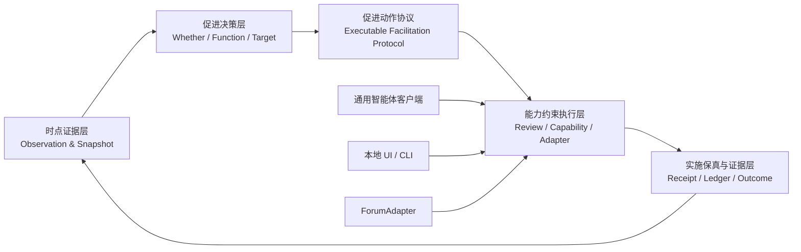

# P4：时点证据约束的智能促进编排框架

英文名称：**Point-in-Time Evidence-Constrained Intelligent Facilitation Orchestration Framework**

推荐短名：**时证促进框架**

> **文档定位：**本文保存研究架构、证据边界与可选工作包，不是顺序任务清单。
> 当前唯一状态与开发顺序以 `docs/CURRENT_RESEARCH_WORKFLOW.md` 为准。
> P4A—P4D-1 与 P4F-lite 均已完成并冻结，P4 最小完整工程主线已经闭环；统一的
> 产品机理和完成状态见 `docs/PRODUCT_MECHANISM_AND_CURRENT_STATUS.md`。

## 1. 方案决策

P4 阶段不以“让通用智能体学会操作论坛”为研究对象，也不以某一种
代理平台的工作流包作为贡献名称。正式研究对象定义为：

> 有限干预预算下，开放课程论坛智能促进的时点证据、决策、行动与
> 实施保真之间的转译和编排机制。

通用智能体负责理解任务、解释证据、调用受控能力和引导异常处理；
时点计算、预算、状态、权限、幂等、目标绑定和远端结果判定继续由
确定性代码负责。底层可以采用 Codex、其他智能体、CLI 或普通界面，
更换客户端不改变研究对象。

一句话设计原则：

> 智能体负责理解、编排与解释；确定性内核负责事实、时钟、约束、
> 持久状态与真实副作用。

## 2. 教育问题与理论定位

### 2.1 核心教育问题

cMOOC 的讨论规模大、线程异步到达，而研究者和促进者的注意力有限。
对所有帖子即时回应既不现实，也会改变学习者自然形成同伴互动的机会。
因此，系统需要在真实决策时点回答三个教育问题：

1. 当前是否需要介入；
2. 采用哪一种主要促进功能；
3. 促进作用于哪一个对象。

这三个决定必须只使用时点 \(t\) 以前的状态，并受到每日预算、候选
可用性、作者重复触达和来源观测完整性的约束。

### 2.2 理论连接

- Community of Inquiry 将教学临场区分为设计组织、话语促进和直接
  指导，支持把“促进”建模为事件级功能，而不是教师或促进者的固定
  等级身份。[Anderson et al., 2001](https://www.thecommunityofinquiry.org/record120)
- 教育编排关注教师在时间、注意力和多重约束下实时管理学习活动，
  可以解释每日预算、多线程选择和人工接管。
  [Dillenbourg, 2013](https://doi.org/10.1016/j.compedu.2013.04.013)
- 在线讨论协议通过明确结构和功能分工影响异步讨论中的参与方式，
  为“可执行促进协议”提供教育学基础。
  [Zydney et al., 2012](https://doi.org/10.1016/j.compedu.2011.07.009)
- Just-in-Time Adaptive Intervention 的决策点、干预选项、时变状态、
  决策规则和近端结果，与本项目的事件时钟结构高度对应。
  [Nahum-Shani et al., 2018](https://pmc.ncbi.nlm.nih.gov/articles/PMC5364076/)

本研究据此完成四个转向：

1. 从“促进者身份”转向“事件级促进功能”；
2. 从最终线程的事后描述转向无未来泄漏的时点决策；
3. 从全量自动回应转向有限注意力预算下的选择性促进；
4. 从平台操作脚本转向可迁移、可审计的促进动作协议。

### 2.3 机制模型

\[
S_{\leq t}, H_{<t}, B_t
\rightarrow
D_t=(I_t,F_t,O_t)
\rightarrow
A_t
\rightarrow
Y^{prox}_{t:t+h}
\]

其中：

- \(S_{\leq t}\)：决策时点前可观察的线程状态；
- \(H_{<t}\)：严格早于当前时点的触达历史；
- \(B_t\)：当前剩余促进预算；
- \(I_t\)：是否介入；
- \(F_t\)：主要促进功能；
- \(O_t\)：目标对象；
- \(A_t\)：经过审阅、执行和核验的促进行动；
- \(Y^{prox}\)：预定未来窗口内的近端人类互动。

资源连接、认知冲突和情感支持代表不同的促进机制。离线历史数据只
用于研究资源配置及其与未来自然互动的关联；促进功能对近端结果的
因果作用留给未来随机分配研究检验。

## 3. 框架的五个层次



### 3.1 时点证据层

负责事件规范化、稳定匿名键、`as-of` 状态、来源观测终点、特征哈希
和未来信息检查。P3A 的 `decision_snapshot_v1`、SQL/Python oracle
和历史特征审计继续作为事实基础。

### 3.2 促进决策层

负责候选资格、每日预算、tick、TTL、自然回应撤回、作者冷却、策略
排序和时间留出评估。决策层只输出教育意图，不输出网页坐标或按钮。

### 3.3 促进动作协议

把“是否介入—主要促进功能—目标对象”转化为版本化、可校验的行动
对象，是教育判断与平台操作之间的正式接口。

### 3.4 能力约束执行层

负责调用身份、能力目录、人工审阅、授权、目标绑定、ForumAdapter
以及本地智能体控制入口。客户端只能请求能力，不能自行扩大权限。

### 3.5 实施保真与证据层

负责追加式事件账本、动作回执、异常核对、协议语义保真、近端结果
连接和影子运行评估。

## 4. 可执行促进协议

协议采用 JSON Schema 2020-12，并生成 TypeScript 类型和运行时
校验器。建议包含以下版本化对象：

| 对象 | 关键内容 | 研究作用 |
|---|---|---|
| `ObservationEnvelopeV1` | 稳定键、事件时间、观察时间、来源观测终点、adapter 版本 | 统一不同论坛的可观察状态 |
| `DecisionEvidenceRefV1` | `decision_at`、快照键、特征哈希、时间契约版本 | 证明决策只使用时点前信息 |
| `InterventionIntentV1` | 是否介入、促进功能、目标、TTL、预算和策略版本 | 表达教育意图 |
| `FacilitationMoveSpecV1` | 事前需要、机制目标、具体促进动作、内容约束和成功判据 | 证明功能标签如何转化为教育行动 |
| `BoundTargetV1` | 线程/评论稳定键、目标类型、目标版本哈希 | 防止易变序号和任意 URL |
| `ReviewBundleV1` | 快照、意图、正文、目标和安全结果哈希 | 固化人工看到的版本 |
| `CapabilityRequestV1` | 调用者、能力、对象引用、关联 ID | 约束智能体调用范围 |
| `ExecutionCommandV1` | 授权、幂等键、预算预留、预期目标状态 | 只允许网关生成 |
| `ExecutionReceiptV1` | 已核验发布、确认未尝试、结果不明 | 统一远端结果语义 |
| `InterventionEventV1` | 双时间戳、因果链 ID、证据状态和哈希 | 支持完整回放 |

`InterventionIntentV1` 的最小教育语义为：

```ts
type FacilitationFunction =
  | "resource_connection"
  | "cognitive_conflict"
  | "emotional_support";

type TargetObject =
  | "thread_author"
  | "specific_participant"
  | "thread_participants";

type NeedState =
  | "connection_gap"
  | "conceptual_tension"
  | "participation_barrier";

type InterventionIntentV1 = {
  evidenceAsOf: string;
  intervene: boolean;
  facilitationFunction: FacilitationFunction | null;
  targetObject: TargetObject | null;
  workloadCost: number;
  candidateExpiresAt: string;
  withdrawalConditions: string[];
  policyVersion: string;
  budgetVersion: string;
  evidenceHash: string;
};

type FacilitationMoveSpecV1 = {
  intentHash: string;
  needState: NeedState;
  mechanismTarget:
    | "reduce_connection_cost"
    | "surface_explanatory_tension"
    | "lower_reentry_cost";
  facilitationMove:
    | "connect_resource_and_invite_application"
    | "pose_counterexample_and_request_explanation"
    | "acknowledge_contribution_and_invite_return";
  targetObject: TargetObject;
  requiredContentElements: string[];
  prohibitedMoves: string[];
  observableSuccessCriteria: string[];
  specVersion: string;
};
```

协议中不包含人格标签、知识等级或基于教师身份的优先级。课程角色只
能作为敏感性分析字段。

`FacilitationMoveSpecV1` 是本阶段新增的教育语义中间层。它防止系统
把“认知冲突”等标签直接当成一段自由生成文本。最终草稿必须能够
回溯到具体的事前需要、机制目标和促进动作，并通过独立盲评检验：

- 草稿是否执行了规定的促进动作；
- 草稿是否仍面向绑定的目标对象；
- 草稿是否包含规定内容元素；
- 草稿是否违反替代学习者作答、身份评判或等级化表达等禁止动作；
- 所谓成功判据是否只是可观察近端指标，而非预先宣称教育效果。

## 5. ForumAdapter 与复用边界

建议最小接口：

```ts
interface ForumAdapter {
  manifest(): AdapterManifest;
  inspectAuth(): Promise<AuthSummary>;
  listThreads(scope: ForumScope, cursor?: string): Promise<ThreadPage>;
  observeThread(ref: ThreadRef): Promise<ObservationEnvelopeV1>;
  bindTarget(ref: TargetRef): Promise<BoundTargetV1>;
  preflight(command: ExecutionCommandV1): Promise<PreflightReceipt>;
  executeAuthorized(command: ExecutionCommandV1): Promise<ExecutionReceiptV1>;
}
```

约束如下：

- 不提供 `publishText(url, text)` 一类任意写入接口；
- `observeThread` 必须区分事件时间与实际观察时间；
- `bindTarget` 必须返回平台稳定 ID 和内容版本哈希；
- `executeAuthorized` 只接受能力网关签发的不可修改命令；
- 结果不明确统一返回 `outcome_unknown`，调用者不得猜测成功并重试；
- adapter 不参与教育排序、预算、人工批准或模型推理。

首批 adapter：

1. `CmoocApiAdapter`：包装当前 cMOOC API 主路径；
2. `MockForumAdapter`：支持虚拟时钟和故障注入；
3. `CmoocBrowserDiagnosticAdapter`：只读诊断，写能力为空；
4. 一个本地合成的第二论坛 adapter，用于验证跨平台契约，不连接
   真实外部站点。

复用性由两部分产生：

| 复用来源 | 提供的复用 |
|---|---|
| 促进动作协议 | 证据、功能、目标、预算、审阅和回执语义跨平台一致 |
| ForumAdapter | 更换论坛时只替换认证、对象映射和传输 |
| 能力网关 | UI、CLI 和智能体客户端共享同一安全门 |
| 智能编排客户端 | 自然语言入口、解释和异常导航可替换 |

因此，协议和 adapter 提供可验证的系统复用；智能编排客户端提供
交互复用。

## 6. 能力网关与客户端边界

能力目录分为三类：

- `read`：状态、认证摘要、研究证据、论坛观察；
- `local_mutation`：预演、审计、benchmark、持久调度配置；
- `external_write`：论坛主评论、评论回复和远端核对。

通用智能体默认只获得：

```text
system.inspect
adapter.inspect_auth
forum.observe
intervention.preview
research.decision.audit
research.scheduler.benchmark
review.open
schedule.preview.configure
schedule.preview.run
events.read_redacted
```

第一版控制入口不暴露真实发布能力。出现发布意图时只打开审阅界面，
由研究者完成确认，现有服务端发布内核继续承担授权和执行。

后续如需开放窄写入能力，仍必须同时满足：

- `realPublishEnabled=true`；
- 稳定目标和最新目标版本一致；
- 快照、意图、正文和目标哈希一致；
- 授权有效且未使用；
- 预算预留和作者冷却仍成立；
- 发布前重观测未发现真人回应；
- adapter 和 URL 均在白名单内。

通用 Browser/Computer Use 不作为日常发布通道，只用于 mock 回归、
页面结构诊断、打开审阅界面和结果不明时的人工在场核对。

## 7. 双状态机

教育意图状态：

```text
observed
  → eligible
  → selected
  → drafted
  → review_required
  → approved
  → execution_claimed

eligible → withdrawn / source_censored / expired
review_required → rejected / superseded
approved → authorization_expired / budget_released
```

远端执行状态：

```text
claimed
  → dispatched
  → verified_published

claimed
  → confirmed_not_attempted
  → review_required

dispatched
  → outcome_unknown
  → reconciliation_required
  → verified_published / confirmed_not_published
```

硬规则：

- `outcome_unknown` 不得自动回到 `claimed`；
- 正文、目标、促进功能、快照或策略版本变化后原授权失效；
- 确认未发布后仍需重新授权才能再次执行；
- 当前任务状态可先作为兼容投影视图，不要求一次性重写所有旧页面。

## 8. P4 工作包与当前优先级

P4A—P4F 是能力和证据的组织方式，不要求按字母机械补齐。只有同时产生用户可见
任务、主要研究问题的具名证据件和固定复现入口，才标记为新的研究阶段进展。
单独增加 schema、manifest、客户端、网关、测试或技术报告不算阶段进展。

### P4A：协议内核

状态：已完成。当前实现与验收入口见 `docs/P4_PROTOCOL_V1.md`。

交付：

- 十类版本化对象及 JSON Schema；
- canonical hash、证据时钟和证据状态；
- TypeScript 类型、运行时校验和属性测试；
- 从 P3A 快照到 `DecisionEvidenceRefV1` 的只读桥接。

验收：

- 加入任意 \(t\) 后事件不能改变既有 intent hash；
- 未知字段和非法证据状态 fail closed；
- 协议产物不含正文、token 或真实身份。

### P4B：ForumAdapter 抽取

状态：已完成。当前实现与验收入口见 `docs/P4_ADAPTER_V1.md`。

交付：

- adapter contract、registry 和 conformance suite；
- cMOOC API、mock、浏览器只读诊断和第二合成论坛四个 adapter；
- 稳定目标绑定和三态执行回执。

验收：

- 新增 adapter 不修改决策、授权和调度模块；
- 每个 adapter 通过同一套目标、时间、异常和回执测试；
- 浏览器诊断 adapter 的外部写能力为零。

### P4C：能力网关与控制入口

状态：P4C-1 已完成并冻结，当前安全入口已足以支撑产品黄金路径。实现与验收见
`docs/P4_CAPABILITY_GATEWAY_V1.md`。

已交付：

- principal、能力目录、策略判定和统一 application service；
- `cmoocctl manifest/status/adapter doctor` 三个本地只读命令；
- 结构化结果、关联 ID、默认拒绝和零真实写授权。

本地 stdio/MCP、第二客户端、更多控制命令及 UI/API 统一接线全部停放。只有出现
真实第二消费者，或黄金路径无法由现有入口表达且问题已经复现时，才恢复窄扩展。

验收：

- 智能体 principal 获得外部写能力的次数为零；
- 命令不能通过参数将 dry-run 升级为真实发布；
- 所有调用返回结构化结果和关联 ID。

### P4D-1：从时点证据到本地可审阅促进动作的黄金路径

状态：已完成并冻结。固定合成候选已接入 `/review`，具名复现命令为
`npm run p4:golden-path:audit`，RQ3 去正文证据写入本地研究产物目录。

交付：

- 在现有本地入口打开固定 `as-of` 候选，并显示为何此时、为何该对象及预算依据；
- 从 P3A/P4A 证据生成合法 `Intent + MoveSpec`；
- 只使用 synthetic/versioned fixture，或明确携带 `contentRevisionStatus` 的文本
  输入，以确定性模板形成可读、可编辑草稿；
- 支持人工接受、修改或拒绝，并生成本地去正文 review receipt 与稳定哈希；
- 用固定时钟、`as-of` 和 fixture 从 snapshot 复跑到 review receipt；仅在存在
  随机过程时固定 seed；
- 形成一个映射 RQ3 的案例证据件，证明实施链可追溯、可复跑且满足已声明规则；
  RQ2 只复用和展示既有 P3A benchmark。

验收：

- 研究者能从现有入口完成整条任务，而不是只读取 schema 或状态；
- 一个具名复现命令和现有 `/review` 浏览器路径均能跑通；
- 接受、修改和拒绝均留下可复现的本地回执；
- 固定真实时钟、未来后缀不变性、2024/2025 边界继续通过；
- 网络写入数与真实论坛写入数均为零，`realPublishEnabled=false`。

`final_export_revision_unknown` 历史正文只用于证明流程可行性，不作为严格
`as-of` 文本判断或语义保真证据。P4D-1 不单独宣称促进动作语义保真；现已完成的
P4F-lite 只提供预声明合成情境中的规则级实施保真，不替代开放式语义质量评价。

完整双状态机、一次性发布授权集成、预算预留和发布前重观测不属于 P4D-1；只有
未来明确进入真实执行研究时才恢复。

### P4E：持久调度与证据账本

状态：后置。只有黄金路径完成、且真实影子周期运行证明进程重启或多 worker 是
研究证据的实际阻塞时才启动。

交付：

- `OperationSchedule`、`ScheduledInvocation`、`DecisionJob`、
  `BudgetReservation` 和 `InterventionEvent`；
- worker lease、heartbeat、崩溃恢复和虚拟时钟；
- 追加式、去正文的本地证据账本；
- shadow runtime 与 P3A replay 的动作比较。

验收：

- 多 worker 与进程重启不产生重复 invocation；
- 离线期间不集中补跑已经过期的 tick；
- 相同合成事件流下，shadow runtime 与 P3A 同策略动作一致。

### P4F：情境任务验证台

状态：P4F-lite 已完成并冻结。现有 mock 与 synthetic timeline adapter 已完成
稳定目标、目标版本变化和时点后新事件三个决定性情境；具名命令为
`npm run p4:fidelity:audit`。

交付：

- 直接复用现有 mock 与 synthetic timeline adapter，不新增平台或页面操作角色；
- 选择稳定目标、目标版本变化和时点后新事件三个决定性情境；
- 复跑 P4D-1，并计算促进功能、具体动作、目标和人工决定的保真结果；
- 在查看结果前冻结功能、动作、目标和禁止动作的评价规则；
- 输出一个固定、去正文的情境比较证据件。

验收：

- 未授权真实论坛写入数为零；
- 结构化日志正文和认证信息泄漏数为零；
- 三个情境的完成率、语义保真和人工接管结果可复现。

更多页面版本、删除/并发/分页/认证/限流/超时/崩溃故障矩阵，以及自由页面操作
基线，只在 P4F-lite 暴露具体缺口或论文比较确实需要时扩展。

P4 的最小完整阶段由 P3A 时点/预算证据、已冻结的 P4A—P4C 底座、P4D-1 产品
黄金路径和一个决定性的 P4F-lite 保真比较构成。P4E、完整故障矩阵、MCP 与真实
发布是条件性扩展，不是默认毕业门槛。

## 9. 分层验证设计

### 9.1 时点与证据完整性

问题：决策是否只使用时点前信息。

指标：

- 时间边界违规数；
- Python/SQL oracle 差异；
- 历史特征重算差异；
- 来源截尾和未来状态混入数。

P3A 已提供该层的正式基线。

### 9.2 决策质量

问题：是否介入、促进功能和目标对象能否形成可解释的人类参考。

第一轮仍限定 60 条：

- 保持现有主动抽样、分层和盲序成员不变；
- 只编码“是否介入、主要促进功能、目标对象”三项；
- 如需设置校准子集和盲评子集，必须在查看任何标签前按分层预声明；
- 未预声明时将 60 条作为一个冻结参考批次，不在看过标签后追溯拆分；
- 不自动扩批；
- 不用该样本估计总体标签流行率。

现有历史导出的正文状态为 `final_export_revision_unknown`，不能证明
页面当前显示的正文就是决策时点 \(t\) 的原始版本。因此需要分开
两类证据：

- P3A 的结构特征、时间戳和结果用于严格时点决策与预算配置验证；
- 现有 60 条正文用于编码规则可行性和功能—目标构念校准，不把它
  表述为严格时点文本判断；
- 严格时点的功能和目标验证改用未来影子运行中在 `decision_at`
  冻结、带版本哈希的正文，或使用能够提供编辑版本史的来源。

若要报告编码一致性，必须在编码前预声明两名独立编码者，或预声明
同一编码者的间隔复测；两次编码都只处理这 60 条和三项标签。没有
独立比较时，只报告完成率、标签分布、规则修订和疑难类型，不使用
“一致率”“信度”或“稳定判断”等表述。

指标：

- 有独立比较时：是否介入一致率及预声明的一致性统计量；
- 有独立比较时：在“需要介入”条件下的功能和目标条件一致性；
- 没有独立比较时：编码完成率、疑难率和规则修订类型；
- 分歧类型及人工修正原因。

### 9.3 预算配置

问题：在相同每日预算下，策略把注意力分配给了哪些线程和作者。

指标：

- Precision@K、selection precision、coverage；
- 历史不必要介入代理；
- 7 日作者重复触达；
- 作者暴露集中度；
- 2024 开发与 2025 时间留出稳定性。

该层回答历史自然互动条件下的资源配置，不回答真实干预效果。

### 9.4 协议执行

问题：相同教育决策能否在不同页面和 adapter 下保持语义并安全完成。

当前 P4F-lite 只复用已有 mock、synthetic timeline 和现有入口，运行稳定目标、
目标版本变化和时点后新事件三个决定性情境。它比较黄金路径的预期协议结果与实际
草稿、目标和人工决定，不要求新增客户端或页面操作智能体。

以下 20—30 个任务族和三路客户端比较是未来完整扩展设计，不属于当前产品、论文
或 P4F-lite 验收：

1. 通用智能体自由操作页面；
2. 当前专用 UI/API 流程；
3. 通用智能体调用可执行促进协议。

指标：

- 任务完成率；
- 目标一致率；
- `MoveSpec → 草稿 → 平台动作` 的功能、机制和目标语义保真；
- 独立盲评的促进动作实现率和禁止动作违规率；
- 重复提交、错误对象、过期目标和未授权写入；
- 人工接管率、恢复率和 trace 完整率；
- 时间、调用次数和可归因运行成本。

当前 P4F-lite 报告完成率、功能/动作/目标保真和人工接管。只有扩展设计实际启动
时，才加入完整故障、trace、成本和三路客户端指标。该层证明执行可靠性和可复用
性，不证明教育效果。

### 9.5 影子运行

在不发布的真实工作流中生成候选、功能—目标建议和预计工作量，记录
人工接受、修改或拒绝。影子运行用于检验工作流适配与实施保真，
`realPublishEnabled` 始终保持 `false`。

### 9.6 未来小型随机试验

获得相应审批和真实发布授权后，可采用预算内配额随机化：

- 以课程—日期为区组；
- 先确定全部合格决策点；
- 当日随机选择 \(m \leq K\) 个进入“人工审阅后促进”组；
- 其余进入不介入对照；
- 保存已知分配概率、分配结果、人工否决和投递回执；
- 主要分析采用 intention-to-treat；
- 每线程一个主要决策点，并保持作者冷却。

首个因果问题只检验是否促进对预定义近端人类互动的作用。促进功能
之间的因果比较需要功能本身也被随机化，不与第一轮同时承担。

近端结果：

- 是否获得外部人类回应；
- 首次外部回应时间；
- 独立回应者数量；
- 原作者返回；
- 回复链延展；
- 小样本盲编码的阐释、连接、观点修订或互动性。

回复数量不能单独替代讨论质量或学习结果。

## 10. 研究问题

### RQ1：时点决策构念

RQ1a：只观察 \(t\) 以前的结构状态，研究者能否形成可复核的
“是否介入”判断？

RQ1b：在正文版本边界明确的前瞻影子数据中，研究者能否对主要促进
功能和目标对象形成可解释的判断？

现有 60 条 `final_export_revision_unknown` 正文只用于代码本可行性，
不用于证明 RQ1b 的严格时点文本判断。编码稳定性只有在预声明独立
复核或间隔复测后才作为评价对象。

### RQ2：有限预算配置

在相同每日预算下，时点化策略与 FIFO、随机和当前手工调度思想相比，
如何配置持续支持缺口、作者覆盖和重复触达？

### RQ3：协议实施保真

将教育决策表示为“意图 + 促进动作规格”，能否在不同论坛 adapter、
目标版本和情境变化下保持证据边界、机制目标、具体促进动作、目标
对象与审阅结果的一致性？

### RQ4：近端人类互动

在未来预算内随机试验中，被分配到人工审阅后促进的线程是否更可能
在预定窗口内形成外部人类回应和原作者返回？

RQ1—RQ3 可以在本地数据、人工参考、mock 与影子模式下完成；RQ4
需要未来真实随机分配，不能由离线关联替代。

## 11. 最小研究数据结构

只保留匿名稳定键和结构化字段：

1. `decision_episode`
   - 匿名线程、作者、课程层；
   - `decision_at`、来源观测终点；
   - as-of 数值特征、资格和事前需要类型。
2. `decision_assignment`
   - 是否介入、功能、目标；
   - 策略、预算和随机分配版本；
   - 未来试验的分配概率和区组。
3. `execution_ledger`
   - 提议哈希、人工决定、动作时间；
   - 幂等键、平台回执和核对状态；
   - 不保存正文。
4. `proximal_outcome`
   - 首次外部回应时间；
   - 人类回应、独立回应者、作者返回和回复深度；
   - 观察终点与删失状态。

## 12. 论文和答辩包装

### 12.1 推荐研究表述

> 本研究将开放课程论坛中的智能促进建模为一个受时点证据、有限
> 注意力预算和教育功能约束的行动编排问题，并以可回放决策快照、
> 可执行促进协议和可核验的人机协同执行链连接历史资源配置验证与
> 未来近端互动试验。

### 12.2 三层贡献

1. **问题建模贡献**：把促进机会定义为真实时点上的预算约束决策，
   而不是基于最终线程的事后建议。
2. **设计贡献**：提出可执行促进协议，形式化连接“是否介入—促进
   功能—目标对象”与审阅、执行和回执。
3. **验证贡献**：建立决策质量、预算配置和协议实施保真的分层基准，
   为未来近端人类互动随机试验提供可运行基础设施。

### 12.3 推荐论文题目

首选：

> **有限预算下开放课程论坛智能促进的时点决策与可审计编排研究**

强调过程：

> **从决策快照到情境行动：开放课程论坛智能促进的证据约束编排框架**

强调转向：

> **从自动回帖到促进编排：cMOOC 可执行促进协议的设计与验证**

### 12.4 建议章节

1. 开放课程论坛中的有限促进注意力问题；
2. 从时点证据到可核验行动的研究框架；
3. 时点证据建模与促进机会定义；
4. 工作量约束的促进调度与离线回放；
5. 可执行促进协议与人机协同实施；
6. 决策质量、执行保真和跨年度稳定性验证；
7. 结论：可审计智能促进的运行基础。

### 12.5 底层实现的准确披露

对外不把 Codex 的可复用工作流包作为理论构念或贡献标题。方法部分
可以透明写为：

> 通用智能体客户端通过项目内的工作流说明、结构化工具和能力网关
> 调用促进协议；该客户端仅承担任务理解和工具编排，可由其他智能体、
> CLI 或本地界面替换。

若被问“是否只是一个代理操作包”，回答：

> 代理包只是安装和调用形式。研究主体是时点证据约束、有限预算
> 调度、教育动作协议、实施状态转换和双层验证；更换执行客户端不
> 改变这些研究对象。

## 13. 当前证据与新增工作边界

已经完成：

- 全体主帖的固定真实时钟决策快照；
- 未来信息审计、SQL/Python oracle 和历史特征重算；
- 2024 开发、2025 时间留出的预算调度回放；
- 透明基线及 Precision@K、coverage、重复触达等指标；
- 冻结 60 条 decision-reference 和本地标注台；
- 现有人工审阅、正文/目标指纹、一次性授权、幂等和远端结果核对基础。

其中，历史正文的编辑版本状态为 `final_export_revision_unknown`。
已完成的 P3A 严格时点证据适用于结构与事件状态；严格时点的正文
语义判断仍属于前瞻影子采集的新增工作。

P4 当前状态：

- **已完成并冻结：**可执行促进协议、`FacilitationMoveSpecV1`、
  ForumAdapter 合同与一致性测试、能力网关和只读控制入口；
- **已完成并冻结：**从时点证据到可编辑草稿、人工决定和本地回执的 P4D-1
  产品黄金路径；
- **已完成并冻结：**复用 mock 与第二合成 adapter 的 P4F-lite 实施保真比较；
- **条件性扩展：**完整双状态机、持久调度、预算预留、证据账本、影子运行仪器
  和未来随机试验接口。

当前阶段不获得论坛正文进入在线模型或真实发布的新增授权。因此 P4
首先在合成论坛、mock 和不发布的影子模式完成，保持
`realPublishEnabled=false`。

## 14. 当前产品与研究验收

当前 P4 最小完整成果按以下门槛判断：

- 研究者能从固定候选运行到 Intent/MoveSpec、可编辑草稿和本地审阅回执；
- 界面能解释为何此时、为何该对象及有限预算下的入选依据；
- 任意 \(t\) 后事件不能改变既有决策或意图哈希；
- 未知编辑版本正文不被表述为严格时点文本证据；
- 草稿与 `MoveSpec`、目标和人工决定保持可追溯绑定，并通过已声明的确定性约束；
  P4F-lite 已完成规则级实施保真评价，开放式语义质量仍不在本结论内；
- 一个固定时钟、seed/fixture 的命令能复跑黄金路径并核验稳定哈希；
- 至少形成一个明确映射 RQ2/RQ3 的案例证据件和一个 P4F-lite 保真比较；
- 通用智能体真实论坛写权限、网络写入和真实发布次数均为零；
- 研究产物不保存论坛正文、token、Cookie、真实平台 ID 或身份信息。

只有报告人工编码一致性时，独立编码者或间隔复测才成为相应指标的前提。完整双
状态机、真实执行核对、持久调度、多 worker、完整故障矩阵和 shadow runtime
比较均为条件性扩展，不阻塞当前产品或论文主线。所有真实干预效果继续留给未来
随机试验，不能由离线回放或黄金路径演示替代。

达到当前门槛后，P4 即完成“从离线时点决策到可审阅促进动作”的核心论证，而不
需要先扩建为通用研究平台。
