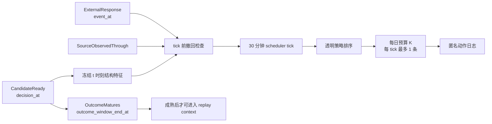

# scheduler replay v2

## 研究问题与边界

`scheduler replay v2` 把决策快照、调度时钟、候选撤回、策略动作和结果成熟分成独立事件。它回答的是：

> 在每日工作量预算固定时，策略在每个真实 tick 只使用当时已经可见的候选状态和严格过去的动作，会选择哪些线程？

所有回放均在本机完成。策略输入不含结果标签或候选未来撤回时间；动作日志只含匿名稳定键、时钟、策略、预算和选择位次。回放评估的是历史自然互动条件下的资源分配，不是智能学伴干预的因果效应。



## 精确事件时钟

正式 benchmark 使用 30 分钟 tick、一个 tick 的候选 TTL、每 tick 最多 1 个动作，以及每日 `K ∈ {1, 3, 5}` 的工作量预算。

- 候选只能在 `decision_at <= tick_at` 后进入调度器。
- `decision_snapshot_v1` 的结构特征冻结在 `decision_at = t`，不会用 `t` 后评论重算评分。
- 若 `t` 后首次外部回应已在当前 tick 发生，即 `event_at <= tick_at`，候选会在策略排序前撤回。
- 正式字段 `first_external_response_after_decision_microseconds` 保存从 `t` 到该事件的精确整数微秒差。它只用于重建撤回事件，永不进入策略可见字段。
- `source_observation_end_after_decision_microseconds` 精确记录来源数据的可观测终点。若 `state_observed_until < tick_at`，候选在排序前按行政删失移出；终点恰好等于 tick 时仍视为完整观测。
- TTL 到期条件为 `decision_at + candidate_ttl <= tick_at`，到期检查发生在选择前。TTL 等于一个 tick，因此每个候选恰好只有一个调度机会，动作延迟满足 `0 <= tick_at - decision_at < 30 分钟`。
- 候选不跨 `decision_date` 携带；达到结果成熟时点后也不再作为待选候选。
- 策略历史只含 `action.tick_at < current tick_at` 的动作；同一 tick 内的动作由一次 `choose` 调用共同产生。
- 结果只在 `outcome_window_end_at <= tick_at` 后成熟。右删失结果成熟时只暴露 `right_censored` 证据状态，不提供零值占位标签。
- 同一事件时间使用 `decision_at ASC, snapshot_key ASC` 的稳定顺序。

“候选撤回”不是未来标签泄漏：外部回应只有在其真实事件时间不晚于当前 tick 时才改变候选状态。来源数据没有完整覆盖到 tick 的候选则 fail closed，不把“未观测”当作“尚无回应”。后续结果标签仍与策略输入隔离。回放测试覆盖 `t / t+ε`、事件恰在 tick、来源终点恰在/早于 tick、输入乱序、晚到候选不改写过去动作、未来结果不改变既往动作、预算重置、TTL 到期边界、时区模式混用拒绝和非法策略选择。

## 策略接口与透明基线

策略每次接收：

1. 当前 tick 可见且未撤回、未过期的 `VisibleCandidate`；
2. 严格过去的匿名动作；
3. 仅在观察终点已经到达后成熟的结果证据；
4. 当前日剩余预算与每 tick 容量。

默认策略不使用成熟结果进行在线学习，且每个年份、策略和预算组合都从独立策略实例开始回放。

| 策略 | 作用 |
|---|---|
| `fifo` | 按候选到达时刻与稳定键选择 |
| `seeded_random` | 使用固定种子的确定性随机基线 |
| `structural_score_only` | 只使用冻结的 as-of 结构评分 |
| `current_manual_structural` | 现有手工结构评分思想，加显式同日与近期重复触达惩罚 |
| `least_recent_author_then_score` | 优先更久未被触达的作者，再比较结构评分 |
| `constrained_structural` | 先执行同日唯一作者和 7 日冷却；容量不足时按预声明顺序放宽 |

这些策略都不推断促进功能。`main_function` 仍由小型人工 decision-reference 提供，不由最终正文或未来结果自动生成。

## 工作量容量

指标同时保留两个容量口径：

- `nominal_budget_capacity`：每天 `min(K, 当日候选数)` 的名义容量，不考虑 tick、TTL、撤回和每 tick 上限。
- `replay_feasible_budget_capacity`：通过同一事件时钟上的填满容量回放得到，考虑每日预算、每 tick 上限、单次候选机会、tick 前撤回和来源状态删失。

一个 tick TTL 与到期边界保证每个候选只在一个 tick 可选，因此填满容量不依赖候选排序策略。主要 `budget_utilization` 为实际动作数除以 replay-feasible capacity；`nominal_budget_utilization` 单独保留，避免把时钟结构造成的空闲误写成策略拒绝。

## 结果可观测性与指标分母

`outcome_observable` 只决定标签指标能否计算，不参与候选进入回放，也不能改变动作。为避免把右删失结果当成负例，标签类指标只使用“当日全部候选结果窗均完整”的日期；若某日存在任一右删失候选，该日整体不进入 Precision、coverage 和不必要介入率的分母。该日候选与动作仍保留在工作量、预算利用率和作者暴露指标中。

| 指标 | 分母 | 含义 |
|---|---|---|
| `precision_at_k_daily_macro` | 每个完整可观测日的 replay-feasible capacity，再跨日宏平均 | 预算位中有多少被持续 support gap 占据；未使用的可行预算位计入分母 |
| `precision_at_k_yearly_micro` | 年内完整可观测日的 replay-feasible capacity 总和 | 年度预算位层面的 Precision@K；`precision_at_k` 是其兼容别名 |
| `selection_precision_daily_macro` | 各完整可观测日的实际选择数 | 仅评价已选择动作的日级精度 |
| `selection_precision_yearly_micro` | 年内完整可观测日的实际选择总数 | 仅评价已选择动作的年度精度 |
| `coverage` | 完整可观测候选中的全部 support gap | 策略覆盖了多少持续缺口 |
| `unnecessary_intervention_rate` | 完整可观测日的实际选择数 | 被选线程中后来自然获得外部回应的比例代理 |
| `author_repeat_touch_rate_1d/7d/28d` | 当年全部动作 | 作者在相应回看窗内被重复触达的动作比例 |

此外报告唯一作者覆盖、最大作者暴露份额、HHI、Gini、月份与匿名课程切片，以及 2025 相对 2024 的 Precision@K、coverage、不必要介入率、7 日重复触达和预算利用率差值。2024 是开发集，2025 是时间留出；策略参数不会在 2025 上重新选择。

这些指标描述观察性调度关联。“后来自然获得回应”只能作为历史资源错配代理，不能解释为介入不产生价值，也不能写成智能学伴干预效应。

## 复现与审计绑定

`metrics.json` 和 `replay-manifest.json` 固定以下复现证据：

- 每个策略的类名、模块、受控参数和策略类源码 SHA-256；
- 每年的 `policy_input_hash`，只覆盖策略实际可见的候选记录；
- 每年的 `replay_state_event_hash`，覆盖候选撤回事件与来源状态可观测终点；
- 每年的 `evaluation_outcome_hash`，单独覆盖未来评估标签；
- 策略可见输入、撤回事件、工作量契约和策略定义组成的 `policy_replay_input_hash`，明确排除未来评估标签；
- 工作量契约、策略定义和年度输入组成的 `benchmark_input_hash`；
- `policies.py`、`replay.py`、`metrics.py`、`benchmark.py` 的完整模块哈希，避免只改 helper 函数却保持策略类哈希不变；
- 每次策略回放的 `action_hash`、全局 `action_log_hash`、规范化 `metrics_result_hash`，以及正式 metrics/actions/snapshot CSV 文件哈希。

这组分离哈希可以区分“策略输入变化”“撤回事件变化”“评估标签变化”和“动作变化”。输入顺序打乱后，按事件时间与稳定键规范化的分量哈希和动作哈希保持不变；改变未来评估标签会改变 evaluation hash 和完整 benchmark hash，但不能改变 outcome-blind 的 policy replay hash、策略动作或 action hash。

构建阶段还执行：

1. 35 个正式字段的逐字段时间契约与逐行 builder 边界不变量；
2. 独立 SQL point-in-time 线程结构、结果和首次回应时刻重算；
3. 作者历史、课程左开 7 日窗口和来源状态终点的独立历史特征重算；
4. 两条重算路径分别与正式快照比较。

2026-07-26 的正式构建检查了 12,622 个结果窗完整的决策点和 111,686 条关联事件。Python/SQL 差异为 0，SQL/正式快照差异为 0；12,627 条历史特征重算差异为 0。正式动作中，回应后仍动作、TTL 到期后动作、来源终点早于 tick 后仍动作均为 0。环境未安装 DuckDB，因此按契约自动使用 Python 标准库 SQLite；流程没有下载或安装依赖。

## 命令与产物

```powershell
npm run research:decision -- build
npm run research:decision -- benchmark
npm run research:decision -- status
```

默认产物：

```text
%LOCALAPPDATA%\cmooc-research\p3a\decision-snapshot-v1
  ├─ audit-v2
  │  ├─ temporal-contract.json
  │  ├─ decision-clock-audit.json
  │  ├─ history-feature-audit.json
  │  └─ point-in-time-oracle.json
  └─ benchmark-v2
     ├─ metrics.json
     ├─ actions.csv
     └─ replay-manifest.json
```

`actions.csv` 不含论坛正文、结果标签、原始平台 ID 或撤回事件时间，只写匿名稳定键和结构化动作元数据。全部产物默认位于 `%LOCALAPPDATA%\cmooc-research`，不进入 Git。

## 开源设计参考

- [Chronon](https://github.com/airbnb/chronon)：借鉴“左侧决策时钟”和 point-in-time 一致性契约，不引入其 Spark/在线特征平台。
- [Feast point-in-time joins](https://docs.feast.dev/getting-started/concepts/point-in-time-joins)：借鉴实体键、事件时间和 TTL 的显式定义，不安装完整 feature store。
- [DuckDB ASOF JOIN](https://duckdb.org/docs/stable/sql/query_syntax/from#as-of-joins)：作为独立 SQL oracle 的设计参考；本机缺少依赖时使用 SQLite。
- [River progressive validation](https://riverml.xyz/latest/api/evaluate/progressive-val-score/)：借鉴按到达顺序预测、结果延迟成熟的回放语义，不引入在线学习模型。

当前阶段不使用 bandit OPE。历史数据没有随机化动作、行为策略概率和可识别反事实奖励，不能据此使用 IPW/DR 宣称策略干预价值。
