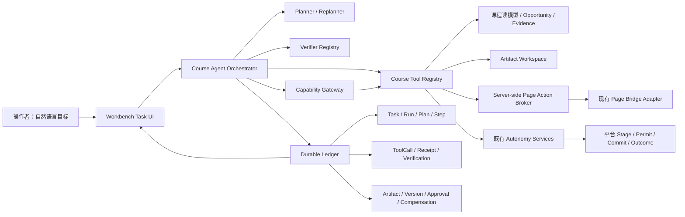
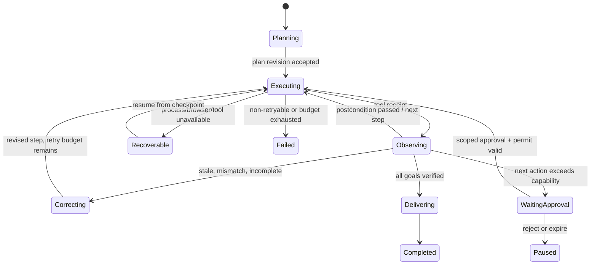

# cMOOC Codex-like 课程运营智能体：主路线图

> 日期：2026-08-12  
> 状态：可进入技术评审与任务拆分；不构成真实发布授权  
> 范围：只读代码审计、公开项目研究、产品与技术方案  
> 配套规格：[第一纵向切片产品/技术规格](./COURSE_AGENT_VERTICAL_SLICE_01_2026-08-12.md)

## 0. 决策摘要

当前产品最准确的定位不是“聊天壳”，也还不是“课程版 Codex”，而是：

> **真实 Codex 执行内核 + 安全投影式 Workbench + 有界页面命令路由 + 已成熟但尚未工具化的课程自治后端。**

这意味着主路线不应重写 Workbench，也不应另建一套 agent 平台。应沿现有 `WorkbenchTask → WorkbenchRunRecord → app-server session → SSE → history/session workspace` 接缝，加入四个缺失的中层：

1. 统一、类型化、可审计的 **Course Tool Registry**；
2. 持久的 **Plan / Step / Tool Call / Receipt / Verification 事件账本**；
3. 可预览、版本化、可 diff、可执行和可恢复的 **Artifact Workspace**；
4. 由后端强制执行的 **capability / permission / compensation ladder**。

首个切片不追求“能做所有事”，而要证明一件决定性的真能力：操作者只说一句目标，系统独立完成“读取锚定课程状态 → 选择支持缺口 → 形成促进草稿 → 由既有 trusted driver 在一个原子 STAGE 事务中完成基线绑定、暂存、回读、ownership-safe 清空与 close audit → 交付草稿和验证报告”，且从未触发提交/发布。

按本文的工程成熟度口径，当前约为 **42%**；完成第一、二切片，并且 S1 已包含的最小 durable checkpoint/degraded resume 通过故障注入后，可按硬门槛评估 **65%**；完成高级耐久执行、自我纠错、广覆盖页面工具和末端审批可评估 **80%**。真正接近目标不是 UI 完成，而是多课程、长时间运行、故障恢复和发布边界经过实证后达到约 **90%+**。

本文用以下标签区分陈述性质：

- **[事实]** 可由本地代码、测试或一手公开仓库核验；
- **[推断]** 从已核验事实推导出的产品/架构判断；
- **[建议]** 尚待实现或评审的设计选择。

## 1. 审计基线与稳定边界

本方案按项目要求依次完整读取并以其为最高本地约束：

1. [PROJECT_RULES.md](<C:/Users/tiany/Nutstore/2/我的坚果云/cMOOC智能学伴自动干预系统/PROJECT_RULES.md>)
2. [PRODUCT_CURRENT.md](<C:/Users/tiany/Nutstore/2/我的坚果云/cMOOC智能学伴自动干预系统/源码/docs/PRODUCT_CURRENT.md>)
3. [AUTONOMOUS_PRODUCT_MASTER_PLAN.md](<C:/Users/tiany/Nutstore/2/我的坚果云/cMOOC智能学伴自动干预系统/源码/docs/AUTONOMOUS_PRODUCT_MASTER_PLAN.md>)
4. [源码/AGENTS.md](<C:/Users/tiany/Nutstore/2/我的坚果云/cMOOC智能学伴自动干预系统/源码/AGENTS.md>)

稳定边界如下：

- 当前真实发布保持硬锁；开发完整发布链不等于获得本轮真实发布授权。
- 允许既有规则覆盖的只读观察，以及真实编辑器的“写入草稿—回读—清空”；不得点击提交、发送通知或更改外部课程状态。
- 不读取、持久化或展示凭据、Cookie、token、登录态、论坛正文和个人身份信息。
- 页面文本一律视为不可信输入；模型输出不是课程事实、权限或执行结果。
- 只有绑定目标、课程、对象、内容版本、期限和策略的后端 permit 才可能授权不可逆发布；UI 的“确认”本身不构成授权。

## 2. 现状：哪些是真能力，哪些仍是预设或展示

### 2.1 已经接近 Codex 的真实能力

| 能力 | 已核验事实 | 当前限制 |
|---|---|---|
| 真实 agent 内核 | [codex-app-server.ts:32](<C:/Users/tiany/Nutstore/2/我的坚果云/cMOOC智能学伴自动干预系统/源码/lib/workbench/codex-app-server.ts:32>) 使用 `gpt-5.6-sol/high`；协议允许 `thread/start`、`turn/start/steer/interrupt`、`thread/goal/set` | 当前课程工具没有交给该 agent；MCP、Apps、Hooks 被明确关闭 |
| 实时计划、目标与执行流 | 原生 plan/goal/item 通知被映射进运行快照与 SSE；同一 Node 进程内可 steer 或继续同一 thread，见 [codex-app-server.ts:1776](<C:/Users/tiany/Nutstore/2/我的坚果云/cMOOC智能学伴自动干预系统/源码/lib/workbench/codex-app-server.ts:1776>)、[run-store.ts:611](<C:/Users/tiany/Nutstore/2/我的坚果云/cMOOC智能学伴自动干预系统/源码/lib/workbench/run-store.ts:611>) | 原生 thread/turn/session handle 未耐久化；进程丢失后不能 exact resume |
| 持久任务外壳 | Prisma 已有 `WorkbenchTask`、run、event、artifact、safe context；见 [schema.prisma:1465](<C:/Users/tiany/Nutstore/2/我的坚果云/cMOOC智能学伴自动干预系统/源码/prisma/schema.prisma:1465>) | plan/goal 仍嵌在 snapshot JSON；事件与 artifact 记录过粗；UI 仍按 run 而非 task 聚合 |
| 有界跨页动作 | `page-bridge` 有版本、能力声明、状态回读和安全 receipt；见 [page-bridge.ts:19](<C:/Users/tiany/Nutstore/2/我的坚果云/cMOOC智能学伴自动干预系统/源码/lib/agent/page-bridge.ts:19>) | 仅 World、Workbench、Platform 三类桥；运行中的 agent 无法调用，只能在委派前执行宏动作 |
| 锚定课程证据 | operator read model 对 invocation/snapshot/manifest/candidate/decision/outcome 做严格锚定，见 [operator-read-model.ts:483](<C:/Users/tiany/Nutstore/2/我的坚果云/cMOOC智能学伴自动干预系统/源码/lib/workbench/operator-read-model.ts:483>) | 这些读能力尚不是 agent 可选择、可组合、可重试的工具 |
| 机会与研究空间 | [course-opportunity-brief.ts:333](<C:/Users/tiany/Nutstore/2/我的坚果云/cMOOC智能学伴自动干预系统/源码/lib/workbench/course-opportunity-brief.ts:333>) 生成有门槛的 brief；[course-evidence-workspace.ts:355](<C:/Users/tiany/Nutstore/2/我的坚果云/cMOOC智能学伴自动干预系统/源码/lib/workbench/course-evidence-workspace.ts:355>) 提供变化、画像、研究透镜和确定性研究导出 | 是只读证据工作区，不是通用成果空间；不能编辑、diff、引用到计划、执行或撤销 |
| 完整自治后端 | `tick → observer → candidate → policy → intent/movespec → re-read → stage/publish → outcome` 已有真实模块；入口见 [tick.ts:1480](<C:/Users/tiany/Nutstore/2/我的坚果云/cMOOC智能学伴自动干预系统/源码/lib/autonomy/tick.ts:1480>)、[one-shot-runner.ts:1269](<C:/Users/tiany/Nutstore/2/我的坚果云/cMOOC智能学伴自动干预系统/源码/lib/autonomy/one-shot-runner.ts:1269>) | 能力分散在专用服务与脚本中；Workbench agent 无统一 discovery、permission、receipt 与 verification 接口 |
| 安全发布边界 | permit、账户绑定、写前重读、unknown outcome 和真实发布硬锁是后端能力，见 [execution-permit.ts:682](<C:/Users/tiany/Nutstore/2/我的坚果云/cMOOC智能学伴自动干预系统/源码/lib/autonomy/execution-permit.ts:682>) | Workbench 没有末端审批对象、审批 diff 或发布准备 artifact；通用 tool loop 也不能触达发布链 |

### 2.2 仍是预设、单页或展示性的能力

- **[事实] 固定自然语言路由。** `AgentCommandAction` 是枚举 union，意图靠 regex/pattern 数组识别；未命中的 residual 才交给 Workbench。见 [command-planner.ts:12](<C:/Users/tiany/Nutstore/2/我的坚果云/cMOOC智能学伴自动干预系统/源码/lib/agent/command-planner.ts:12>)、[command-planner.ts:171](<C:/Users/tiany/Nutstore/2/我的坚果云/cMOOC智能学伴自动干预系统/源码/lib/agent/command-planner.ts:171>)。
- **[事实] page bridge 是浏览器前置宏。** 当前 Codex 只能收到已执行页面动作的安全回执，不能在运行中形成“观察—决定—再调用—回读”的闭环。执行路径见 [AgentSessionProvider.tsx:434](<C:/Users/tiany/Nutstore/2/我的坚果云/cMOOC智能学伴自动干预系统/源码/components/agent/AgentSessionProvider.tsx:434>)。
- **[事实] “恢复”有两种语义。** 同进程追问是真正同 thread；进程丢失则把旧 run 标为 `WORKBENCH_PROCESS_LOST`，再建立 lineage child，而不是恢复旧 thread。见 [history-store.ts:327](<C:/Users/tiany/Nutstore/2/我的坚果云/cMOOC智能学伴自动干预系统/源码/lib/workbench/history-store.ts:327>)、[launch.ts:12](<C:/Users/tiany/Nutstore/2/我的坚果云/cMOOC智能学伴自动干预系统/源码/lib/workbench/launch.ts:12>)。
- **[事实] 工具活动是真执行但弱表示。** UI 聚合“调用几次、状态如何”，不提供逐调用的安全输入摘要、输出引用、父子关系、重试、验证与撤销。见 [presentation.ts:209](<C:/Users/tiany/Nutstore/2/我的坚果云/cMOOC智能学伴自动干预系统/源码/lib/workbench/presentation.ts:209>)。
- **[事实] 周期计划和 brief handoff 主要填预设 prompt。** “检查计划”与机会交接不会直接启动或驱动持久任务。见 [AgentWorkbench.tsx:2773](<C:/Users/tiany/Nutstore/2/我的坚果云/cMOOC智能学伴自动干预系统/源码/components/workbench/AgentWorkbench.tsx:2773>)、[AgentWorkbench.tsx:2786](<C:/Users/tiany/Nutstore/2/我的坚果云/cMOOC智能学伴自动干预系统/源码/components/workbench/AgentWorkbench.tsx:2786>)。
- **[事实] demo 是 fixture。** [demo-events.ts:12](<C:/Users/tiany/Nutstore/2/我的坚果云/cMOOC智能学伴自动干预系统/源码/lib/workbench/demo-events.ts:12>) 明确未连接真实执行引擎。
- **[事实] “电脑观察”只是去 `/platform` 的链接。** app-server 本身没有 browser/computer-use 工具；见 [AgentWorkbench.tsx:3258](<C:/Users/tiany/Nutstore/2/我的坚果云/cMOOC智能学伴自动干预系统/源码/components/workbench/AgentWorkbench.tsx:3258>)。
- **[事实] 文案存在边界错位。** UI 写“只读运行”，但默认 Codex sandbox 是工作区可写；准确说法应是“课程平台只读/受控暂存，任务工作区可写”。见 [codex-app-server.ts:1434](<C:/Users/tiany/Nutstore/2/我的坚果云/cMOOC智能学伴自动干预系统/源码/lib/workbench/codex-app-server.ts:1434>)、[AgentWorkbench.tsx:3291](<C:/Users/tiany/Nutstore/2/我的坚果云/cMOOC智能学伴自动干预系统/源码/components/workbench/AgentWorkbench.tsx:3291>)。

### 2.3 Canvas、Evidence、Artifact 与论坛链的专项差距

- **[事实] Canvas 是运行时课程投影，不是机会 dossier。** Brief 最多合成五项，但事项切换时四个 lens 共用同一个课程快照级 `evidenceWorkspace`；事项本身没有独立、可重放的证据 reader。见 [CourseOpportunityBrief.tsx:312](<C:/Users/tiany/Nutstore/2/我的坚果云/cMOOC智能学伴自动干预系统/源码/components/workbench/CourseOpportunityBrief.tsx:312>)、[OpportunityEvidenceWorkspace.tsx:84](<C:/Users/tiany/Nutstore/2/我的坚果云/cMOOC智能学伴自动干预系统/源码/components/workbench/opportunity-canvas/OpportunityEvidenceWorkspace.tsx:84>)。
- **[事实] 资格瀑布尚不能证明“证据完整”。** evidence reader 当前传 `qualification: null`，因此首层为 UNKNOWN；见 [evidence-read-model.ts:341](<C:/Users/tiany/Nutstore/2/我的坚果云/cMOOC智能学伴自动干预系统/源码/lib/workbench/evidence-read-model.ts:341>)、[course-evidence-workspace.ts:223](<C:/Users/tiany/Nutstore/2/我的坚果云/cMOOC智能学伴自动干预系统/源码/lib/workbench/course-evidence-workspace.ts:223>)。
- **[事实] Content Graph 完整性核验不足。** 当前 reader 只核对 snapshot/course/time/coverage 标量，未核对已存在的 `contentGraphHash/nodeSetHash/edgeSetHash` 和节点/边计数；见 [evidence-read-model.ts:195](<C:/Users/tiany/Nutstore/2/我的坚果云/cMOOC智能学伴自动干预系统/源码/lib/workbench/evidence-read-model.ts:195>)、[schema.prisma:1052](<C:/Users/tiany/Nutstore/2/我的坚果云/cMOOC智能学伴自动干预系统/源码/prisma/schema.prisma:1052>)。
- **[事实] Research export 可确定性重建，但不是持久成果。** 请求时生成 JSON，不保存 artifact/receipt；当前 `X-CMOOC-Evidence-SHA256` 是带协议域分离的 canonical digest，不是下载字节的普通 SHA-256，UI 也未读取/核验该响应头。见 [research-export-route-handler.ts:34](<C:/Users/tiany/Nutstore/2/我的坚果云/cMOOC智能学伴自动干预系统/源码/lib/workbench/research-export-route-handler.ts:34>)、[course-evidence-workspace.ts:608](<C:/Users/tiany/Nutstore/2/我的坚果云/cMOOC智能学伴自动干预系统/源码/lib/workbench/course-evidence-workspace.ts:608>)。
- **[事实] 当前 Artifact 只是文件变化索引。** 公共类型只有 id/label/relativePath/kind/status/time，DB 会覆盖同一 run/path 的记录；没有内容 hash、不可变 revision、preview、diff、approval 或 revert。见 [contracts.ts:126](<C:/Users/tiany/Nutstore/2/我的坚果云/cMOOC智能学伴自动干预系统/源码/lib/workbench/contracts.ts:126>)、[history-store.ts:246](<C:/Users/tiany/Nutstore/2/我的坚果云/cMOOC智能学伴自动干预系统/源码/lib/workbench/history-store.ts:246>)。
- **[事实] 论坛后端边界强，但 UX 断裂。** `/platform` 当前仅展示 readiness；真正 STAGE v2 位于 companion/driver 链，旧 review、兼容 API、CLI 与 Workbench 没有统一入口。见 [PlatformReadinessPanel.tsx:102](<C:/Users/tiany/Nutstore/2/我的坚果云/cMOOC智能学伴自动干预系统/源码/components/PlatformReadinessPanel.tsx:102>)、[stage-companion.ts:419](<C:/Users/tiany/Nutstore/2/我的坚果云/cMOOC智能学伴自动干预系统/源码/lib/live-runtime/stage-companion.ts:419>)。
- **[事实] STAGE 的“清空”不是发布后的 undo。** 生产 committer 对不确定结果采用回读、禁止重发并记录 `outcome_unknown`，但项目没有远端删除/撤回已发布回复能力。见 [production-committer.ts:350](<C:/Users/tiany/Nutstore/2/我的坚果云/cMOOC智能学伴自动干预系统/源码/lib/autonomy/production-committer.ts:350>)。

### 2.4 “无所不能感”不能靠文案伪装

**[建议]** 下列体验只有对应真能力存在时才能呈现：

| 用户感受 | 必须存在的可验证能力 | 禁止的伪装方式 |
|---|---|---|
| “它理解当前课程” | 带 freshness、courseId、snapshot/invocation/manifest hash 的读工具与证据引用 | 用静态摘要或模型常识写“已分析课程” |
| “它会自己计划” | 持久、可修订的 plan revision；每步有状态、输入、产出、阻塞原因 | 先写一段看似计划的聊天文本，再按固定脚本走 |
| “它能跨页面做事” | agent 可在运行中请求有界 browser action，等待执行并读取验证 receipt | 先切页，再把跳转包装成“跨页执行” |
| “它做完会检查” | 独立 verifier、postcondition、before/after hash、fresh re-read | 把模型自述“已检查”当验证 |
| “成果一直在那里” | artifact ID、版本、内容策略、diff、引用关系、状态与恢复 | 仅在聊天中输出一次长文本 |
| “断了还能继续” | 耐久 cursor、step checkpoint、幂等 tool call、exact resume 或明确 degraded resume | 把重新起一个 prompt 称作恢复原会话 |
| “我可放心授权” | 后端 capability gate、late-bound approval、scope/expiry/content hash、补偿或 unknown-outcome halt | 一个通用“总是允许”按钮 |
| “它真的发布了” | 平台 commit receipt 与独立回读；发布对象/内容版本完全绑定 | 用“已发布”聊天文案替代外部回读 |

## 3. 能力成熟度模型

### 3.1 维度评分

评分为 0–5；权重用于产品工程估算，不是用户效果指标。

| 维度 | 权重 | 当前 | 当前证据判断 | 65% 门槛 | 80% 门槛 | 接近目标门槛 |
|---|---:|---:|---|---|---|---|
| 工具覆盖 | 16% | 1.5 | 后端能力多，但 agent 可调用课程工具接近 0 | 15+ 个 typed tools 覆盖一个真实纵向任务 | 覆盖读、分析、artifact、stage、schedule、approval、publish prepare | 多平台 adapter；能力 discovery 与退化路径稳定 |
| 开放式规划 | 12% | 2.5 | Codex 会规划，课程动作仍由 regex/预设 prompt 限制 | 目标生成可执行工具计划；可插入/跳过/修订 | 观察后自动重规划；约束和预算参与规划 | 跨周期目标和策略优化仍可解释、可治理 |
| 持续执行 | 14% | 2.0 | 同进程真 session；跨进程新 child | step/checkpoint、durable cursor、verified degraded resume | 定时唤醒、预算/取消；exact resume 仅在 feasibility/privacy gate 通过后计分 | 多日运行、升级、连接中断经过 soak |
| 自我验证 | 12% | 2.0 | 自治链部分能力很强，Workbench 未统一接入 | 首切片全链 postcondition | verifier registry、unknown outcome、修正循环 | 每类工具有观测充分性与长期结果验证 |
| 成果空间 | 12% | 1.5 | evidence/research export 与 path metadata | artifact preview/version/reference/delivery | diff/edit/apply/undo/recover；执行状态可见 | 跨任务复用、模板、协作、生命周期治理 |
| 记忆/恢复 | 10% | 2.5 | safe snapshot、lineage、handoff 已有 | task 聚合、verified-checkpoint 恢复、清晰 resume 语义 | memory provenance/TTL；conditional exact session resume | 长期偏好与课程记忆可控、可遗忘、可审计 |
| 权限/撤销 | 12% | 2.5 | 自治后端硬锁强，Workbench 未统一；artifact 无 undo | L0–L3 gate 与本地/暂存补偿 | late-bound L4 approval + permit + post-read | 多平台一致策略、异常演练和治理审核 |
| 协作 | 5% | 2.0 | Codex 子智能体是真实，但仅安全摘要展示 | 子任务归属与成果引用 | 并发预算、handoff、冲突处理 | 人/agent 角色治理与跨任务协调 |
| 前端体验 | 7% | 2.7 | 暗色 chat-first 基础好；深工作区已有，但视图割裂 | 单主线 + summoned workspace | 计划、artifact、审批、恢复自然共存 | 桌面/移动/无障碍与长任务经实测稳定 |

加权估算为约 **42%**。这里的关键不是小数，而是短板结构：课程能力已经在后端，缺的是可组合运行时和成果/验证语义。

### 3.2 阶段定义

- **M1：有界智能控制台（当前，约 40%）**：能聊天、能真实执行本地 Codex、能展示课程证据，也能运行固定跨页动作；复杂任务没有课程工具闭环。
- **M2：受约束课程智能体（65%）**：一句话能完成至少三个真实纵向任务；计划、调用、artifact、验证、恢复均有持久对象；不可逆发布仍锁定。
- **M3：课程运营智能体（80%）**：宽工具覆盖、跨进程续跑、自我纠错、跨页 action broker、版本化 artifact、可逆自动执行、不可逆末端审批形成统一运行时。
- **M4：接近目标（90%+）**：多课程、多周期、真实平台异常、授权发布与长期 outcome 经 soak/演练/用户研究验证；不是“接了更多模型”即可达到。

## 4. GitHub 与公开项目研究：一手机制综合

检索日期为 2026-08-12。活动状态以仓库 commit/release 页为准；机制只采用仓库 README、官方文档或源码。纯聊天壳、营销壳和明显停更项目未进入核心建议。

活动快照：Codex、OpenHands、Cline、Vercel AI SDK、assistant-ui 与 CopilotKit 在 2026-08-12 可见新提交；Goose、Browser Use 在 2026-08-11 可见提交；Playwright MCP 与 MCP TS SDK 在 2026-08 仍有更新；Temporal TS 在 2026-07 可见提交；LangGraph 以 Python 核心 2026-05 release 为可靠依据，JS port 待引入时复核；Vercel Chatbot 最近可见的主要变动在 2026-02，因此仅列作 UI 模板。具体证据均链接到各行的 commit/release 页。

### 4.1 运行时、持久性与权限

| 项目 | 许可证与维护状态 | 可借鉴机制及一手位置 | 适配判断 / 不能照搬 |
|---|---|---|---|
| [OpenAI Codex](https://github.com/openai/codex) | Apache-2.0；[main 持续提交](https://github.com/openai/codex/commits/main) | [app-server](https://github.com/openai/codex/blob/main/codex-rs/app-server/README.md) 的 Thread/Turn/Item、start/resume/fork/steer、事件分页、compact 与 server-initiated approval；[protocol](https://github.com/openai/codex/blob/main/codex-rs/protocol/src/protocol.rs) 和 [exec policy](https://github.com/openai/codex/blob/main/codex-rs/execpolicy/README.md) | **适配度：高。** 借协议和审批边界；不搬 Rust OS sandbox、代码编辑权限默认值或 session-wide publish approval |
| [OpenHands](https://github.com/OpenHands/OpenHands) / [Software Agent SDK](https://github.com/OpenHands/software-agent-sdk) | MIT，enterprise 子目录需单独核验；[持续活跃](https://github.com/OpenHands/OpenHands/commits/main) | [ConversationState](https://github.com/OpenHands/software-agent-sdk/blob/main/openhands-sdk/openhands/sdk/conversation/state.py) 的 event log、workspace、autosave、secret redaction；[tool system](https://docs.openhands.dev/sdk/arch/tool-system)；fork/time travel | **适配度：高（机制）。** 借 event-sourcing、持久会话和分叉；不引入 Python runtime、云凭据继承或默认 workspace 权限 |
| [Cline](https://github.com/cline/cline) | Apache-2.0；[持续活跃](https://github.com/cline/cline/commits/main) | [SDK](https://github.com/cline/cline/blob/main/sdk/README.md) 的 SQLite session/RPC、README 中的 checkpoint/diff/restore、Plan/Act 和 tool summary | **适配度：高（TS/SQLite/UX）。** 借 checkpoint UX，不复制遥测、云服务或通用 auto-approve |
| [Goose](https://github.com/aaif-goose/goose) | Apache-2.0；[持续活跃](https://github.com/aaif-goose/goose/commits/main) | [环境与模式文档](https://github.com/aaif-goose/goose/blob/main/documentation/docs/guides/environment-variables.md) 的 session mode、turn cap、扩展/MCP、smart approval | **适配度：中。** 借 per-session mode、预算和插件 registry；smart approval 不能升级成课程发布许可 |
| [LangGraph](https://github.com/langchain-ai/langgraph) | MIT；Python 核心 [release 持续](https://github.com/langchain-ai/langgraph/releases)，JS port 活跃度需在引入时重核 | [JS HITL](https://github.com/langchain-ai/langgraphjs/blob/main/docs/docs/agents/human-in-the-loop.md) 的 interrupt/checkpointer/`Command({resume})`；[SQLite checkpointer](https://github.com/langchain-ai/langgraph/blob/main/libs/checkpoint-sqlite/langgraph/checkpoint/sqlite/__init__.py) | **适配度：中（语义）。** 借状态语义，不为此引入第二套 agent runtime；在 Prisma/SQLite 中原生实现 |
| [Temporal TypeScript SDK](https://github.com/temporalio/sdk-typescript) | MIT；[持续维护](https://github.com/temporalio/sdk-typescript/commits/main) | [Temporal architecture](https://github.com/temporalio/temporal/blob/main/docs/architecture/README.md) 的 append-only history、deterministic workflow、activity/retry/query | **适配度：低（当前实现）/高（语义）。** 作为耐久标杆；当前单体阶段不引入 Temporal server 运维面 |

### 4.2 工具、浏览器与 MCP

| 项目 | 许可证与维护状态 | 可借鉴机制及一手位置 | 适配判断 / 不能照搬 |
|---|---|---|---|
| [Browser Use](https://github.com/browser-use/browser-use) | MIT；[持续活跃](https://github.com/browser-use/browser-use/commits/main) | [BrowserProfile](https://github.com/browser-use/browser-use/blob/main/browser_use/browser/profile.py) 的 allowed/prohibited domains、IP blocking、CDP；[Agent service](https://github.com/browser-use/browser-use/blob/main/browser_use/agent/service.py) 的 event-bus/WAL/pause/recovery | **适配度：中（安全机制）。** 借域名策略、WAL 和暂停恢复；禁用 cloud profile/storage state，页面内容视为 prompt-injection 输入 |
| [Microsoft Playwright MCP](https://github.com/microsoft/playwright-mcp) | Apache-2.0；[持续维护](https://github.com/microsoft/playwright-mcp/commits/main) | [README](https://github.com/microsoft/playwright-mcp/blob/main/README.md) 的 accessibility snapshot、结构化 ref、click/fill、allowed hosts/origins、workspace roots | **适配度：高（TS adapter）。** 参数限制不是安全边界，提交/发送必须在独立后端 capability gate 后 |
| [MCP TypeScript SDK](https://github.com/modelcontextprotocol/typescript-sdk) | 许可过渡：新贡献 Apache-2.0、未重许可既有代码 MIT、非规范文档 CC-BY-4.0，见 [LICENSE](https://github.com/modelcontextprotocol/typescript-sdk/blob/main/LICENSE)；[仍在更新](https://github.com/modelcontextprotocol/typescript-sdk/commits/main) | [README](https://github.com/modelcontextprotocol/typescript-sdk/blob/main/README.md) 显示 v2 已随 2026-07-28 spec 成为 stable，v1 至少继续 6 个月修复；v2 提供 Standard Schema、tools/resources/prompts、stdio/HTTP 与 middleware | **适配度：高（协议）/中（直接依赖）。** 可作内部 tool transport；annotations 仅提示，不执行安全策略；采用时锁定确切 v2 tag 并做 app-server 兼容/隐私 spike，不让 SDK 变成策略层 |

### 4.3 Chat-first 与 Artifact 前端

| 项目 | 许可证与维护状态 | 可借鉴机制及一手位置 | 适配判断 / 不能照搬 |
|---|---|---|---|
| [Vercel AI SDK](https://github.com/vercel/ai) | Apache-2.0；[持续活跃](https://github.com/vercel/ai/commits/main) | [README](https://github.com/vercel/ai/blob/main/README.md)、[chat transport](https://github.com/vercel/ai/blob/main/packages/ai/src/ui/chat-transport.ts)：typed tool parts、流式消息、provider-neutral UI | **适配度：高（表现层）。** 聊天流绝不能成为执行账本或审批事实 |
| [assistant-ui](https://github.com/assistant-ui/assistant-ui) | MIT；[持续活跃](https://github.com/assistant-ui/assistant-ui/commits/main) | [README](https://github.com/assistant-ui/assistant-ui/blob/main/README.md) 的可组合 Thread/Message/Composer/ThreadList、tool rendering、inline approval、键盘与无障碍 | **适配度：高（组件语义）。** 借 UI primitive 与 focus 行为；不替换本项目 durable task/ledger |
| [CopilotKit](https://github.com/CopilotKit/CopilotKit) | MIT；[持续活跃](https://github.com/CopilotKit/CopilotKit/commits/main) | [README](https://github.com/CopilotKit/CopilotKit/blob/main/README.md) 的 shared state、generative UI、HITL、agent/frontend 协作 | **适配度：中。** 借 agent state 与前端联动；不要把客户端 shared state 当课程事实或权限 |
| [Vercel Chatbot / OpenChat](https://github.com/vercel/chatbot) | Apache-2.0；维护慢于核心 SDK，[commit 页](https://github.com/vercel/chatbot/commits/main) | 仓库的 `app/artifacts/components/hooks/lib/tests` 和 chat + artifact panel | **适配度：低（仅模板）。** 不复制 Neon/Blob/Auth/云存储假设，不作为 runtime 依赖 |

### 4.4 综合采用结论

**[推断]** 最适合本项目的组合不是选一个框架，而是吸收四种语义：

1. Codex 的 `Task/Thread → Turn → Item + approval` 协议；
2. OpenHands/Cline 的 durable event、checkpoint、fork、artifact/diff；
3. MCP/Playwright/Browser Use 的 typed tool、受限 browser adapter 与不可信页面输入；
4. Vercel AI SDK/assistant-ui 的 chat-first progressive disclosure。

**[建议]** 不整包引入 OpenHands、LangGraph 或 Temporal，不开启任意第三方 MCP，不保存浏览器 profile/credentials，不采用通用 auto-approval，不让前端或模型自行决定 publish。

除明确标作 **[事实]** 或 **[推断]** 的句子外，以下第 5–16 节均为待实现的 **[建议/规格]**，不代表当前产品已经具备。

## 5. 目标架构：在现有 Workbench 上长出课程运行时



### 5.1 核心对象与现有对象的映射

| 新语义 | 复用/扩展现状 | 关键规则 |
|---|---|---|
| Task | 复用 `WorkbenchTask` | 一个长期目标；聚合 root/restart/continuation/plan-execution。只持久化 `SafeTaskObjective`（分类后的结构化目标、safe summary/hash、来源、TTL/删除规则），不保存原始 20k prompt 或目标原文 |
| Run / Attempt | 扩展 `WorkbenchRunRecord` | 一次执行尝试；可靠基线是 verified-checkpoint `degraded child resume`。`exact resume` 只有通过 app-server 可行性与隐私 gate 后才启用，UI 明确区分 |
| PlanRevision / Step | 从 snapshot JSON 拆成版本化记录 | 模型 plan 只是 proposal；服务端 plan compiler/validator 产出 canonical executable plan。旧 revision 不覆盖；step 引用 tool/artifact/verification |
| Event | 扩展 `WorkbenchEventRecord` | 全局 task/run seq、durable cursor、delta 优先、周期 snapshot；不可把 SSE 当事实库 |
| ToolCall / Receipt | 新增 | 每次调用独立 lifecycle；安全 input/output summary、hash、证据、幂等键、重试、父子关系 |
| Artifact / Version | 扩展现有 metadata-only artifact | 内容分级、版本、diff、引用、执行状态、恢复；发布后版本不可改写 |
| Verification | 新增 | 独立于 agent 文案；记录 verifier、postcondition、observed state/hash、freshness |
| Approval / Permit | 新增 Workbench 审批投影，复用自治 permit | UI 请求和后端授权分离；审批绑定具体 action/content/target/version/expiry |
| Compensation | 新增 | 可逆动作的反向工具/令牌；不可逆动作不伪称 undo |
| ExecutionLease | 新增 | DB CAS claim、owner、generation、fencing token hash、heartbeat/expiry；tool dispatch 与 receipt commit 均需匹配当前 generation |
| BrowserBinding | 新增 | app-shell 持久连接、browser session/tab/route/revision/course lease、单次 claim/ack、nonce/TTL 与断连转移；普通客户端不认证 L3 |

### 5.2 开放式目标循环



**接入方式：**

- `AgentWorkbench` 仍创建现有 run；模型原生 plan 只投影为 proposal。`CourseAgentOrchestrator` 的 plan compiler/validator 把它编译为 canonical `PlanRevision/Step`：每步必须声明 tool/version、依赖、服务端输入引用、pre/postcondition、effect/capability、验收、失败/重规划边界；纯聊天 plan 不能直接执行或授权。
- `codex-app-server.ts` 保留原生 thread/turn/plan/goal；增加一个内部 `CourseToolTransport`。首选 app-server 的受控 dynamic tool adapter；若当前协议版本不足，则使用只暴露本项目 registry 的本地 stdio MCP adapter。`mcp_servers={}` 在该私有 adapter 完成前保持不变，绝不开放任意 MCP。
- `command-planner.ts` 保留为快速 UI shortcut（导航、打开 Canvas、停任务），不再承担复杂课程任务规划；开放目标先进入 agent，再由 agent 选择 registry 工具。
- `page-bridge.ts` 保留浏览器端 adapter。新增 server-side broker：agent 发出白名单 action request → app-shell 级持久连接送到持有有效 lease 的浏览器 session → 精确标签页单次 claim/ack → adapter 执行 → nonce-bound receipt → agent 继续。binding 必须含 browserSession、route/revision/course、lease generation、TTL；多标签只允许一个 winner，重复/过期 receipt 拒绝，断连后显式转移。不得开放任意 URL、CSS selector、DOM script。L3 STAGE 不信任普通 adapter 回执，必须复用 trusted driver 的签名事务 receipt。
- `run-store` 继续承担同进程快速状态；`history-store` 升级为 append-only ledger 的持久投影。SSE 从 durable seq 重放，内存 ring 只作缓存。每个 run/step 由数据库 CAS claim 的执行 lease 驱动，带 fencing token、heartbeat/expiry；tool request 与 receipt 提交均校验当前 lease generation，防止重启/多进程重复副作用。
- 既有自治模块通过薄 adapter 注册为 course tools；不得复制 `tick/observer/stage/permit/committer` 的业务规则。

## 6. Course Tool Registry

### 6.1 工具族

| 工具族 | 首批示例 | 默认 capability | 典型产出/证据 |
|---|---|---|---|
| 查询 | `course.context.resolve`、`course.snapshot.read`、`opportunity.list/read`、`decision.read`、`outcome.read` | L0 | 锚定 ref、freshness、input/output hash |
| 分析/筛选/比较/画像 | `evidence.read_anchored`、`world.compare_windows`、`cohort.slice.aggregate`、`support_gap.rank` | L0 | 聚合指标、限定结论、证据链；无身份/正文 |
| 生成 | `intent.compose`、`movespec.compose`、`artifact.create`、`schedule.propose` | L1 | artifact version + source refs + validator receipt |
| 编辑/引用 | `artifact.patch`、`artifact.diff`、`artifact.link_evidence`、`artifact.render` | L1 | 新 immutable version；旧版本保留 |
| 协作 | `task.delegate`、`task.handoff`、`artifact.request_review` | L1/L2 | 子任务、责任人/agent alias、交付引用 |
| 导出 | `research.export`、`artifact.export` | L1/L2 | 文件 hash、格式、来源版本；不含禁限数据 |
| 排期/可逆变更 | `schedule.apply_local`、`governance.propose`、`undo.compensate` | L2 | before/after、补偿令牌、有效期 |
| 浏览器/平台暂存 | `platform.readiness.inspect`、`target.preflight_read`、`editor.stage_verify_clear`、`editor.reconcile_stage` | L0/L3 | 可信 driver 的单一原子 STAGE receipt；中间 write/readback/clear 不独立持久成功 |
| 审批/发布 | `publication.prepare`、`approval.request`、`publication.commit`、`publication.readback` | L3/L4 | approval binding、permit、commit/readback receipt；L4 默认不可达 |

### 6.2 类型与契约

```ts
type CapabilityLevel = "L0_READ" | "L1_ARTIFACT" | "L2_REVERSIBLE" |
  "L3_EXTERNAL_STAGE" | "L4_IRREVERSIBLE";

type EffectClass = "pure" | "read" | "local_write" | "reversible_write" |
  "external_stage" | "irreversible_external";

interface CourseToolDefinition<I, O> {
  name: string;                 // namespaced, stable
  version: string;              // exact implementation contract
  capability: CapabilityLevel;
  effect: EffectClass;
  inputSchema: Schema<I>;
  outputSchema: Schema<O>;
  dataClasses: string[];
  preconditions: Precondition[];
  idempotency: {
    strategy: "input_hash" | "client_key" | "stage_nonce" | "not_retryable";
    scope: "step" | "run" | "task" | "course";
  };
  evidence: EvidencePolicy;
  verification: VerificationPolicy;
  retry: RetryPolicy;
  compensation?: CompensationSpec;
}

// The model may supply business parameters only.
interface ModelToolRequest<I> {
  toolName: string;
  toolVersion?: string;
  input: I;
}

// Constructed and fenced by the orchestrator; never accepted from the model/client.
interface ToolExecutionEnvelope<I> {
  callId: string;
  taskId: string;
  runId: string;
  planRevisionId: string;
  stepId: string;
  toolName: string;
  toolVersion: string;
  input: I;
  inputHash: string;
  idempotencyKey: string;
  grantedCapability: CapabilityLevel;
  grantRef?: string;
  attempt: number;
  leaseGeneration: number;
  fencingToken: string;
}

// Transient in-process result. Registry-specific projector decides what the model can see.
interface ToolExecutionResult<O> {
  receiptId: string;
  callId: string;
  status: "succeeded" | "failed" | "unknown" | "compensated";
  transientOutput: O;
  safeModelProjection: unknown;
  outputHash: string;
  evidenceRefs: EvidenceRef[];
  beforeRef?: StateRef;
  afterRef?: StateRef;
  verificationId?: string;
  compensationSecretRef?: string; // protected server store only
  observedAt: string;
  expiresAt?: string;
  containsForumText: false;
  containsIdentity: false;
}

// Only this projection enters the ordinary durable ledger/SSE.
interface DurableToolCallProjection {
  callId: string;
  taskId: string;
  runId: string;
  stepId: string;
  toolName: string;
  toolVersion: string;
  status: "succeeded" | "failed" | "unknown" | "compensated";
  safeInputSummary: string;
  safeOutputSummary: string;
  inputHash: string;
  outputHash: string;
  evidenceRefs: EvidenceRef[];
  verificationId?: string;
  compensationRef?: string; // non-replayable identifier, not the capability secret
  observedAt: string;
}
```

强制契约：

1. schema annotation 不是权限；所有调用必须先过服务端 capability gateway。
2. 每个 side effect 工具必须声明幂等策略；`unknown` 结果不得盲目重试。
3. 每个结果必须带 evidence/provenance；模型总结不能作为 receipt。
4. L2/L3 工具必须有真实 compensation 或明确的“回到安全态”操作。STAGE 的安全态恢复属于一个 trusted atomic transaction/reconcile，不拆成任意 `clear` 工具；只在当前值仍归属于本调用时清除。
5. L4 无通用 undo；只能提供平台真实支持的撤回/更正工具，不得用本地回滚伪装。
6. input/output 的 durable 记录只保存安全摘要和 hash；原始业务输出与 capability/compensation secret 不进入普通事件表、SSE 或模型历史。task/run/step/course/capability/idempotency/attempt/fencing 均由服务端注入，模型和浏览器客户端不能覆盖。

## 7. Capability / Permission Ladder

| 层级 | 典型动作 | 默认行为 | 控制与撤销 |
|---|---|---|---|
| L0 Read | 读锚定快照、聚合分析、页面 readiness、回读 | 直接执行，不打断用户 | freshness、域名/课程 scope、证据 receipt |
| L1 Artifact | 生成/编辑/导出安全 artifact、创建计划 | 直接执行 | immutable version、diff、删除进回收区、可恢复 |
| L2 Reversible | 应用本地排期、变更任务状态、保存可恢复内部草稿 | 目标范围内自动执行 | before/after + protected compensation secret reference + undo TTL |
| L3 External Stage | 受信 driver 在一个原子事务中完成基线检查、写入、回读、ownership-safe 清空和 close audit；不提交 | 用户目标只触发 request；后端为精确 course/target/artifact/body hash 签发 scoped grant 后执行，不逐相位弹窗 | signed one-shot token/nonce、目标/基线绑定、guard-before-page、最终单一 receipt；unknown 只做 trusted reconcile |
| L4 Irreversible | 真实发布、发送通知、改变外部课程记录 | **末端确认**；当前环境硬锁 | 绑定 course/target/contentVersion/audience/expiry/policy/permit；commit 后独立回读 |

产品不应过度防御：L0/L1 不弹审批；L2 有真实补偿就自动做；L3 在精确 request 通过既有后端策略并签发 scoped grant 后完成整个暂存事务，不要求连续点击确认，但 `intent:"implement"` 或目标文字本身都不等于 L3 授权。只有 L4 在真正不可逆的最后一步暂停，而且暂停卡必须展示“将对谁、在哪门课、发布哪个确切版本、影响范围、许可何时过期”。

## 8. Artifact Workspace

### 8.1 支持的成果类型

- 课程态势分析、证据摘要、群体切片、角色/互动画像；
- 促进策略、教学方案、活动设计、排期提案；
- 论坛回复草稿、公告草稿、教师复核包；
- Opportunity Canvas 保存视图；
- 研究包、可复现导出、验证报告、执行 receipt 集合。

### 8.2 对象和状态

```text
Artifact
  ├─ ArtifactVersion (immutable content/hash/schema/source refs)
  ├─ ArtifactLink (evidence / plan step / derived-from / replaces)
  ├─ ArtifactAction (preview / edit / export / stage / publish / compensate)
  └─ VerificationReceipt

draft → validated → ready_to_stage → staged → delivered
                                  └→ approval_pending → published
draft/validated/staged → superseded
reversible action → compensated
```

### 8.3 内容分级

- `safe_aggregate`：可持久保存，包含聚合课程证据和安全分析。
- `safe_generated`：通过已定义确定性 privacy/content checks 的非敏感生成物；检查不能“证明”自然语言绝无可重识别线索。只有数据治理明确允许的类型才可版本化保存。
- `restricted_transient`：平台目标文本、论坛正文、身份、敏感上下文或不能确认可持久化的草稿；**只在受控进程内存中存在**，任何 DB、session workspace、同步目录或其他磁盘仅保存 hash、schema、TTL 与再生成 recipe。加密也不改变禁止持久化边界。
- `external_receipt`：只保存平台返回的安全元数据和 hash，不保存页面正文或认证信息。

论坛目标草稿在首期默认按 `restricted_transient` 处理；恢复时从锚定 evidence + intent/movespec 重新生成并重新检查，而不是持久化源正文、身份或敏感草稿。

### 8.4 用户动作

- **预览**：结构化 preview，不把 Markdown 长文塞进聊天。
- **Diff**：版本/目标页面当前值/即将执行值三种 diff；敏感字段只显示摘要。
- **编辑**：产生新 version，不覆盖执行过的版本。
- **引用**：用 `@artifact`、`@evidence`、`@plan-step` 加入后续目标。
- **执行**：从 artifact action 发起，仍走 registry + permission ladder。
- **撤销**：只对带 compensation 的 action 显示；撤销也生成 receipt。
- **恢复**：显示最后 verified checkpoint 与未决 action；默认是 degraded handoff resume，只有 feasibility/privacy gate 已通过的部署才显示 exact resume。

## 9. 事件、记忆、验证与失败恢复

### 9.1 事件账本

事件应 append-only，至少包含：

```text
task.created / task.status_changed
run.started / run.resumed_exact / run.resumed_from_handoff / run.ended
plan.revised / step.started / step.blocked / step.completed / step.skipped
tool.requested / tool.started / tool.receipt / tool.retry_scheduled
artifact.created / artifact.versioned / artifact.actioned
verification.started / verification.passed / verification.failed
approval.requested / approval.resolved / approval.expired
compensation.started / compensation.completed
incident.raised
```

每条事件有 `taskSeq`、`runSeq`、schema version、actor、safe summary、causationId、correlationId、observedAt。前端断线后按 durable cursor 重放；完整 snapshot 只周期性发送，避免当前“每事件附全快照”的扩展问题。

### 9.2 长期记忆分层

1. **课程事实层**：Event World、Graph、decision/outcome；永远按 as-of 和来源读取，不由模型写成事实。
2. **任务记忆层**：`SafeTaskObjective`（结构化目标/safe summary/hash，不含原始 prompt）、plan revision、artifact metadata/recipe、验证、选择理由、安全 handoff；有 TTL、删除规则且可恢复，不把用户 20k prompt/goal 原文悄然写入持久层。
3. **运营偏好层**：经明确设置的风格、预算、时间窗、默认 capability；有来源、作用域和过期。
4. **瞬时工作记忆**：页面正文、目标复读、敏感草稿；不进入普通日志，任务结束清除。

### 9.3 自我验证

Verifier 必须与 tool definition 绑定，可组合以下模式：

- schema/contract 验证；
- 锚点与 freshness 验证；
- 业务不变量验证（课程/对象/时间窗/预算/策略）；
- before/after state 比较；
- 独立平台回读；
- artifact privacy/unsupported-claim lint；
- 长期 outcome observation。

“模型再看一遍自己的答案”只能是生成质量检查，不能替代工具 postcondition。

### 9.4 失败与恢复

- 纯读/确定性分析可按策略重试；side effect 先查询当前状态，再决定重试或补偿。
- `unknown` 外部结果立即进入 incident/verification，不允许重复提交。
- 浏览器离线进入 `waiting_for_browser`；用户重新打开受信页面后从同一步继续。
- 进程重启的可靠基线是从 last verified checkpoint 建立 `resumed_from_handoff` child attempt。另设 exact-resume feasibility/privacy gate：只有 app-server 能在不启用额外原始 prompt/tool result 历史持久化的前提下恢复 opaque session handle，并通过版本/访问/删除/泄漏测试，才可优先 exact resume；否则不得承诺或显示该选项。
- 每次重规划产生新 plan revision；已完成 step 和已生成 artifact 不被覆盖。
- 预算耗尽、策略拒绝、证据过期与用户停止都是一等状态，不压成普通 `failed`。

## 10. 前后端与外部接入边界

### 后端负责

- 课程真实状态、tool registry、schema validation、capability/policy/permit；
- plan/step/call/receipt/artifact/approval/verification ledger；
- idempotency、retry、compensation、unknown-outcome governance；
- 外部 adapter allowlist、course/target binding、隐私过滤；
- app-server session 与 verified-checkpoint degraded resume；conditional exact resume 需先过单独 feasibility/privacy gate。

### 前端负责

- 目标输入、计划/活动/成果/审批的渐进披露；
- 当前页 page-bridge adapter 的受限执行；
- 聚焦、键盘、响应式、断线重连；
- 展示后端已验证状态，不自行推断“已成功/已发布”。

### 外部平台 adapter

每个平台实现统一接口：`readiness → observe → reread_target → stage → readback → clear → prepare_commit → commit → verify_commit`。域名、route、target identity、账号绑定都由服务端策略决定；浏览器 profile、Cookie、token 不进入 tool input、receipt 或前端状态。

## 11. 前端产品方案

视觉取舍基于现有产物复核：保留 [极简空闲态](<C:/Users/tiany/Nutstore/2/我的坚果云/cMOOC智能学伴自动干预系统/源码/artifacts/design-qa/workbench-idle-gpt-theme-final-1440x1024.png>) 的安静主线；复用 [桌面 Canvas](<C:/Users/tiany/Nutstore/2/我的坚果云/cMOOC智能学伴自动干预系统/源码/artifacts/design-qa/slice2-opportunity-canvas-1440x1024.png>) 与 [移动 Canvas](<C:/Users/tiany/Nutstore/2/我的坚果云/cMOOC智能学伴自动干预系统/源码/artifacts/design-qa/slice2-opportunity-canvas-390x844.png>) 的深工作/focus 模式；不回到 [工具运行密集分屏](<C:/Users/tiany/Nutstore/2/我的坚果云/cMOOC智能学伴自动干预系统/源码/artifacts/design-qa/workbench-conversation-running-tools-1280x720.png>) 那种图、工具、指标同时常驻的驾驶舱。

### 11.1 三个布局备选

| 方案 | 形态 | 优点 | 主要问题 | 取舍 |
|---|---|---|---|---|
| A. 单主线 + 唤起式工作区 | 默认仅对话主线；计划是紧凑 activity bar；打开 Canvas/artifact/approval 时右侧 workspace 出现 | 最像 Codex，闲时极简；深工作又不离开任务；移动端可自然全屏 | 需要良好的 panel/focus 状态管理 | **推荐默认** |
| B. 常驻三栏 | 左 task、中心 chat、右 artifacts/tools | 信息密度高，适合重度运营者 | 1280 以下拥挤；容易退化成驾驶舱；移动端割裂 | 只作为超宽屏“固定工作区”偏好 |
| C. Canvas-first 38/62 | 左机会列表，右证据/研究；对话作为悬浮/底部 | 当前 Canvas 深度任务体验好 | 宽能力入口被锁在“机会”模型；不适合任意目标 | 保留为 workspace mode，不做首页 |

### 11.2 推荐：Adaptive Single Spine

桌面默认：

```text
┌──────────┬──────────────────────────────────────┬──────────────────────┐
│ Tasks    │ Conversation spine                   │ Workspace (hidden)   │
│ 56/240px │ 目标、紧凑计划、结果、composer       │ Artifact/Canvas/...  │
│ collaps. │ 工具活动按步骤折叠                   │ 需要时占 38–44%      │
└──────────┴──────────────────────────────────────┴──────────────────────┘
```

- 空闲态保持当前居中 composer 和暗色视觉，不展示 KPI 卡。
- 运行时 composer 上方出现一条 `PlanActivityBar`：当前步骤、已完成数、阻塞/停止；点击才展开完整计划。
- artifact 创建后以轻量 chip 出现在相应 assistant turn；点击打开右侧 workspace。Canvas、Research、Approval、Recovery 共用同一容器，不各造一套大页面。
- 宽度 `<1100px` 时 workspace 变为覆盖式 drawer；`<720px` 时为全屏 sheet/子路由，关闭后焦点回到触发 chip。
- 现有 Canvas 38/62 布局继续用于它自己的内部桌面布局；移动端继续单列，不把 graph/KPI 塞回首页。

### 11.3 如何既显得能力宽，又保持极简

默认只显示三件事：目标输入、当前一步、最新可交付成果。能力宽度通过以下入口被“发现”，而不是铺满卡片：

- composer 中的 `/` 或 `⌘/Ctrl+K` 命令面板，按“分析、生成、排期、暂存、导出”展示能力族；
- 空闲态 3–4 条动态 starter，来自可用 tool manifest 和当前课程状态；
- `@` 引用 Canvas、artifact、计划步骤与安全 evidence；
- 当 agent 需要 L4 时才出现 approval card；当失败可恢复时才出现 recovery card；undo 只在真实补偿存在时出现。

默认隐藏：raw tool args/output、每次模型思考、完整事件时间线、证据 scalar、旧 artifact versions、权限策略细节、系统健康指标。展开时机：

- 成功步骤：折叠为一行“读取 3 项证据并验证”；
- 失败/重试/等待审批：自动展开相关步骤，不展开无关日志；
- 用户点击“详情”：展示安全 input summary、receipt、引用与耗时，仍不展示敏感原文；
- 调试模式：单独 drawer，不混入聊天记录。

### 11.4 关键状态与交互规则

| 状态 | 主线呈现 | workspace |
|---|---|---|
| idle | composer + 动态 starters | 隐藏 |
| planning | 一行“正在制定计划”，随后 plan capsule | 可打开 Canvas 引用 |
| executing | 当前 step + 汇总工具活动；允许 steer/stop | 正在生成的 artifact 骨架 |
| correcting | 显示“验证未通过，正在修正”及原因摘要 | diff/失败 receipt 自动定位 |
| waiting_browser | 说明需打开/绑定哪个受信页面 | platform readiness |
| waiting_approval | 主线一张 scoped approval card | 必须显示版本 diff、对象、范围、expiry |
| completed | 结论 + artifact chips + 验证摘要 | 默认打开主要成果（桌面） |
| recoverable | 默认显示 verified-checkpoint resume；若部署支持才区分 exact/degraded | recovery timeline |

键盘/焦点：`Ctrl/Cmd+K` 打开能力面板；`Ctrl/Cmd+Shift+A` 切换 artifact workspace；`Esc` 关闭最上层 drawer；`Alt+↑/↓` 在计划步骤移动；`Enter` 发送、`Shift+Enter` 换行。动态状态用低干扰 live region；approval、错误和恢复必须可完全键盘操作。网络重连不得把视图/焦点跳回底部或重复朗读旧事件。

## 12. 近期纵向切片与优先级

评分 1–5；“投入可控/风险可控”越高越有利。

| 切片 | 用户价值 | 能力跃迁 | 现有基础 | 投入可控 | 风险可控 | 协同度 | 总分 |
|---|---:|---:|---:|---:|---:|---:|---:|
| S1 一句话完成支持缺口→草稿→真实编辑器暂存/回读/清空→成果交付 | 5 | 5 | 5 | 3 | 4 | 5 | **27** |
| S2 Artifact Workspace：版本、diff、引用、编辑、导出、可恢复 | 5 | 4 | 4 | 3 | 4 | 5 | **25** |
| S3 Advanced Durable Task Runtime：lease/fencing、durable cursor、自我纠错、定时唤醒、conditional exact resume | 5 | 5 | 4 | 3 | 3 | 5 | **25** |
| S4 扩展跨页工具 + L0–L4 审批/补偿 + publish prepare（仍默认硬锁） | 5 | 5 | 4 | 2 | 3 | 5 | **24** |
| S5 多成果协作：子任务 ownership、review、冲突合并、跨周期运营包 | 4 | 3 | 3 | 3 | 4 | 4 | **21** |

顺序采用 `S1 → S2 → S3 → S4 → S5`。S1 内含最小 durable step/checkpoint、verified degraded resume、artifact 与受信 browser binding；S3 把它扩展为通用长任务运行时，不重复造基础设施。

### 中期能力组合

- **运营准备组合**：课程巡检 + 机会筛选 + 教学/促进 artifact + 排期提案 + stage verification。
- **研究与复盘组合**：变化比较 + 群体切片 + outcome 观察 + 可复现研究包 + 引用链。
- **受控发布组合**：prepare + exact diff + late approval + permit + commit + independent readback + incident handling。
- **长期目标组合**：定时唤醒 + 预算 + plan revision + retry/compensation + 多周期 artifact 更新。

### 暂不做

- 任意 MCP marketplace、任意网页/DOM/桌面控制；
- 保存浏览器 profile、Cookie、token、登录态或论坛正文；
- 让 Workbench 绕过自治 permit 直接发布；
- 用“智能批准/本会话总是允许”覆盖 L4；
- 不能真实撤回的平台上提供虚假 undo；
- Neo4j、Temporal server、独立 Python agent runtime 或大规模微服务化；
- 驾驶舱式首页、KPI 卡海、agent 头像编队或工具日志瀑布；
- 多课程编排、全自动群体个体化、心理画像、无来源长期模型记忆；
- 把 shadow、合成数据或编辑器暂存写成真实教学干预效果。

## 13. 文件级改造地图

### 新增核心模块

```text
lib/course-tools/
  contracts.ts          registry.ts          executor.ts
  policy-gateway.ts     receipt-store.ts     verifier-registry.ts
  tools/course-read.ts  tools/opportunity.ts tools/artifacts.ts
  tools/platform-stage.ts                   tools/publication.ts

lib/workbench/
  task-orchestrator.ts  durable-ledger.ts    plan-store.ts
  artifact-store.ts     approval-store.ts    browser-action-broker.ts

components/workbench/
  PlanActivityBar.tsx   ToolStepGroup.tsx    ArtifactWorkspace.tsx
  ArtifactDiff.tsx      ApprovalCard.tsx     RecoveryCard.tsx
```

### 重点修改

- [lib/workbench/contracts.ts](<C:/Users/tiany/Nutstore/2/我的坚果云/cMOOC智能学伴自动干预系统/源码/lib/workbench/contracts.ts>)：加入 task/plan revision/step/tool receipt/artifact/verification/approval 公共投影。
- [lib/workbench/codex-app-server.ts](<C:/Users/tiany/Nutstore/2/我的坚果云/cMOOC智能学伴自动干预系统/源码/lib/workbench/codex-app-server.ts>)：接内部 CourseToolTransport；保持任意 MCP/Apps 关闭；映射安全 tool lifecycle。
- [lib/workbench/run-store.ts](<C:/Users/tiany/Nutstore/2/我的坚果云/cMOOC智能学伴自动干预系统/源码/lib/workbench/run-store.ts>) / [history-store.ts](<C:/Users/tiany/Nutstore/2/我的坚果云/cMOOC智能学伴自动干预系统/源码/lib/workbench/history-store.ts>)：内存缓存与 durable ledger 分责；verified degraded resume；conditional exact-resume gate。
- [lib/agent/page-bridge.ts](<C:/Users/tiany/Nutstore/2/我的坚果云/cMOOC智能学伴自动干预系统/源码/lib/agent/page-bridge.ts>) / [AgentSessionProvider.tsx](<C:/Users/tiany/Nutstore/2/我的坚果云/cMOOC智能学伴自动干预系统/源码/components/agent/AgentSessionProvider.tsx>)：成为 server-requested browser action adapter，保留现有 capability/revision/receipt。
- [components/workbench/AgentWorkbench.tsx](<C:/Users/tiany/Nutstore/2/我的坚果云/cMOOC智能学伴自动干预系统/源码/components/workbench/AgentWorkbench.tsx>)：拆分单文件、接 adaptive single spine；修正文案。
- [prisma/schema.prisma](<C:/Users/tiany/Nutstore/2/我的坚果云/cMOOC智能学伴自动干预系统/源码/prisma/schema.prisma>)：新增版本化计划、调用、receipt、artifact version、verification、approval、compensation 与 browser action 表。
- 复用 [operator-read-model.ts](<C:/Users/tiany/Nutstore/2/我的坚果云/cMOOC智能学伴自动干预系统/源码/lib/workbench/operator-read-model.ts>)、[evidence-read-model.ts](<C:/Users/tiany/Nutstore/2/我的坚果云/cMOOC智能学伴自动干预系统/源码/lib/workbench/evidence-read-model.ts>) 和 `lib/autonomy/*`，只加 adapter，不复制业务判断。

## 14. 测试与浏览器视觉验收

### 测试层级

1. **Contract/unit**：tool schema、registry collision、capability denial、safe projection、idempotency key、retry/unknown、compensation、artifact version/diff、privacy guard。
2. **Integration/DB**：task/run/plan/step/call/receipt 事务；durable cursor；process-loss recovery；重复请求不重复 side effect；过期 evidence 触发重读。
3. **Agent protocol**：模拟 app-server dynamic tool/MCP adapter，覆盖 tool call、cancel、steer、approval、resume；不得依赖聊天措辞。
4. **Browser adapter**：迟到注册、断连、错误页面、目标 revision 改变、stage/readback/clear、清空失败；网络记录证明无 submit/publish。
5. **End-to-end**：一句话首切片，在授权测试课程/测试页面只做 stage/readback/clear；保存完整安全 receipt 链。
6. **Security/privacy**：prompt injection 页面、off-domain、任意 selector、PII/正文 leak、credential basename、replay、expired approval、cross-course scope。
7. **Soak**：长事件流、SSE 断连、server restart、browser restart、重复唤醒、backpressure、DB migration/restart。

### 视觉验收矩阵

| Viewport | idle | running | artifact open | correcting/failure | recovery | approval |
|---|---|---|---|---|---|---|
| 1440×1024 | 居中 composer、无 KPI | 单主线 + plan bar | 右侧 38–44% | 仅相关 step 展开 | task timeline | exact diff + scope |
| 1280×720 | composer 不被挤压 | 主线可滚动、底部固定 | drawer 不遮 stop | 无日志瀑布 | 可见最后 checkpoint | 主操作不出屏 |
| 1024×768 | task rail 折叠 | workspace overlay | focus trap 正确 | 错误摘要可读 | exact/degraded 标签 | 键盘完成 |
| 390×844 | 单列、底部 composer | plan capsule | 全屏 artifact sheet | 返回位置稳定 | 一键恢复 | scope 分段展示 |
| 320×568 | 无横向滚动 | stop 可触达 | diff 纵向呈现 | 文案不截断 | 不遮系统键盘 | 不使用并排按钮 |

补充：200% zoom、reduced motion、高对比、全键盘、screen-reader live region、长中文/英文、断线重连后焦点与滚动位置均纳入验收。

## 15. 分阶段交付与百分比跃迁条件

### Phase 0：契约与诚实语义

- 修正“只读运行”和 resume 文案；
- 冻结 Tool/Receipt/Artifact/Verification/Capability v1 schema；
- 把现有课程服务列入 registry manifest，但仅启用 L0；
- 建 durable migration 与 feature flag，不改变现有默认行为。

### Phase 1：第一纵向切片

- 完成配套规格中的 12 个最小工具、orchestrator、受信 browser binding、最小 artifact workspace；
- 在授权测试页面完成 stage/readback/clear，无真实发布；
- process/browser failure 可安全恢复。

### Phase 2：成果工作区与多任务模板

- artifact version/diff/edit/reference/export/compensation；
- Opportunity Canvas 变为一种 workspace，不再是独立孤岛；
- 再增加“教学活动方案”和“研究复盘包”两个一句话 E2E。

**达到 65% 的硬条件：** 至少 3 个真实纵向任务；15+ registry tools；每步有 durable receipt；artifact 可版本化/引用；跨进程可从 verified checkpoint 恢复；L0–L3 无伪审批；所有 E2E 证明未发布。

### Phase 3：耐久运行、自我纠错与宽工具覆盖

- task-first API/UI、执行 lease/fencing、durable SSE cursor、定时唤醒；另行完成 exact-resume feasibility/privacy spike，只有 gate 通过才启用 exact session resume；
- verifier registry、自动重规划、预算/重试/unknown outcome；
- 页面 broker 扩展到所有受信操作页；L2 compensation 完整。

### Phase 4：受控发布准备与协作

- publish prepare artifact、末端 approval、permit binding、commit/readback/incident UI；
- 真实发布仍保持 feature/policy hard lock，只有另一次明确授权的受控验证才可开启；
- 子任务 ownership、review、artifact merge。

**达到 80% 的硬条件：** 6+ 真实任务族；read/generate/edit/schedule/stage/export/prepare 全覆盖；verified degraded resume、lease/fencing 与 conditional exact resume（若启用）均经过故障注入；验证失败可自动修正；可逆动作能真实补偿；L4 审批绑定且无法被前端/模型绕过；桌面/移动视觉矩阵全绿。

### Phase 5：接近目标

- 多课程/多周期 soak；平台升级和异常演练；可观测成本与成功率；长期 outcome/incident 回流；运营者研究。

**真正接近目标的硬条件：** 不是达到某个页面完成度，而是连续运行中 `verified completion`、恢复成功、重复 side effect、权限越权、unknown outcome 处置、artifact 可追溯和用户控制均达到既定 SLO；真实发布链经过单独授权的测试且仍可随时硬锁。未满足这些证据时，产品不得自称“近乎无所不能”。

## 16. 立即可拆分的开发 Epic

1. `COURSE-TOOLS-01`：registry/contracts/policy/receipt 基础；
2. `TASK-LEDGER-01`：plan revision、step、tool call、verification、durable SSE；
3. `ARTIFACT-01`：最小 preview/version/reference + safe content policy；
4. `PAGE-BROKER-01`：server-requested action queue + existing bridge adapter；
5. `SLICE-01`：支持缺口到 stage/readback/clear 的完整任务；
6. `WORKBENCH-UX-01`：Adaptive Single Spine、plan bar、tool grouping、artifact workspace；
7. `RECOVERY-01`：verified degraded resume、lease/fencing、conditional exact-resume spike、browser/process fault injection；
8. `SECURITY-01`：prompt injection、cross-course、credential/正文/身份泄漏和 publish negative tests。

每个 Epic 的共同 Definition of Done：真实工具 receipt、失败路径、隐私边界、恢复测试、浏览器验收齐全；聊天文案、静态 fixture 或截图不能替代能力验收。
