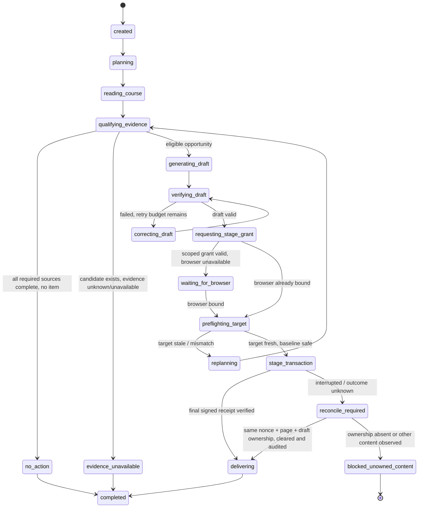

# 第一纵向切片规格：一句话完成“支持缺口 → 草稿 → 暂存验证 → 成果交付”

> Spec ID：`COURSE-AGENT-SLICE-01`  
> 日期：2026-08-12  
> 状态：Ready for breakdown  
> 真实发布：不在范围内，必须保持硬锁  
> 上位方案：[主路线图](./CODEX_LIKE_COURSE_OPERATIONS_AGENT_MASTER_ROADMAP_2026-08-12.md)

本文第 1 节“已有真能力”是代码事实；其余流程、类型、接口、状态机与验收均为待实现的产品/技术规格，不表示现有系统已经具备这些能力。

## 0. 一页结论

操作者输入：

> **“找出当前课程最值得教师关注且证据完整的支持缺口，生成一份可发布前复核的促进回复草稿，在编辑器中暂存、回读并清空，最后交付草稿和验证报告；不要发布。”**

系统应在一个 task 中独立完成：

1. 解析当前课程和锚定快照；
2. 读取并验证机会/证据，而非让模型凭摘要猜；
3. 选择一个满足策略与证据门槛的支持缺口；
4. 形成 Intent + MoveSpec 和可审阅草稿；
5. 在受信浏览器/测试课程中写入真实编辑器；
6. 回读并验证写入内容，再清空编辑器并验证空值；
7. 交付版本化草稿、选择理由、证据引用和 STAGE 验证报告；
8. 任一时刻都不调用提交、发布、通知或外部课程修改接口。

该切片的价值不在于展示一段漂亮回答，而在于首次把现有锚定读模型、自治语义生成、真实 STAGE 链和 Workbench 运行时接成可计划、可观察、可恢复、可验证的工具闭环。

## 1. 已有基础与必须补齐的缺口

### 已有真能力

- [operator-read-model.ts:483](<C:/Users/tiany/Nutstore/2/我的坚果云/cMOOC智能学伴自动干预系统/源码/lib/workbench/operator-read-model.ts:483>) 已做课程、invocation、snapshot、manifest、candidate、decision、outcome 的严格绑定。
- [course-opportunity-brief.ts:333](<C:/Users/tiany/Nutstore/2/我的坚果云/cMOOC智能学伴自动干预系统/源码/lib/workbench/course-opportunity-brief.ts:333>) 能产生最多五项、带 gate/limitation/contextRef 的课程简报。
- [evidence-read-model.ts:210](<C:/Users/tiany/Nutstore/2/我的坚果云/cMOOC智能学伴自动干预系统/源码/lib/workbench/evidence-read-model.ts:210>) 对比较基线采用严格同课程、同 manifest、早于当前时点和无歧义规则。
- [semantic-renderer.ts:429](<C:/Users/tiany/Nutstore/2/我的坚果云/cMOOC智能学伴自动干预系统/源码/lib/autonomy/semantic-renderer.ts:429>)、[draft-revalidation.ts:65](<C:/Users/tiany/Nutstore/2/我的坚果云/cMOOC智能学伴自动干预系统/源码/lib/autonomy/draft-revalidation.ts:65>) 已有受约束语言生成与写前重验能力。
- 真 STAGE 链已经具备签名 token、单次 nonce、页面/目标绑定、空编辑器前置、写入/回读/清空和零发送网络守卫，核心见 [stage-companion.ts:419](<C:/Users/tiany/Nutstore/2/我的坚果云/cMOOC智能学伴自动干预系统/源码/lib/live-runtime/stage-companion.ts:419>)、[cmooc-quill-stage-driver.ts:351](<C:/Users/tiany/Nutstore/2/我的坚果云/cMOOC智能学伴自动干预系统/源码/lib/live-runtime/cmooc-quill-stage-driver.ts:351>)。
- Workbench 已有真实 app-server run、SSE、safe persistence、lineage 和 session workspace。

### 本切片必须补齐

1. 把上述服务封装成 agent 可调用、带权限和验证契约的 Course Tools。
2. 把 plan step、tool call、receipt、artifact version、verification 变成 durable 对象。
3. 让运行中的 agent 可以请求受控平台动作，而不是委派前先走 regex/page macro。
4. 把当前 metadata-only “artifact”升级为可预览的真实成果。
5. 修复两个证据完整性问题后才能声称“证据完整”：
   - 当前 evidence reader 传入 `qualification: null`，资格瀑布首层为 UNKNOWN；见 [evidence-read-model.ts:341](<C:/Users/tiany/Nutstore/2/我的坚果云/cMOOC智能学伴自动干预系统/源码/lib/workbench/evidence-read-model.ts:341>)。
   - 当前 content graph 只核对 coverage 标量，未核对 `contentGraphHash/nodeSetHash/edgeSetHash/counts`；字段见 [schema.prisma:1052](<C:/Users/tiany/Nutstore/2/我的坚果云/cMOOC智能学伴自动干预系统/源码/prisma/schema.prisma:1052>)。

## 2. 范围

### In scope

- 单课程、单个支持缺口、单个促进回复草稿；
- 当前已锚定的最新完整课程快照；
- 真实受信编辑器的 write/readback/clear；
- 一次自动修正草稿和有限重试；
- task/run/step/tool/artifact/verification 的持久记录；
- 桌面和移动端最小 Artifact Workspace；
- process/browser 断连后的安全恢复；
- 所有 publish/submit/send 的负向证明。

### Out of scope

- 点击提交、真实发布、通知、删除/撤回外部回复；
- 多课程编排、群体逐人干预、自动排期写入；
- 任意 URL/DOM/桌面控制或第三方 MCP；
- 保存论坛正文、身份、浏览器 profile、Cookie、token、登录态；
- 通用 artifact 协同编辑、复杂 merge、L4 审批 UI；
- 将 STAGE 当成干预或效果。

## 3. 用户流程

### 3.1 正常流程

1. 操作者在 `/workbench` 输入一句目标，不需要先切到 Canvas 或 `/platform`。
2. 主线出现一个紧凑计划：`确认课程 → 核验证据 → 选择缺口 → 生成并验证草稿 → 编辑器暂存验证 → 交付`。
3. Agent 读取锚定课程状态；如果某项证据不完整，则尝试下一项机会。只有规定来源全部检查完成且确无事项时才交付 `no_action`；存在候选但证据未知/不可用时交付 `evidence_unavailable`，不能暗示课程无需支持。
4. 生成草稿 artifact v1，运行 unsupported-claim/privacy/style verifier。失败时把 verifier feedback 交给生成器，最多修正一次，形成 v2。
5. Agent 提出绑定 `course + target + artifactVersion + draftBodyHash + expiry` 的 L3 capability request；策略网关核对本项目既有 STAGE 授权后才可签发一次性 grant。浏览器未绑定时，task 进入 `waiting_for_browser`，UI 只要求用户打开受信页面，不要求复制内容。
6. 单一可信工具 `platform.editor.stage_verify_clear@1` 调用既有 trusted companion/driver，在同一事务内完成：guard-before-page → fresh target/baseline 绑定 → 空编辑器前置 → write → normalized readback → ownership check → clear → empty readback → close audit。
7. write/readback/clear 的中间成功只可作为瞬时 phase progress；只有整个事务结束后，服务端验证过的 driver 签名 receipt 才能成为 durable checkpoint。中断或超时进入 reconcile，绝不直接重写或让普通前端布尔值认证成功。
8. 主线给出一段短结论，自动打开 Artifact Workspace，展示草稿、证据引用、选择理由和验证报告。状态明确写“已完成暂存验证；未发布”。

### 3.2 用户可见信息

默认聊天主线只出现：

```text
你：一句目标
系统：计划 6 步 · 正在核验证据
系统：已选择 1 个支持缺口 · 5 项证据通过
系统：草稿已生成并通过检查（打开成果）
系统：编辑器写入、回读、清空均验证通过 · 未发布
系统：已交付 3 个关联成果
```

工具细节折叠在相应 step 中；失败、修正、等待浏览器自动展开。raw 页面文本、命令参数、DOM、token、模型推理不进入聊天。

### 3.3 Artifact Workspace

本切片交付三个关联成果：

1. `FacilitationDraft`：草稿当前版本、生成约束、source evidence refs；
2. `StageVerificationReport`：可信 driver 为原子 STAGE 事务签发的最终安全 receipt；中间 phase 不构成独立执行凭证；
3. `DeliveryBundle`：选择理由、限制、未发布声明、artifact/verification 引用。

桌面右侧 40% panel；移动端全屏 sheet。用户可预览草稿、查看 v1→v2 diff、复制安全草稿、下载验证报告；本切片不显示“发布”按钮。

## 4. 运行状态机



### 状态不变量

- 进入 `stage_transaction` 前必须已有 validated artifact version、独立 scoped L3 grant、一次性 stage nonce 和可信 driver binding；`intent:"implement"` 本身不授权 L3。
- write/readback/clear 是既有 STAGE 的一个原子可信事务；中间相位不写 durable success checkpoint，也不能由普通 page bridge/result API签发成功凭证。
- reconcile 只在当前页面、target、nonce、baseline 与正文仍能证明由本次调用拥有时清空；观察到其他或不可归属内容必须进入 `blocked_unowned_content`，不得自动清除或重新 stage。
- `completed` 必须有 `clear_verified=true` 或根本未进入 stage。
- 任意状态都不存在 `publication.commit` transition。
- `stop` 在 STAGE 前立即停；原子事务开始后，停止请求不能截断安全收尾，driver 必须完成 ownership-safe clear/close audit，或返回高可见 blocked/unknown 状态。

## 5. 最小 Course Tool 清单

| # | Tool | 能力 | 输入摘要 | 输出/证据 | 幂等与失败 |
|---:|---|---|---|---|---|
| 1 | `course.context.resolve@1` | L0 | `courseAlias/contextRef` | courseId、asOf、manifest/snapshot refs | 按 context hash；歧义直接失败 |
| 2 | `course.snapshot.read@1` | L0 | courseId + asOf | safe scalar snapshot + freshness | `snapshotId`；不得 latest fallback |
| 3 | `opportunity.list@1` | L0 | exact anchor | 最多 5 个候选及 gates/limits + source-completeness | input hash；仅全源检查完成且无事项时返回 no_action，否则返回 boundary/unavailable |
| 4 | `evidence.read_opportunity@1` | L0 | opportunityId + anchor | 事项级 evidence refs，不复用模糊课程级 dossier | exact anchor；冲突 409 语义 |
| 5 | `evidence.verify_integrity@1` | L0 | candidate/world/coverage/graph refs | schema、canonical hash、graph hashes/counts、qualification | 任一 UNKNOWN 不得标“完整” |
| 6 | `opportunity.select_support_gap@1` | L0 | eligible candidates + policy | selected id + deterministic reason + exclusions | 纯函数；排序规则版本化 |
| 7 | `facilitation.intent.compose@1` | L1 | selected evidence + policy/budget | Intent + MoveSpec + validator receipt | input hash；不产正文 |
| 8 | `artifact.reply_draft.create@1` | L1 | Intent/MoveSpec + safe evidence | artifact/version/hash + privacy/claim lint | task/purpose/input hash；最多 1 次修正 |
| 9 | `platform.target.preflight_read@1` | L0 | bound course/target/page | target revision/hash、baseline hash、editorEmpty、page binding | 仅用于计划/等待提示；不能替代 STAGE 内 fresh binding |
| 10 | `platform.editor.stage_verify_clear@1` | L3 | scoped grant + artifact version + `draftBodyHash` + signed one-shot token/nonce | trusted driver 的单一最终 receipt：write/readback/clear/guard/close audit | 一个原子事务；中间相位不持久化为成功；unknown 禁止盲重写 |
| 11 | `platform.editor.reconcile_stage@1` | L3 recovery | 原 call/grant/nonce + driver audit refs | final receipt 或 `blocked_unowned_content` | 仅可清除精确匹配本次 staged hash 的内容；不是通用 clear |
| 12 | `delivery.bundle.create@1` | L1 | artifact + evidence + verification refs | DeliveryBundle artifact | task + goal hash；仅在安全不变量满足时完成 |

### 明确不注册的工具

本切片的 agent manifest 中不出现 `click_submit`、`send_notification`、`publication.commit`、任意 DOM script、任意 HTTP、任意 shell 网络工具。即使模型生成同名调用，也必须在 registry discovery/dispatch 前被拒绝并记录 capability denial。

## 6. 工具与验证契约

```ts
interface SliceToolContext {
  taskId: string;
  runId: string;
  planRevisionId: string;
  stepId: string;
  courseScope: { courseId: string; alias: string };
  intent: "inspect" | "implement";
  baseCapability: "L0_READ" | "L1_ARTIFACT";
  capabilityGrantRefs: string[]; // server-injected; model cannot supply
  policyVersion: string;
  deadlineAt: string;
}

interface EvidenceRef {
  kind: "manifest" | "invocation" | "snapshot" | "world" | "coverage" |
    "content_graph" | "candidate" | "decision" | "stage_receipt";
  id: string;
  hash: string;
  observedAt: string;
}

interface VerificationReceipt {
  id: string;
  verifier: string;
  verifierVersion: string;
  subjectType: "evidence" | "artifact_version" | "target" | "stage_transaction";
  subjectId: string;
  status: "passed" | "failed" | "unknown";
  checks: Array<{
    code: string;
    status: "passed" | "failed" | "unknown" | "not_evaluated";
    safeSummary: string;
  }>;
  evidenceRefs: EvidenceRef[];
  observedAt: string;
  expiresAt?: string;
  containsForumText: false;
  containsIdentity: false;
}
```

### Evidence-complete 的机械定义

只有与所选支持缺口及拟写 claim 相关的条件全部成立才可进入生成：

1. course、manifest、invocation、snapshot、world、candidate set、coverage 同 scope；
2. observedAt 不晚于 task asOf；只有生成变化/趋势断言时才要求 baseline 严格早于当前且无同时间歧义，没有 baseline 时禁止变化断言但不一概阻止非变化型成熟缺口；
3. candidate/coverage/world canonical hash 通过；
4. 使用 Content Graph 推导的 claim 必须核对 `contentGraphHash/nodeSetHash/edgeSetHash`、node/edge counts 与子投影；不依赖图的候选不因无关图数据缺失而被全局阻塞；
5. 所选匿名 thread/candidate 必须绑定到 exact cutoff/as-of 投影；成熟支持缺口所需的年龄、外部人类回复、distinct actor、作者返回、系统回复、资格状态等目标级谓词按当前策略版本逐项为 passed，不能仅凭课程聚合量；
6. qualification 中与该候选/claim 相关的硬 gate 不为 UNKNOWN 且全部 passed；
7. 无 active incident/halt/deny 冲突；
8. 不需要论坛正文或个人身份才能支持选择理由。

否则该 opportunity 被排除并生成机器可读 limitation。若规定来源全部检查完成且确无事项，才是 `no_action`；若候选存在但所需检查为 UNKNOWN/不可用，结果是 `evidence_unavailable`；若证据完整但策略禁止动作，结果是 `policy_no_safe_action`。不得用模型“看起来证据够”替代。

### 草稿验证

- MoveSpec/Intent schema 与预算通过；
- 不出现姓名、账号、可重识别细节、源论坛原句；
- 每个课程事实 claim 可追溯到 safe evidence ref；
- 不把推断写成事实，不声称已干预/已发布/有效果；
- 符合目标平台长度、格式与禁止动作；
- artifact version 在 stage 前冻结，stage 过程中不可悄然变更。
- artifact 的对象级 `contentHash` 与正文级 `draftBodyHash` 分开；后者必须直接复用 [draft-content.ts:3](<C:/Users/tiany/Nutstore/2/我的坚果云/cMOOC智能学伴自动干预系统/源码/lib/live-runtime/draft-content.ts:3>) 的 `cmooc.transient-draft-content.v1`（CRLF/CR→LF、Unicode NFC、canonical protocol hash），不得另造不兼容摘要。

### STAGE 验证

- 只有既有 trusted companion/driver 可执行并签发；普通前端 adapter 只能传输 opaque request/receipt，不能声明验证成功；
- 签名一次性 token、nonce consume、guard-before-page、page/course/parent/target/revision binding 与 close audit 均在最终 receipt 中可验证；
- fresh target reread 与 planned course/parent/target/revision 一致，editor 初始为空；若未来支持非空 baseline，必须原值恢复而非 clear，本切片直接 fail closed；
- write count = 1，clear count = 1；正文回读使用 `draftBodyHash` 算法并与 staged artifact version 的同名字段匹配；
- current editor 只有仍精确匹配本 call 的 `draftBodyHash + nonce + page binding` 时才可清空；并发用户内容/无所有权内容不清除；
- 页面创建前安装的结构化网络 guard 与 close audit 均报告 submit/send mutation count = 0；
- `realPublishEnabled=false`、`bodyPersisted=false`，clear 后 editor 再次为空；
- write/readback/clear 中间 phase 不生成独立 durable receipt，只有最终签名 STAGE receipt 或 blocked/unknown incident。

## 7. API 与事件契约

### 7.1 保留现有 API

- `POST /api/workbench/runs`：创建 task/root run；必须真正消费 `intent`：
  - `inspect` → read-only sandbox，max L0；
  - `implement` → workspace-write + base L1；不会自动获得任何平台写能力；
  - L3 必须由 orchestrator 为一个已验证 artifact/target 单独创建 capability request，再由后端策略签发精确 grant；用户目标文字只是请求来源，不是授权本身；
  - 本切片不接受 `publish`。
- `GET /api/workbench/runs/:id`：返回安全快照。
- `GET /api/workbench/runs/:id/events`：SSE；升级为 durable cursor。
- `POST /api/workbench/runs/:id/messages`：steer/continue。
- `POST /api/workbench/runs/:id/stop`：按安全态停止。

### 7.2 新增只读/回执 API

| Route | 调用者 | 用途 |
|---|---|---|
| `GET /api/workbench/tasks/:taskId` | UI | task 聚合、current run、plan、artifacts、resume mode |
| `GET /api/workbench/course-tools` | UI/diagnostics | 仅安全 manifest；不含内部 endpoint/secret |
| `GET /api/workbench/artifacts/:artifactId` | UI | artifact metadata、可见版本、safe preview/diff refs |
| `GET /api/workbench/browser-bindings/events` | app shell | task 路由之外仍存活的受控 action stream；按 browser-session lease/route/course 投递 |
| `POST /api/workbench/browser-bindings/claim` | app shell/tab adapter | 单标签页以 nonce + lease generation claim action；重复/过期 claim 拒绝 |
| `POST /api/workbench/browser-actions/:actionId/result` | app-shell 持久连接 | 仅回传 L0 页面动作结果或 trusted driver 的 opaque 签名 receipt；普通客户端结果永不构成 L3 证明 |

Tool execution 不提供通用浏览器可调用的 `POST /tools/execute`。模型只能经 app-server 的内部 `CourseToolTransport` 提交业务参数；task/run/step/course、capability grant、幂等键、attempt 与 fencing token 全由服务端注入。前端不能伪造 L1–L3 tool call；L3 最终 receipt 还必须通过 trusted driver 签名、nonce consumption 和 close-audit 验证。

浏览器 binding 不能依赖 `/workbench` 组件自己的 EventSource，因为跨页后该组件会卸载。连接必须提升到 app shell/provider 层并具备 `browserSessionId + tabId + routeRevision + courseScopeHash + leaseGeneration + heartbeat + expiresAt`；一个 action 只允许一个标签页通过 CAS claim，其他标签收到 superseded。断连或 route/course 变化立即失效，转移前需新 lease；重复/晚到 receipt 以 nonce + generation 拒绝。

### 7.3 SSE 事件

```ts
type SliceEvent =
  | { kind: "plan.revised"; planRevisionId: string; safeSummary: string }
  | { kind: "step.started" | "step.completed" | "step.blocked"; stepId: string }
  | { kind: "tool.started"; callId: string; stepId: string; toolLabel: string }
  | { kind: "tool.receipt"; callId: string; status: string; receiptRef: string }
  | { kind: "verification.failed" | "verification.passed"; verificationId: string }
  | { kind: "artifact.versioned"; artifactId: string; versionId: string }
  | { kind: "browser.waiting" | "browser.action_requested"; actionId: string }
  | { kind: "run.resumed_exact" | "run.resumed_from_handoff"; checkpointId: string }
  | { kind: "delivery.ready"; bundleArtifactId: string };
```

每条事件带 durable `taskSeq/runSeq`、`schemaVersion`、`causationId`、`observedAt`；不带 raw draft、论坛正文、DOM 或身份。前端用 cursor 重放，不能从聊天文本推导 tool status。

## 8. 数据模型最小增量

以下是语义要求，不限定最终字段命名：

```prisma
model WorkbenchSafeTaskObjective {
  id                String @id
  taskId            String @unique
  schemaVersion     String
  objectiveHash     String
  safeSummary       String
  structuredGoalJson String
  source            String
  expiresAt         DateTime?
  createdAt         DateTime
}

model WorkbenchPlanRevision {
  id            String   @id
  taskId        String
  runId         String
  revision      Int
  objectiveHash String
  createdAt     DateTime
  steps         WorkbenchPlanStepRecord[]
  @@unique([taskId, revision])
}

model WorkbenchPlanStepRecord {
  id             String @id
  planRevisionId String
  ordinal        Int
  status         String
  toolName       String?
  toolVersion    String?
  dependencyIdsJson String
  inputRefsJson  String
  preconditionsJson String
  postconditionsJson String
  effectClass    String
  requiredCapability String
  acceptanceJson String
  replanPolicyJson String
  safeSummary    String
  startedAt      DateTime?
  completedAt    DateTime?
}

model WorkbenchToolCallRecord {
  id             String @id
  taskId         String
  runId          String
  stepId         String
  toolName       String
  toolVersion    String
  capability     String
  effectClass    String
  inputHash      String
  idempotencyKey String
  attempt        Int
  grantRef       String?
  leaseGeneration Int
  fencingTokenHash String
  status         String
  causationId    String?
  createdAt      DateTime
  completedAt    DateTime?
  @@unique([toolName, idempotencyKey, attempt])
}

model WorkbenchToolReceiptRecord {
  id                String @id
  callId            String @unique
  status            String
  safeOutputSummary String
  outputHash        String
  evidenceRefsJson  String
  beforeRefJson     String?
  afterRefJson      String?
  compensationRef  String? // non-replayable id; capability secret stays in protected server store
  containsForumText Boolean @default(false)
  containsIdentity  Boolean @default(false)
  observedAt        DateTime
}

model WorkbenchArtifactVersion {
  id             String @id
  artifactId     String
  version        Int
  schemaVersion  String
  contentClass   String
  contentHash    String
  draftBodyHash  String?
  contentRef     String?
  sourceRefsJson String
  createdByCallId String?
  createdAt      DateTime
  @@unique([artifactId, version])
}

model WorkbenchVerificationRecord {
  id              String @id
  taskId          String
  subjectType     String
  subjectId       String
  verifier        String
  verifierVersion String
  status          String
  checksJson      String
  evidenceRefsJson String
  observedAt      DateTime
  expiresAt       DateTime?
}

model WorkbenchBrowserActionRecord {
  id             String @id
  taskId         String
  runId          String
  callId         String @unique
  actionType     String
  capability     String
  targetScopeHash String
  nonceHash      String @unique
  bindingLeaseId String
  leaseGeneration Int
  trustedDriverReceiptRef String?
  status         String
  requestedAt    DateTime
  claimedAt      DateTime?
  completedAt    DateTime?
}

model WorkbenchExecutionLease {
  id              String @id
  taskId          String
  runId           String
  stepId          String?
  ownerInstanceId String
  generation      Int
  fencingTokenHash String
  heartbeatAt     DateTime
  expiresAt       DateTime
  status          String
  @@unique([runId, stepId])
}
```

`WorkbenchSafeTaskObjective` 只接受分类后的结构化目标与安全摘要/hash；原始 prompt/目标原文继续保持 transient，不因 task-first 改造进入 DB、session bundle 或 handoff。模型 plan 不是上述 `WorkbenchPlanStepRecord` 的可信来源。服务端 plan compiler/validator 只从 allowlisted tool manifest 和 safe refs 生成 canonical step；模型不能填写 capability、grant、task/run/course、幂等键、lease generation 或 fencing token。worker 执行前以数据库 CAS 获取 lease，receipt 提交时再核对 generation，避免 server restart 或多实例同时重放副作用。

`contentRef` 不得指向论坛正文、身份信息或平台目标文本。`restricted_transient` 只能存在于受控进程内存；普通 DB、session workspace 和其他磁盘位置仅保存 hash/schema/TTL/再生成配方。生成草稿即使通过确定性检查也不等于“证明无隐私风险”；本切片默认只在内存预览正文，持久 artifact 保存 `draftBodyHash`、MoveSpec、safe evidence refs 与再生成配方。若未来要持久保存完整草稿正文，必须另行修改项目授权与数据治理方案，不能由本规格暗含开启。

## 9. Artifact 内容与隐私策略

### 草稿内容

- 草稿先存在当前 run 的 transient buffer。
- privacy/claim guard 只能证明“通过已定义的确定性检查”，不能证明自然语言绝无可重识别线索。
- 本切片不把完整草稿正文写入 DB、session workspace、同步目录或其他磁盘；artifact version 持久保存 `contentHash`、`draftBodyHash`、MoveSpec、safe evidence refs、guard version/结果、TTL 和再生成 recipe。预览正文仅存在于当前受控进程内存，进程丢失后重生成并重新验证。
- artifact 不复制到普通日志、handoff 文本、聊天 event 或测试输出；删除 task 时同步删除所有可恢复 recipe 与 transient handle。

### 证据内容

- 仅存 scalar/aggregate、安全 limitation 和强类型 ref；
- 不持久化论坛正文、帖子标题中可识别文本、用户名、头像、账号、URL query 中的 token；
- 研究/验证导出同时提供普通响应字节 SHA-256 与 protocol digest，避免当前 `X-CMOOC-Evidence-SHA256` 名称/语义混淆。

### 浏览器内容

- snapshot/页面文本标记为 `untrusted_external`；
- 仅 trusted driver 内部使用必要的 DOM/文本完成 target binding 和 STAGE readback；普通 page adapter 不获得 L3 认证权；
- tool receipt 返回 hash、revision、计数和安全枚举，不把正文回传到 ledger/模型历史；
- 域名、origin、route、course、target 在服务端校验，不能只靠 MCP/客户端参数。

## 10. 幂等、重试与故障恢复

### 10.1 重试矩阵

| 失败 | 自动动作 | 禁止动作 |
|---|---|---|
| 课程读超时 | 相同 asOf/anchor 指数退避重试，最多 3 次 | 改用未经锚定的 latest |
| evidence stale/conflict | 重新读取并生成 plan revision | 沿用旧选择继续生成 |
| 草稿 verifier 失败 | 带结构化 feedback 修正 1 次 | 无限改写或降低 gate |
| 浏览器未连接 | `waiting_for_browser`，保留 checkpoint | 让用户手工复制敏感内容 |
| 页面/目标改变 | 重新重读、必要时重选机会 | 在未知页面写入 |
| STAGE 事务超时/进程丢失 | 调用 trusted `reconcile_stage`；核对原 grant/nonce/page/target/baseline/draft ownership | 直接重复写入或让普通前端回传成功 |
| reconcile 观察为本次草稿且 ownership 全匹配 | trusted driver 完成 clear + empty readback + close audit，签发最终 receipt | 再写一遍 |
| reconcile 为空 | 核验 nonce consume、driver audit、网络 guard 与 clear evidence，决定 final/unknown | 假定暂存成功或发布成功 |
| reconcile 为其他/不可归属内容 | `blocked_unowned_content` + incident，禁止该 target 自动执行 | 自动 clear、覆盖或重新 stage |
| ownership-safe clear 失败 | 保持高可见 `blocked_stage_residue`，冻结该 target/nonce，等待受控人工处置 | 标 completed、隐藏残留或通用重试 clear |
| 进程丢失 | 可靠基线是从 last verified checkpoint 建 child attempt；只有 exact-resume feasibility/privacy gate 已通过的部署才先尝试 exact resume | 把 degraded resume 说成原 thread 恢复，或为 exact resume 开启额外原始 prompt/tool-result 历史 |

### 10.2 恢复 checkpoint

至少在以下位置落 durable checkpoint：

1. course context resolved；
2. evidence integrity passed + opportunity selected；
3. artifact version validated；
4. scoped L3 grant issued + browser/driver binding ready；
5. **完整原子 STAGE 最终签名 receipt**（write/readback/clear/close audit 全通过）或 blocked/unknown incident；
6. delivery created。

绝不在 write/readback/clear 中间 phase 写 durable success checkpoint。恢复逻辑先验证最终 receipt；若只有 nonce consumption/事务开始记录而无最终 receipt，唯一允许的 side-effecting 下一步是 trusted reconcile。它只清除仍由本 call 精确拥有的草稿；没有所有权证明即阻断。

## 11. 权限与发布负向边界

- 操作者原目标明确要求 stage/readback/clear，只允许 orchestrator **提出** L3 request；既有后端 STAGE policy 对该精确请求验证通过后，可一次性签发而无需 write/readback/clear 三次弹窗。`intent:"implement"` 不产生 L3。
- L3 grant 只绑定：course、target、artifactVersion、`draftBodyHash`、stage nonce、trusted driver/page binding、baseline empty hash、有效期、`realPublishEnabled=false`。
- grant 不能升级到 L4，不能跨 artifact version 或 target 重用。
- 后端 compile-time real write lock、manifest/policy lock 均保持；旧 authorize/publish 路由继续 423。
- 页面创建前安装的网络 guard、结构化通道计数与 close audit 必须全部通过；只持久化脱敏计数/违规码，不能以原始 network trace 或“没点按钮”单独证明无外部修改。
- UI 所有完成态必须同时显示 `已清空编辑器` 与 `未发布`。

## 12. 前端最小实现

### 新组件

- `PlanActivityBar`：6 步 compact plan、当前 step、stop；
- `ToolStepGroup`：按 step 汇总工具调用，成功默认折叠；
- `ArtifactWorkspace`：tabs 为“草稿 / 验证 / 证据”，桌面右 panel、移动全屏；
- `ArtifactVersionDiff`：仅在自动修正产生 v2 时显示；
- `BrowserBindingNotice`：`waiting_for_browser` 状态；
- `RecoveryCard`：默认显示 verified-checkpoint degraded resume 与 last checkpoint；仅 gate 通过的部署显示 exact resume。

### 复用

- 现有 Workbench 暗色 tokens 和单应用 `100dvh`；
- `OpportunityCanvas` 的 focus trap、Escape、background inert、focus return、移动横向 rail；
- 现有 task history、composer、SSE、stop/steer；
- 不引入 KPI 卡、永久三栏、agent 头像或 raw tool console。

### Focus/响应式验收

- artifact chip 打开 workspace 后 focus 进入标题；Esc 关闭并返回 chip；
- 右 panel 打开不清空 composer、不重置聊天滚动；
- 390×844 与 320×568 使用全屏 sheet，底部安全区可见；
- 200% zoom 无横向滚动；
- `prefers-reduced-motion`、`forced-colors`、keyboard loop、axe 无严重错误；
- 辅助关键文字不小于可读 token，不沿用当前 0.58rem 的关键状态文本。

## 13. 文件级实施地图

### 新增

```text
lib/course-tools/contracts.ts
lib/course-tools/registry.ts
lib/course-tools/executor.ts
lib/course-tools/policy-gateway.ts
lib/course-tools/receipt-store.ts
lib/course-tools/verifier-registry.ts
lib/course-tools/tools/course-context.ts
lib/course-tools/tools/opportunity-evidence.ts
lib/course-tools/tools/facilitation-draft.ts
lib/course-tools/tools/platform-stage.ts
lib/course-tools/tools/delivery.ts

lib/workbench/task-orchestrator.ts
lib/workbench/plan-store.ts
lib/workbench/artifact-store.ts
lib/workbench/browser-action-broker.ts
lib/workbench/durable-ledger.ts

components/workbench/PlanActivityBar.tsx
components/workbench/ToolStepGroup.tsx
components/workbench/ArtifactWorkspace.tsx
components/workbench/ArtifactVersionDiff.tsx
components/workbench/BrowserBindingNotice.tsx
components/workbench/RecoveryCard.tsx

app/api/workbench/tasks/[taskId]/route.ts
app/api/workbench/course-tools/route.ts
app/api/workbench/artifacts/[artifactId]/route.ts
app/api/workbench/browser-bindings/events/route.ts
app/api/workbench/browser-bindings/claim/route.ts
app/api/workbench/browser-actions/[actionId]/result/route.ts

prisma/migrations/<timestamp>_add_course_agent_tool_ledger/
```

### 修改

| 文件 | 修改 |
|---|---|
| [prisma/schema.prisma](<C:/Users/tiany/Nutstore/2/我的坚果云/cMOOC智能学伴自动干预系统/源码/prisma/schema.prisma>) | 新增 plan/step/tool/receipt/artifact version/verification/browser action；保留现有表兼容 |
| [lib/workbench/contracts.ts](<C:/Users/tiany/Nutstore/2/我的坚果云/cMOOC智能学伴自动干预系统/源码/lib/workbench/contracts.ts>) | v2 snapshot/event/artifact/tool projections；旧 v1 parse/migration |
| [lib/workbench/codex-app-server.ts](<C:/Users/tiany/Nutstore/2/我的坚果云/cMOOC智能学伴自动干预系统/源码/lib/workbench/codex-app-server.ts>) | 注入内部 CourseToolTransport；安全映射逐调用 lifecycle；不启用任意 MCP |
| [lib/workbench/run-store.ts](<C:/Users/tiany/Nutstore/2/我的坚果云/cMOOC智能学伴自动干预系统/源码/lib/workbench/run-store.ts>) | orchestrator/session handle/checkpoint 缓存；不再把内存 ring 当 durable source |
| [lib/workbench/history-store.ts](<C:/Users/tiany/Nutstore/2/我的坚果云/cMOOC智能学伴自动干预系统/源码/lib/workbench/history-store.ts>) | append-only ledger、task 聚合、verified degraded resume；conditional exact-resume 投影 |
| [app/api/workbench/runs/route.ts](<C:/Users/tiany/Nutstore/2/我的坚果云/cMOOC智能学伴自动干预系统/源码/app/api/workbench/runs/route.ts>) | 机械消费 `intent` 并设置 sandbox/max capability；修复 Canvas inspect 文案与行为错位 |
| [lib/workbench/evidence-read-model.ts](<C:/Users/tiany/Nutstore/2/我的坚果云/cMOOC智能学伴自动干预系统/源码/lib/workbench/evidence-read-model.ts>) | 接真实 qualification；核验 graph hashes/counts；事项级 evidence refs |
| [lib/workbench/course-evidence-workspace.ts](<C:/Users/tiany/Nutstore/2/我的坚果云/cMOOC智能学伴自动干预系统/源码/lib/workbench/course-evidence-workspace.ts>) | 修正/删除无语义保证的 event share；导出双 digest |
| [lib/agent/page-bridge.ts](<C:/Users/tiany/Nutstore/2/我的坚果云/cMOOC智能学伴自动干预系统/源码/lib/agent/page-bridge.ts>) | 新增 server-requested action envelope，保留 capability/revision/result checks |
| [components/agent/AgentSessionProvider.tsx](<C:/Users/tiany/Nutstore/2/我的坚果云/cMOOC智能学伴自动干预系统/源码/components/agent/AgentSessionProvider.tsx>) | 接收/claim browser action；回传 nonce-bound receipt；不执行任意动作 |
| [components/workbench/AgentWorkbench.tsx](<C:/Users/tiany/Nutstore/2/我的坚果云/cMOOC智能学伴自动干预系统/源码/components/workbench/AgentWorkbench.tsx>) | 拆出新组件、task-first 状态、artifact panel、准确安全文案 |
| [lib/live-runtime/stage-companion.ts](<C:/Users/tiany/Nutstore/2/我的坚果云/cMOOC智能学伴自动干预系统/源码/lib/live-runtime/stage-companion.ts>) | 仅增加稳定 adapter 接口/返回值；不弱化 token/nonce/network guard |

## 14. 测试策略

### Unit / contract

```text
tests/unit/course-tool-registry.test.ts
tests/unit/course-tool-policy-gateway.test.ts
tests/unit/course-tool-idempotency.test.ts
tests/unit/course-evidence-integrity.test.ts
tests/unit/course-artifact-privacy.test.ts
tests/unit/course-draft-verifier.test.ts
tests/unit/workbench-plan-ledger.test.ts
tests/unit/workbench-artifact-workspace.test.ts
tests/unit/workbench-browser-action-broker.test.ts
```

必测：未知工具、版本错配、越级 capability、cross-course、stale evidence、qualification UNKNOWN、graph hash/count corruption、重复 idempotency key、prompt injection、PII/正文 leak、artifact version race、过期 nonce。

### Integration

```text
tests/integration/workbench-course-agent-slice-01.test.ts
tests/integration/workbench-tool-ledger-recovery.test.ts
tests/integration/workbench-stage-no-publish.test.ts
tests/integration/workbench-process-loss-resume.test.ts
```

故障注入点：每个 checkpoint 前后 server crash；SSE 断开；browser 断开；read timeout；stage response 丢失；clear 第一次失败；DB 重启。断言 tool side effect 次数不增加。

### Browser / visual

Playwright 覆盖：

| 尺寸 | 场景 |
|---|---|
| 1440×1024 | idle、规划、运行、artifact panel、v1/v2 diff、完成 |
| 1280×720 | 长计划、浏览器等待、修正、clear failure、恢复 |
| 1024×768 | overlay workspace、键盘 focus、200% zoom |
| 390×844 | 全屏 artifact、返回 focus、软键盘、错误状态 |
| 320×568 | 无横向溢出、操作不被遮挡、长中文 |

真实受信编辑器验证只在明确配置的测试课程/账号环境运行：允许原子 stage/readback/clear，不点击 submit。测试必须复用页面创建前安装的 trusted network guard，并只持久化 allowlisted method + 去 query 的 route + mutation 分类计数/违规码；不得保存原始 trace、header、query、body、DOM 正文或认证数据。零外部修改的结论来自硬锁、route/DOM guard、结构化通道计数和 close audit 的组合，而非单一“未观察到请求”。

## 15. 验收标准

### 功能

- [ ] 在受信浏览器已完成有效绑定的 happy path，用户只输入一次自然语言目标，之后无需手动切页、复制粘贴或选择固定命令；冷启动允许一次“打开/绑定受信页面”的明确 readiness 动作，仍不允许复制敏感内容。
- [ ] 系统生成并持久化可执行 plan，至少包含 6 个用户可理解步骤。
- [ ] agent 实际调用 Course Tools；聊天文本不能直接把步骤标 completed。
- [ ] 机会选择使用 exact anchor 与目标级机械 gate；只有全源检查完成且确无事项时为 `no_action`，候选证据未知/不可用时为 `evidence_unavailable`，证据完整但策略拒绝时为 `policy_no_safe_action`。
- [ ] 草稿生成 artifact version；若自动修正，v1/v2 diff 可见且 stage 绑定最终版本。
- [ ] trusted driver 在一个原子事务中完成 write=1、`draftBodyHash` readback match、ownership-safe clear=1、empty readback、guard/close audit，并只签发一个最终 durable receipt。
- [ ] 交付 `FacilitationDraft`、`StageVerificationReport`、`DeliveryBundle`。

### 安全/隐私

- [ ] agent manifest 没有发布/提交/通知工具；旧真实写路由继续硬锁。
- [ ] 编译期硬锁 + trusted pre-page guard + 脱敏通道计数 + close audit 均通过且 submit/send mutation=0；不持久化原始 network trace；receipt 明确 `realPublishEnabled=false`。
- [ ] 普通 DB、SSE、日志、handoff、测试输出均不含 forum body、身份、Cookie、token、登录态。
- [ ] off-domain、错误 course/target、页面 revision 变化、编辑器非空均 fail closed。
- [ ] 页面 prompt injection 不能改变目标、工具权限、course scope 或发布边界。

### 耐久/幂等

- [ ] 在每个 checkpoint 故障后都能 verified degraded resume；若 exact-resume feasibility/privacy gate 已通过，则 exact 路径也通过同一故障矩阵，否则 UI/API 不暴露该能力。
- [ ] STAGE ambiguous 时只能进入 trusted reconcile；绝不盲目重复写入，绝不清除无 ownership 的内容。
- [ ] 重复 API、重复 SSE、重复 tool request 不造成重复 side effect/artifact version。
- [ ] ownership-safe clear 失败不显示 completed，冻结 target/nonce 并显示 `blocked_stage_residue`；恢复后只运行 trusted reconcile。

### 产品体验

- [ ] 成功工具日志默认折叠，聊天没有日志瀑布；失败/修正只展开相关 step。
- [ ] 桌面保持 ChatGPT/Codex 式单主线，artifact 需要时才出现。
- [ ] 移动端为单列/full-screen workspace，无 KPI 卡和横向溢出。
- [ ] 键盘、focus return、reduced motion、forced colors、axe、200% zoom 通过。
- [ ] 完成态文案准确为“暂存验证完成、编辑器已清空、未发布”。

## 16. 最小实现与分阶段提交顺序

### 0. 诚实语义与 feature flag

- 增加 `courseAgentToolsV1` flag，默认关闭；
- 修正 inspect/implement sandbox 映射与“只读运行”文案；`implement` 的 base capability 最高为 L1，L3 始终走独立 scoped request/grant；
- 先写 publish-negative contract test。

### 1. Ledger migration

- 新表、兼容读写、safe projection、durable cursor；
- 现有 run/history 测试全绿后再启用。

### 2. Registry + L0 tools

- contracts/registry/executor/policy；
- context/snapshot/opportunity/evidence/integrity/select；
- 先证明 `no_action / evidence_unavailable / policy_no_safe_action` 的差异与 evidence corruption。

### 3. L1 artifact + verifier

- Intent/MoveSpec adapter、draft artifact、privacy/claim verifier、最小 preview/diff；
- 不接浏览器即可完成 dry E2E。

### 4. L3 platform adapter

- 包装既有 trusted STAGE companion/driver 为一个 `stage_verify_clear` 原子工具及一个 ownership-safe `reconcile_stage` 恢复工具；普通 browser action broker 不签发 L3 证明；
- 签名 token/nonce consume/page binding/guard-before-page/close audit、unknown/recovery 与 zero publish mutation tests。

### 5. Orchestrator loop

- goal→plan→tools→observe→correct→deliver；
- model 只能提出调用，executor/policy/verifier 决定事实状态。

### 6. Workbench UX

- plan bar、step grouping、artifact workspace、browser/recovery card；
- 桌面/移动 visual matrix。

### 7. 受控 E2E

- 先 mock adapter，再本地 browser fixture，最后明确授权的测试课程 stage/readback/clear；
- 任何环境都不运行真实 publish。

## 17. 切片完成后的能力跃迁

完成本规格不会让产品立刻达到 65%，但会建立最重要的“真能力骨架”：

- 第一次让 agent 在运行中选择课程工具，而不是靠固定命令或提示词；
- 第一次把分析、生成、平台暂存和验证接成统一 task；
- 第一次把成果作为版本化、可引用、可恢复对象交付；
- 第一次用 tool receipt 和 independent postcondition 证明“做过”，而不是让聊天声称“做过”；
- 第一次证明 L0/L1/L3 可以流畅自动完成，同时 L4 根本不可达。

随后补齐 S2 的通用 Artifact Workspace 与另外两个真实任务模板，即可按主路线图的硬条件评估是否达到 65%。
