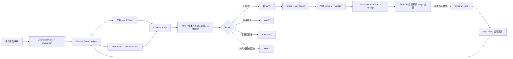
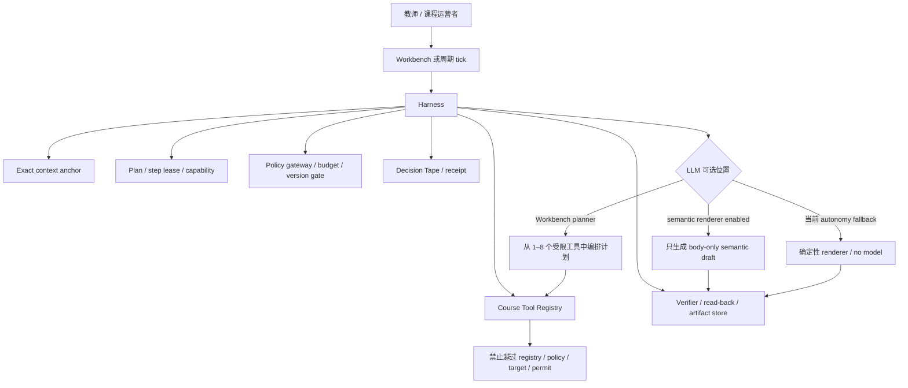
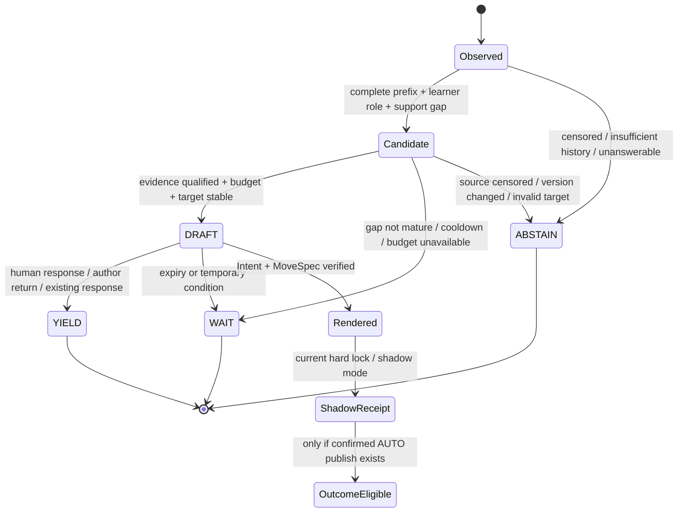
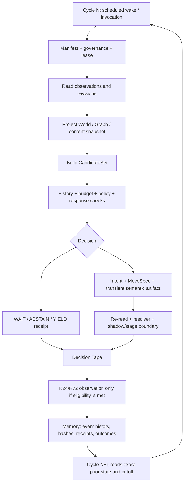
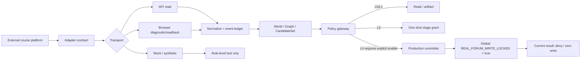
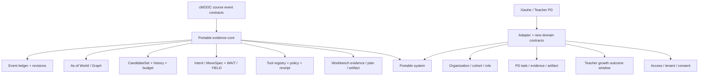
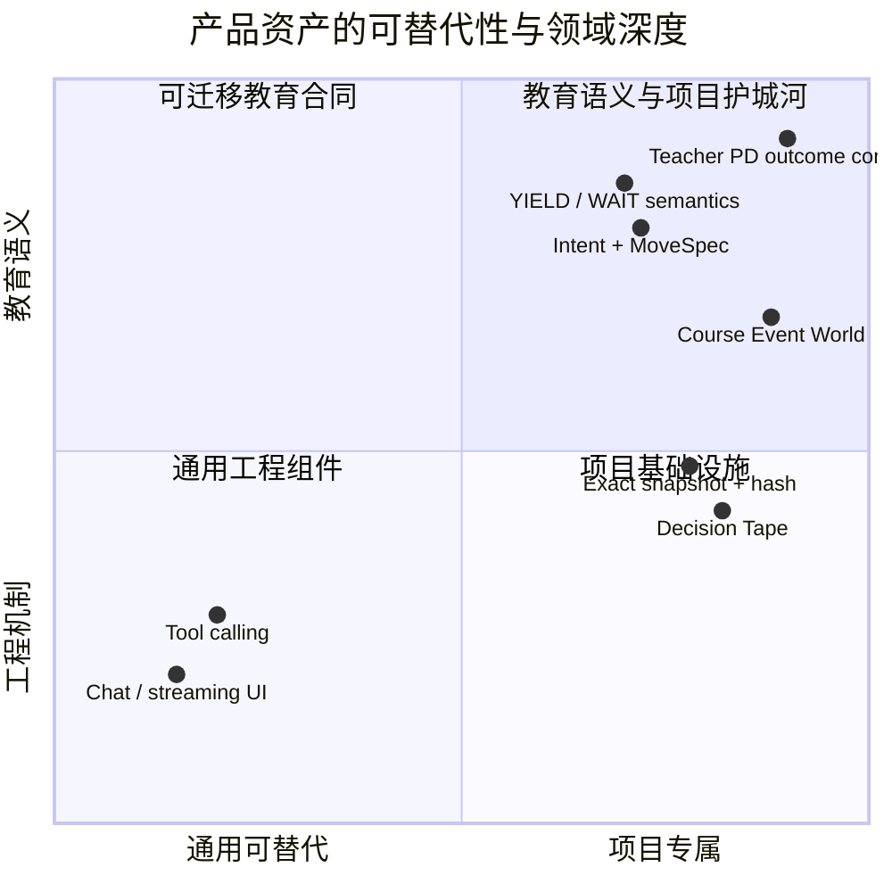
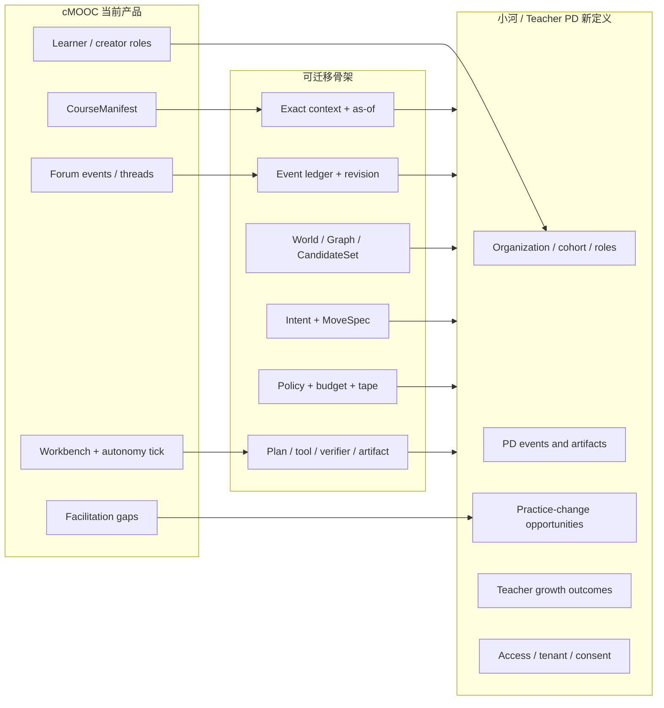

# cMOOC 智能学伴 Product Truth Audit

审计日期：2026-08-16  
审计范围：当前仓库、当前可读的本地运行界面、现有测试入口、产品与研究文档  
审计性质：只读、证据分层、未修改产品实现

> 这不是产品宣传稿，也不是把研究设想直接改写成产品事实。本报告只把能够在代码、测试、只读运行界面和教育证据中分别站得住的内容写成相应强度的结论。

## 证据标记与阅读规则

- `[CODE]`：当前源码、schema、策略、路由或组件直接支持。
- `[TESTED]`：本次实际执行的命令或断言支持；历史文档中“曾通过”的测试另行标为文档证据，不冒充本次运行。
- `[LIVE-READ]`：本次只读观察到的本地 production build/UI/数据库读模型状态；不等于重新构建后的当前源代码，也不等于外部平台状态。
- `[LIVE-ACTION]`：本次没有执行任何外部写入、发布、发送、提交或真实课程平台操作；报告中不会制造这类证据。
- `[EDU-EVIDENCE]`：教育结果或教育研究证据。当前审计没有发现可以支持“提高学习效果”的证据；“0”表示当前产品边界内没有教育效果证据，不表示产品价值为零。
- `UNKNOWN`：当前范围内不能安全确认，或需要新的权限、持续运行、跨平台现场或实证研究才能确认。

重要约束：`DRAFT` 不等于已发布；`SHADOW` 不等于持续自主运行；Graph 不等于学习效果；R24/R72 不等于因果检验；一次历史性真实动作不等于可持续、可规模化的自动运营。

## 审计执行说明

本次先按“单一 Luna Max、一次完整 Product Truth Audit、禁止修改产品”的要求启动了一个独立只读执行分支。该分支在限定时间内没有返回可交付报告或资产，因此没有把它的未完成状态当作证据；随后由主线程按同一审计边界完成仓库、测试入口、本地界面、截图与证据分层。该执行事实只说明本报告的生成路径，不改变产品结论。

仓库在审计开始前已经存在大量未提交改动和未跟踪文件。本次没有 reset、clean、覆盖源文件，也没有修改数据库、策略、硬锁、凭据或运行配置；新增范围仅为本报告及 `assets/` 下的去标识化截图。

---

## 0. 一页结论：产品现在到底是什么

### 0.1 最强、最准确的定义

> `[CODE]` 当前产品是一个面向课程共同体的、以证据和治理约束为中心的观察—决策—工作台系统：它把课程平台观察规范化为严格 `as-of` 的 Course Event World 与 Graph，形成可审计的 CandidateSet，经过历史、预算、版本、政策和人类响应检查后，输出 `DRAFT / WAIT / ABSTAIN / YIELD` 等受约束决策，并通过 Workbench 让教师或课程运营者检查证据、创建受限任务和查看可核验产物。

它不是以下任何一种未经证实的说法：

| 说法 | Truth Audit 结论 |
|---|---|
| 自动回帖机器人 | `[CODE]` 不准确。当前产品把发布能力置于多重锁和一次性授权之后，当前环境全局真实写入关闭。 |
| 教育效果引擎 | `[EDU-EVIDENCE]` 未证实。现有结果观察是近端过程信号，不是学习增益或因果效果。 |
| “LLM 自己决定教什么” | `[CODE]` 不准确。模型被限定在 registry、plan、capability、policy、verification 和 evidence contract 内。 |
| 课程 Graph / learner model | `[CODE]` 不准确。Graph 当前是基于事件和关系的投影；它不自动成为学习者心理状态或学习效果模型。 |
| 已上线的长期自主运营系统 | `UNKNOWN`/边界未闭合。代码有运行闭环和 worker 入口，现有文档同时指出 long-soak、UI directive 和外部唤醒限制；本次未完成持续运行证明。 |

### 0.2 当前最重要的产品资产

1. `[CODE]` 不是某个聊天界面，而是一组可复用的课程级控制合同：`CourseManifest`、严格时间截面、事件修订、World/Graph、CandidateSet、预算、`Intent + MoveSpec`、policy gateway、Decision Tape、verification 和 artifact version。
2. `[CODE]` `YIELD`、`WAIT`、`ABSTAIN` 不是异常，而是一等决策；系统可以在有人已经回应、证据不够、版本变化、预算不足或目标不再适合时让位或停止。
3. `[LIVE-READ]` 本地 Workbench、Policy、Outcomes、World 和 Synthetic Review 页面能把上述控制链的一部分呈现出来；当前读模型显示真实发布关闭、可用真实 permit 为 0、结果只作近端过程观察。
4. `[EDU-EVIDENCE]` 当前没有教育效果证据。最合理的产品定位是“使课程促进决策可观察、可复核、可治理”，而不是声称已经证明学生学得更多。

### 0.3 CEO 一句话

这是一个已经把“何时观察、何时等待、何时让位、何时形成受限行动草稿”结构化的课程智能基础设施；它的下一条价值验证路径是把 Workbench 的可解释、可审计、可迁移能力转成稳定的教师日常工作流，而不是把模型换得更大或直接打开发布。

---

## 1. 产品对象、第一用户与价值单位

### 1.1 第一用户

`[CODE]` 当前最清晰的第一用户是教师或课程运营者：Workbench 的入口标题是“智能控制台”，读取 operator workspace read model，提供今日简报、机会证据、课程画像、研究证据和课程任务入口。第二类用户是研究者、产品负责人和治理审核者，他们需要查看事件边界、决策原因、版本、策略、receipt 和近端结果。

### 1.2 用户正在解决的问题

课程中的“需要支持的机会”通常不是简单的未回复计数。系统需要同时知道：

- 观察发生在什么课程、什么 invocation、什么 snapshot、什么时间截面；
- 线程和参与者的可见事件是否完整，是否存在 revision 或 conflict；
- 是否已经有外部人类、原作者、系统或其他 agent 回应；
- 这个支持缺口是否成熟、是否过期、目标版本是否变化；
- 采取什么促进功能不会代替学习者发言，也不会把未经证实的心理或学习状态写成事实；
- 当前是否允许产生草稿、何时应等待，是否具有预算和一次性执行许可。

### 1.3 价值单位不是“一条回复”

`[CODE]` 当前更准确的价值单位是：

```text
一个精确绑定的课程观察截面
→ 一个有证据合同的 Opportunity/Candidate
→ 一个带原因和边界的 DRAFT / WAIT / ABSTAIN / YIELD 决策
→ 一个可验证、可回读、可撤回或不发布的 Artifact/Receipt
```

如果未来真实发布被单独授权，它也必须是上述链条的后半段，而不是把生成文本直接送入平台。

### 1.4 典型使用时刻

| 时刻 | 用户动作 | 系统应交付的真实价值 |
|---|---|---|
| 每日课程巡检 | 打开今日简报，查看为什么某个机会出现 | `[CODE]` 用同一课程、invocation、snapshot 和证据集合解释机会；证据不足时显示未知。 |
| 课程结构或互动变化 | 打开 Opportunity Canvas | `[CODE]` 查看事件变化、课程画像、研究证据和支持缺口，而不是只看一段生成文字。 |
| 教师提出课程任务 | 用自然语言提出“帮我检查/整理/准备” | `[CODE]` 由受限目标分类、1–8 个 registry tools、顺序计划、租约和 verifier 组成可核验任务。 |
| 需要外部动作前 | 检查 stage/readback/clear | `[CODE]` 当前默认停在读取、草稿或暂存验证边界；真实写入硬锁仍关闭。 |
| 事后复盘 | 查看 receipt、Decision Tape、R24/R72 | `[CODE]` 观察近端过程信号；`[EDU-EVIDENCE]` 不能由此推出学习效果。 |

---

## 2. 产品全景：从课程观察到可治理行动



图 1 说明：`[CODE]` 产品核心不是“输入 prompt、输出 reply”，而是把观察、候选、决策、证据、行动和回读串起来。虚线表示当前能力边界：有生产提交器代码和历史路径，但本次当前环境仍处在真实发布硬锁下；`[EDU-EVIDENCE]` 结果回流目前只能支持近端过程观察。

### 2.1 四层边界

| 层 | 当前可确认内容 | 当前不能直接推出的内容 |
|---|---|---|
| 观察层 | `[CODE]` 事件、修订、严格 cutoff、线程/参与者/关系投影 | 完整平台数据；被截断内容不会被补猜。 |
| 决策层 | `[CODE]` CandidateSet、history、budget、policy、`DRAFT/WAIT/ABSTAIN/YIELD` | 学习者真实需要、心理状态或学习结果。 |
| 行动层 | `[CODE]` Intent/MoveSpec、受限草稿、artifact、stage/readback contract | 当前环境可持续自动发布。 |
| 结果层 | `[CODE]` R24/R72 观察条件和近端字段 | `[EDU-EVIDENCE]` 学习增益、因果作用、长期课程质量。 |

---

## 3. AI 与 Harness：谁在决定什么



图 2 说明：`[CODE]` LLM 是 Harness 内的一个受限组件，不是拥有课程权限的主权 agent。`lib/workbench/course-agent-mvp-planner.ts` 将 open-course-task 约束为 registry 中的 1–8 个工具，并排除发布、外部 stage 和 recovery 工具；`lib/autonomy/semantic-renderer.ts` 的模型输入是 evidence hashes、Intent、MoveSpec 和输出合同，且不允许接收论坛正文、身份或平台标识。真正控制范围的是 context、tool registry、policy、budget、lease、verification、readback 和 tape。

### 3.1 AI 可以做的事

- `[CODE]` 在 Workbench live mode 中，根据已解析的课程目标和受限 registry 选择一组 1–8 个工具，形成顺序计划。
- `[CODE]` 在 semantic renderer 被启用且合同满足时，依据 Intent/MoveSpec 和 evidence hash 生成 body-only draft；不满足条件时可用确定性 fallback，或直接不生成。
- `[CODE]` 把已完成步骤、artifact、receipt 和 verifier 结果呈现给 Workbench。

### 3.2 AI 明确不能自行做的事

- `[CODE]` 不能越过 exact course anchor、snapshot/hash、target version、candidate eligibility、budget、policy gateway 或 execution permit。
- `[CODE]` 不能把普通模型输出当成已发布内容；`bodyPersisted:false` 是核心边界之一。
- `[CODE]` 不能直接选择未知工具或未经计划的下一步；runtime 按 canonical plan、step order 和 step lease 拦截。
- `[CODE]` 不能自行判断“某学生学会了”或“某学生心理状态如何”；protocol 明确禁止诊断性心理状态断言和不可验证的学习效果断言。

### 3.3 模型替换的影响

如果将来替换模型，主要替换的是 planner 或 semantic realization 的生成质量和成本。`[CODE]` 课程事件、严格时间截面、候选资格、policy、预算、一次性许可、verifier、readback、Decision Tape 和真实写入锁不会因为模型替换而消失。这是产品可迁移性的关键，也是为什么不能把产品价值简化为“用了哪个模型”。

---

## 4. Course Event World 与 Graph：产品真正的“看见”

### 4.1 World 与 Graph 的区别

| 对象 | `[CODE]` 当前含义 | 不能说成 |
|---|---|---|
| Course Event Ledger | 平台观察事件及其 revision、conflict、cutoff 组织方式 | 完整、无偏的课程现实。 |
| Course Event World | 某一 `asOfAt` 下线程、参与者、互动计数、完整性、support gap 等状态投影 | 学习者内在知识或心理世界模型。 |
| Interaction Graph | `reply_to` 等可观测关系、边权重、时间范围和 state hash | 社会关系真相、学习关系或教育效果图。 |
| Course Content Graph | 课程内容结构的投影和快照 | 学习路径已被证明有效。 |
| CandidateSet | 对某个 world/snapshot 的可行动候选集合及证据 hash | “系统知道谁需要帮助”。 |

### 4.2 一个去标识化的事件例子

以下是根据当前数据结构构造的抽象例子，不复述任何真实论坛正文、姓名或平台 ID：

```text
t0       Actor-A 发布线程 Thread-1
t0+22h   截止观察：Thread-1 没有外部人类回应，观察完整性为 complete
t0+72h   仍无作者回返，supportGapHours 达到规则阈值

t1       Actor-B 在 Thread-2 回复 Actor-C
         → Graph 形成 reply_to(Actor-B, Actor-C, Thread-2) 边

投影结果：
  World 记录线程状态、角色/参与者计数、完整性、开放支持缺口和 hash
  Graph 记录关系边、权重、时间范围和 graphHash
  CandidateSet 只保留目标版本、观察 receipt、事件集合和 hash
```

`[CODE]` 该结构足以支持“是否有可观察支持缺口、是否有人已经回应、目标版本是否变化”等决策前检查；它不足以支持“Actor-A 处于某种心理状态”或“下一条干预一定能促进学习”。

### 4.3 严格 as-of 是产品价值的一部分

`[CODE]` `live-world-projector.ts` 对事件排序、`eventSetHash`、`worldHash`、`asOfAt` 和增量/重放有明确边界；持久化时拒绝 cutoff/hash 冲突。`[CODE]` CandidateSet 绑定 `courseAlias`、`worldHash`、`eventSetHash`、`asOfAt`、目标版本和 observation receipt hash。它解决的是“不要根据未来信息或过期目标行动”的工程问题，而不是自动解决教育判断问题。

---

## 5. Opportunity：系统何时形成机会、何时停止



图 3 说明：`[CODE]` `WAIT / ABSTAIN / YIELD` 共同构成“不要多做”的控制面。`lib/live-runtime/facilitation-kernel.ts` 明确区分 `DRAFT_ELIGIBLE`、`WAIT_VOLUNTARY`、`WAIT_FORCED`、`ABSTAIN`、`YIELD_TO_HUMAN` 和 `YIELD_TO_EXISTING_RESPONSE`；`lib/autonomy/tick.ts` 记录 draft/wait/abstain 计数和 zero publish/write summary。

### 5.1 DRAFT 的成立条件

当前代码可支持的典型条件组合是：

- `[CODE]` 目标线程/版本和观察截面精确匹配；
- `[CODE]` 观察前缀完整，且候选没有被系统、外部人类、作者或已有 agent 回应完成；
- `[CODE]` 目标角色、support gap、history 和 budget 满足规则；
- `[CODE]` `Intent` 与 `MoveSpec` hash 相互匹配，TTL 和 withdrawal conditions 合法；
- `[CODE]` renderer、verifier、artifact 和 write boundary 均通过；
- `[CODE]` 当前 autonomy tick 允许的模式是 `OBSERVE` 或 `SHADOW`，因此这条链在当前运行边界下仍不是真实发布。

### 5.2 WAIT / ABSTAIN / YIELD 的产品意义

| 决策 | 典型触发 | 产品含义 |
|---|---|---|
| `WAIT` | `[CODE]` support gap not mature、cooldown、预算暂不可用、短暂等待窗口 | 机会可能存在，但现在行动会过早或不经济。 |
| `ABSTAIN` | `[CODE]` source censored、history insufficient、unanswerable、target changed | 当前证据不足以支持行动；系统不应填空。 |
| `YIELD` | `[CODE]` 外部人类回应、作者回返、已有 response、system/agent response | 共同体已有足够回应，系统把空间还给人类或已有互动。 |
| `DRAFT` | `[CODE]` 资格、证据、预算、版本和语义合同全部成立 | 只表示形成受约束的行动候选，不表示发送。 |

### 5.3 CandidateSet 的可审计性

`[CODE]` CandidateSet 不保存论坛正文，而是保存 threadKey、authorKey、rootEventKey、目标版本 hash、时间、计数、support gap、完整性和 source observation receipt hash；若已有集合 hash 与新计算不一致，会拒绝静默覆盖。这种设计让“为什么当时看到了这个机会”比“一段文本看起来像不像好回复”更可追踪。

---

## 6. Autonomous Loop：真实用户旅程与当前闭环



图 4 说明：这是 `[CODE]` 当前产品合同中的可执行链路；“Memory”在当前实现中首先是可审计的事件、快照、hash、Decision Tape、artifact version、policy receipt 和近端 outcome 数据，不是已经被证明会自动训练出更好的教学策略。`[EDU-EVIDENCE]` 从 Cycle N 到 Cycle N+1 的学习效果改进尚未被验证。

### 6.1 Cycle N 存什么

- `[CODE]` 事件及 revision/conflict 记录、`eventSetHash`、`worldHash`、`graphHash`、content graph snapshot；
- `[CODE]` CandidateSet、支持缺口、目标版本、observation receipt、budget reservation；
- `[CODE]` decision、Intent/MoveSpec hashes、Decision Tape 链、artifact version、verification 和 execution/stage receipts；
- `[CODE]` 若存在合资格真实 AUTO publish，才允许进入 R24/R72 outcome observer；当前真实写入关闭时不会凭 shadow/stage 生成 outcome row。

### 6.2 Cycle N+1 能读什么

`[CODE]` 下一轮可以读精确历史、截止时间、目标版本、作者冷却、已有回应、预算消耗、策略状态和前一轮 receipts，从而避免重复行动、过期行动和超预算行动。`UNKNOWN`：当前尚不能把这些历史自动说成“模型已经学会了一个更好的教育策略”；是否存在可持续的 policy learning、效果校准或人类反馈优化，需要另行实现和验证。

### 6.3 长期运行的真实状态

`[CODE]` 有 `autonomy:tick`、worker、schedule、lease、Decision Tape 和治理页面；`[LIVE-READ]` Policy 页面显示数据库中存在计划，但同时明确数据库 schedule 不证明外部唤醒，页面还显示全局硬锁和 0 个 usable real permit。现有产品文档记录过 natural worker 和 `LONG_SOAK_ACTIVE`，但也记录 UI directive limitation 和 long-soak 未闭合。结论：持续唤醒与长期稳定运行是 `PARTIAL/UNKNOWN`，不能由代码入口或单张页面截图升级为“已经持续自主运营”。

---

## 7. Workbench：当前最接近产品化的入口

```mermaid
sequenceDiagram
    participant T as Teacher / Operator
    participant UI as Workbench
    participant API as Workbench API
    participant CTX as Exact Context
    participant PLAN as Planner + Registry
    participant RUN as Runtime + Lease
    participant V as Verifier + Artifact

    T->>UI: Open /workbench
    UI->>API: Read brief / evidence / runtime readiness
    API->>CTX: Resolve courseAlias + invocationId + snapshotId
    CTX-->>UI: Brief, evidence lenses, or UNKNOWN
    T->>UI: Ask a bounded course task
    UI->>API: POST trusted JSON mutation
    API->>PLAN: Classify goal and choose 1–8 allowed tools
    PLAN-->>API: Immutable sequential plan
    API->>RUN: Start live/demo run with exact scope
    RUN->>V: Execute next leased tool and verify receipt
    V-->>UI: Activity, artifact, terminal or recoverable failure
    UI-->>T: Evidence-backed result; no automatic publish
```

图 5 说明：`[CODE]` Workbench 是“日常操作面”，不是另一个无边界聊天框。它把课程上下文、证据 workspace、规划、工具执行、artifact、receipt、continuation 和失败恢复放在同一个用户可见链路中；它与 autonomous tick 共享合同和 runtime，但入口和节奏不同。

### 7.1 教师的一次真实日常流程

1. `[LIVE-READ]` 打开 Workbench：本地读模型显示“智能控制台”“今日简报”“只读运行 · 真实发布关闭”；本次观察到的 snapshot 没有可精确绑定的课程巡检简报，因此界面显示“简报尚未就绪”。
2. `[CODE]` 在有精确上下文时，Workbench 以 `courseAlias + invocationId + snapshotId` 绑定 brief 和 evidence，不接受模糊的“当前课程聚合”。
3. `[CODE]` Opportunity Canvas 提供 evidence、change、portrait、research 四个视角；research 视图限制为聚合证据，不提供个体诊断、因果效果或真实发布。
4. `[CODE]` 教师可以提出受限课程任务；系统分类目标、解析 exact context、选择 1–8 个 registry tools、编译顺序 plan、按 step lease 执行并记录 verifier/artifact。
5. `[LIVE-READ]` 当本机 Codex harness 不可用或没有精确 snapshot 时，界面会停在“不可用/简报未就绪”，而不是假装已经完成任务。
6. `[CODE]` 即使后续出现 stage action，也由专门的 action coordinator、一次性 grant、expiry、hash binding、readback 和 clear verification 控制；当前代码不把这一步变成自动 publish。

### 7.2 Workbench 与自动干预引擎的关系

| 问题 | 结论 |
|---|---|
| 是否同一套证据与安全合同？ | `[CODE]` 是。两者都使用课程锚点、工具 registry、capability、policy、verification、artifact/receipt 边界。 |
| 是否同一个用户入口？ | `[CODE]` 不是。Workbench 是按需的 operator/teacher surface；autonomy tick 是周期巡检和治理运行。 |
| Workbench 能否替代 autonomous loop？ | `[CODE]` 不能。Workbench 处理人的任务和检查；它不等于 scheduler、event ledger、CandidateSet、长期预算和 outcome observer。 |
| Autonomous loop 能否替代 Workbench？ | `[CODE]` 不能。周期运行需要一个人可读、可复核、可继续或纠错的入口；Workbench 正在承担这个角色。 |

---

## 8. Workbench 现状：已产品化、半产品化与未闭合处

### 8.1 已经真实存在的产品表面

- `[CODE]` `/workbench` 页面存在，标题、描述、动态 operator workspace read model 和 `AgentWorkbench` 组件已连接。
- `[CODE]` 有 brief/evidence/runs/runtime/operator-locator/research-export 等 API 路由；run POST 要求 trusted JSON mutation，live mode 先检查 Codex harness readiness。
- `[CODE]` course-agent MVP planner 对 open course task 限定工具集合，排除发布、外部 stage 和 recovery 工具；编译结果带输入引用、postcondition、capability、acceptance 和 stop-and-replan。
- `[CODE]` runtime 对 scope、canonical plan、step order、step lease、tool call 和 verifier 进行约束，并将结果写入持久化记录。
- `[CODE]` UI 有 idle、active、terminal、continuation、failure recovery、pending action 等状态，而不是只有成功卡片。
- `[CODE]` schedule panel 明确“只读，不修改调度或发布权限”；research workspace 明确“聚合证据、排除个体诊断/因果效果/真实发布”。

### 8.2 半产品化位置

| 位置 | 证据 | 判断 |
|---|---|---|
| 今日简报对教师的稳定供给 | `[LIVE-READ]` 本次本地页面显示没有可精确绑定的 snapshot；产品文档描述了 brief contract，但当前现场供给未闭合。 | `PARTIAL` |
| live harness 可用性 | `[LIVE-READ]` 本地 Workbench 显示“本机不可用”；源码有 readiness/login 路由。 | `PARTIAL` |
| 真实课程平台读取 | `[CODE]` 有 adapter contract、API/browser diagnostic boundary；`[LIVE-READ]` 当前页面是本地 snapshot。 | `PARTIAL` |
| Workbench 任务执行 | `[CODE]` 路由/runtime/planner/registry 完整；`[TESTED]` 本次 `test:workbench` 被 esbuild 平台依赖阻断。 | `PARTIAL` |
| 长期周期运行 | `[CODE]` 有 tick/worker/schedule；文档和 Policy 页面仍保留外部唤醒、soak、UI directive 边界。 | `PARTIAL/UNKNOWN` |
| 外部 stage/readback | `[CODE]` 有受限 action contract；默认 adapter 在写前失败或等待浏览器，真实写入仍硬锁。 | `PROTOTYPE/PARTIAL` |

### 8.3 当前最需要产品化的不是“更多按钮”

产品化优先级应是：

1. `[CODE]` 让精确 snapshot/brief 在教师首次进入时稳定可解释地出现，或者把“暂无精确快照”转成可操作的下一步。
2. `[CODE]` 把 harness readiness、live/demo、只读/暂存、可继续/需人工接管用同一套清晰状态语言呈现。
3. `[CODE]` 把 Workbench 的 evidence → plan → receipt 体验做成日常课程巡检闭环，而不是把未闭合的真实发布链提前暴露给教师。
4. `[EDU-EVIDENCE]` 在真实教师流程中验证的是“教师判断更快、更可复核、更少重复劳动”等过程价值；不要从 UI 使用量直接跳到学习效果。

---

## 9. 当前 AI 拓扑与模型边界的代码真相

### 9.1 当前可确认的模型入口

`[CODE]` `lib/llm/client.ts` 支持 `mock / real` 模式和 openai-compatible、SiliconFlow、DashScope 等 provider；密钥只从环境读取，不进入 runtime status 或普通输出。没有真实配置时默认 mock；real 模式缺少 key 会抛错，在线错误不会静默退回 mock。

`[CODE]` `lib/workbench/course-agent-mvp-planner.ts` 在 real mode 可调用 `generateJson` 选择受限 registry 工具；mock mode 有可确定复现的计划。`[CODE]` `lib/autonomy/semantic-renderer.ts` 支持注入式 generator，但在当前确定性/fallback 路径中可以不调用在线模型；文档将当前 autonomy semantic path 作为证据约束的确定性 continuation，而不是开放式生成。

### 9.2 旧/兼容模型 schema 的解释

`[CODE]` `lib/llm/client.ts` 还保留 `ValueAnalysis`、`AutoReply`、`SafetyReview` 等 schema。它们不能自动被解释为当前 Workbench 或 autonomous tick 的完整 AI 架构；产品事实要以实际调用路径、tool registry、policy 和 tick mode 为准。`UNKNOWN`：本次没有对所有历史/兼容调用点做全仓库运行时覆盖追踪，因此不把这些 schema 归入当前主路径。

### 9.3 模型输出的最小权限原则

`[CODE]` 当前语义 renderer 对模型输入输出设定了明确边界：evidence hashes、Intent、MoveSpec、output contract；不传 forum text、identity、platform identifiers；非 DRAFT 不承载 semantic payload；draft body 也以 `bodyPersisted:false` 为默认边界。这个设计把“生成一个可能的语言实现”与“对课程世界采取行动”分开。

### 9.4 不能用什么指标描述 AI

当前不应把以下内容当作模型质量：

- 图节点数、边数、帖子数；
- DRAFT 数、tool call 数、计划步骤数；
- R24/R72 行数；
- 本地 synthetic rubric 通过数；
- UI 中出现了 Intent/MoveSpec；
- 一次历史性真实发布。

这些可以描述系统覆盖、过程、工程能力或近端信号，但 `[EDU-EVIDENCE]` 不能单独支持学习结果。

---

## 10. Intent + MoveSpec：行动的语义接口

### 10.1 当前 canonical functions / moves

`[CODE]` 当前 `facilitation-protocol/schemas.ts` 的 canonical functions 是：

| Function | Need state | Mechanism | Move |
|---|---|---|---|
| `resource_connection` | `connection_gap` | `reduce_connection_cost` | `connect_resource_and_invite_application` |
| `cognitive_conflict` | `conceptual_tension` | `surface_explanatory_tension` | `pose_counterexample_and_request_explanation` |
| `emotional_support` | `participation_barrier` | `lower_reentry_cost` | `acknowledge_contribution_and_invite_return` |

`[CODE]` success criteria 可观察为 external human response、original author return、independent responder count、reply chain extension、resource application attempt、explanatory revision 等；withdrawal conditions 包括 human response、source censored、candidate expired、budget unavailable、target version changed、author cooldown 和 human rejected。

### 10.2 这不是固定人格

当前代码同时有 `operational / wayfinding / meaning_making / innovation / social_affective` 等 contribution functions，以及 `learner / creator / helper / follower / unknown` 等角色字段。它们是不同层次的分类，不能未经证据合并成“Guide、Connector、Amplifier、Socratic”等固定 agent 人格。`UNKNOWN`：本次未在当前 canonical protocol 中确认这些英文角色是现行产品名；如果它们来自历史概念，应在迁移时做显式映射，而不是把名称当作当前实现。

### 10.3 为什么 Intent + MoveSpec 是核心资产

`[CODE]` Intent 定义功能、目标、need、mechanism、success criteria、TTL 和 withdrawal；MoveSpec 必须匹配 intent hash、target 和 function，并强制保留禁止项，如不得代替学习者作答、不得进行身份排名、不得作稳定人格判断、不得作诊断性心理状态断言、不得声称不可验证的学习效果。这样，模型可以变化，语义合同仍然能被 verifier、policy 和人类审核。

---

## 11. 外部平台边界：READ、STAGE、WRITE 到底在哪里



图 6 说明：`[CODE]` adapter contract 区分 `api / mock / browser_diagnostic` transport 和 `none / synthetic_only / gateway_authorized` external write mode。P4B 的 API/browser 读取即使存在认证也保持 `externalWriteMode:none`；Mock adapter 仅为 `synthetic_only`。`[CODE]` production committer 具备更高能力的代码路径，但 `REAL_FORUM_WRITE_LOCKED = true`、`realPublishEnabled=false` 和 policy/permit 条件使当前环境的真实写入结果为 0。

### 11.1 当前现场证据

`[LIVE-READ]` `/autonomy/policy` 页面显示：全局写入硬锁开启、manifest 存在、数据库计划存在、active AUTO policy 为 0、usable real permits 为 0，并明确数据库计划不证明外部唤醒。`[LIVE-READ]` `/autonomy/outcomes` 页面显示真实发布关闭，只有 confirmed publish 才有 outcome eligibility；当前页面把结果定义为 near-term process signal，而不是 educational effect/causal evidence。

### 11.2 本次没有执行的动作

`[LIVE-ACTION]` 本次没有打开真实课程平台、没有发送或提交、没有点击真实发布、没有写论坛、没有读取凭据、没有把任何真实正文或身份信息写入报告/截图。因此“当前没有新增真实发布”是审计行为边界和当前锁状态的组合结论，不是对所有外部平台未来状态的永久声明。

---

## 12. 研究资产如何变成产品能力

| 研究/工程阶段 | 解决的问题 | 当前产品化位置 | 不能越界的解读 |
|---|---|---|---|
| P3A strict as-of snapshot/replay | 在时间截面上避免未来信息泄漏和重复行动 | `[CODE]` World/Candidate/target hash、cutoff、replay contract | `[EDU-EVIDENCE]` 离线决策快照不是教育效果。 |
| P4A facilitation protocol | 把促进功能、目标、机制、success/withdrawal 结构化 | `[CODE]` Intent + MoveSpec schemas/semantics/verifier | 协议通过不等于真实互动质量或学习增益。 |
| P4B adapter contract | 把平台读取/写入能力拆成可治理边界 | `[CODE]` adapter transport、externalWriteMode、readback | API/browser contract 不等于当前平台已联通。 |
| P4C-1 capability gateway | deny-by-default、scope、grant、permit、expiry | `[CODE]` policy gateway、L0–L4、one-shot grant | 代码存在 L4 路径不等于当前已获发布授权。 |
| P4D-1 synthetic golden path | 验证 stable/response/version-change 等规则 | `[CODE]/[TESTED history]` synthetic adapter、review receipts | synthetic forum 不等于真实平台或开放语义质量。 |
| P4F-lite | 验证有限的响应/目标变化与人类接管 | `[CODE]/[TESTED history]` mock/synthetic rubric | rubric 通过不等于长期课程行为效果。 |
| Current Workbench | 把证据、任务、计划和回执变成教师入口 | `[CODE]` `/workbench`、brief、evidence、runs、artifact | 页面存在不等于每个课程都有稳定 snapshot。 |

### 12.1 当前“研究—产品”分界

`[EDU-EVIDENCE]` 研究工作当前给产品提供的是问题结构、决策合同、可观察指标和安全/治理边界；它没有在本次材料中提供足够的现场对照证据去声称“系统提高了课程学习效果”。产品可以沿用这些结构继续做可用性、教师工作流和过程质量验证，但不能把工程 receipt 改写成教育结果。

---

## 13. 迁移到“小河 / 教师专业发展”场景

### 13.1 可直接保留的通用内核



图 7 说明：`[CODE]` 可迁移的是证据、时间截面、决策和治理的骨架；不是把 cMOOC 里的 thread、learner、forum reply 名称机械复制到教师 PD。新的教育域必须重写角色、机会、artifact、success criteria 和 outcome contract。

### 13.2 迁移表

| 模块 | cMOOC 当前实现 | 小河/教师 PD 迁移方式 | 工作量 | 当前状态 |
|---|---|---|---|---|
| 事件层 | `[CODE]` CourseEvent、revision、cutoff | 将帖子/回帖换为教研活动、备课、观课、反馈、资源使用等事件 | 中 | `PARTIAL` |
| World | `[CODE]` 线程、参与者、support gap | 映射为教师/小组/学校/主题/任务状态，保留 as-of 与 completeness | 中高 | `UNKNOWN` |
| Graph | `[CODE]` reply_to 与互动边 | 映射为同伴协作、资源引用、反馈关系或主题关联 | 中 | `UNKNOWN` |
| CandidateSet | `[CODE]` 课程支持缺口 | 定义“需要同伴反馈/资源连接/重新进入任务”的 PD opportunity | 中 | `UNKNOWN` |
| Intent/MoveSpec | `[CODE]` 三类 facilitation function/move | 重新定义教师成长场景的连接、解释冲突、回返支持及可观察成功标准 | 中高 | `UNKNOWN` |
| Workbench | `[CODE]` brief、evidence、plan、artifact、receipt | 改为教研主管/教师的今日任务、证据包、行动建议、可复核产物 | 中 | `PARTIAL` |
| Tool registry | `[CODE]` course/context/snapshot/research/schedule/platform tools | 新增教研资料、活动日历、观课记录、资源包和反馈工具；保留 capability gate | 中 | `PARTIAL` |
| 外部平台 adapter | `[CODE]` API/mock/browser boundary | 对接小河的读取和受限写入；先明确真实平台合同和权限模型 | 高 | `UNKNOWN` |
| Outcome | `[CODE]` R24/R72 过程观察 | 定义短期采纳、反馈回应、实践修改、再提交等过程窗口；再研究专业成长 | 中高 | `UNKNOWN` |
| Tenant/access | 当前主要围绕课程/运营者 | 新增组织、学校、角色、授权、审计和数据隔离 | 高 | `UNKNOWN` |

### 13.3 迁移优先级

1. 先迁移 `[CODE]` evidence/plan/receipt/verification 骨架，让教师看到“为什么建议这样做”。
2. 再迁移事件与 Graph 的领域语义，避免把“互动”直接等同为“专业成长”。
3. 最后定义 outcome 和教育证据；在没有现场研究前，只把产品目标写成过程质量和教师工作流价值。

---

## 14. Commodity、项目特异、教育特异与数据/历史资产



图 8 说明：这是产品资产分类，不是商业估值图。最通用的 UI、streaming 和 tool calling 容易被替代；真正可迁移的差异化来自“如何把领域事件转成可审计机会，再把机会转成有边界的行动”。教育价值仍需现场验证，不应把架构复杂度本身当作教育壁垒。

### 14.1 Commodity

`[CODE]` Next/React 页面、对话/流式 UI、通用 tool calling、JSON schema、session/auth 适配、artifact 基本读写和本地 app-server transport 都属于可替代工程组件。它们重要，但不是最强的长期护城河。

### 14.2 项目特异

`[CODE]` exact `courseAlias + invocationId + snapshotId`、strict as-of、event revision/conflict、World/Graph hash、CandidateSet、budget/history gates、Decision Tape、Course Tool Policy、stage/reconcile/clear 合同是本项目的具体组合。迁移时可以复用设计，但需要新的领域 schema 和 adapter。

### 14.3 教育特异

`[CODE]` facilitation functions、need states、mechanisms、success/withdrawal criteria、不得代答/不得诊断/不得排名、YIELD 给人类让位，这些是教育互动语义，而不是普通 agent framework 的默认能力。

### 14.4 数据与历史

`[CODE]` 当前最有潜在复利价值的是带 cutoff、hash、版本和 receipt 的事件历史与决策历史，而不是聊天记录。它可以支持重复行动抑制、过程复盘、策略校准和未来研究设计。`[EDU-EVIDENCE]` 是否能转化为更好的学习或专业成长结果尚未被证明。

---

## 15. 结果回流：记录了什么，没有记录什么

### 15.1 Outcome loop

`[CODE]` `outcome-observer.ts` 规定 R24/R72 只对 fully attested AUTO publication eligible；STAGE/SHADOW 不能创建 outcome rows；需要 decision draft、publish attempted、AUTO、exactly one mutation、permit used、`realPublishEnabled=true` 和 bound remote receipt。结果页面把这些定义为 near-term process signals。

可观察的过程字段包括：

- `[CODE]` 外部人类回应、原作者回返、独立回应人数、reply chain extension；
- `[CODE]` 目标线程版本、覆盖/截断、时间窗口和 receipt；
- `[LIVE-READ]` 本地 Outcomes 页面显示两条已观察记录及 24h/72h 窗口，但这是本地 build/db snapshot，不是本次新发布。

### 15.2 结果回流不等于学习回流

```text
有回应 ≠ 学会了
回复链变长 ≠ 概念理解提高
资源被引用 ≠ 迁移到新任务
教师点击 artifact ≠ 教师专业成长
R72 有数据 ≠ 处理组因系统而改变
```

`[EDU-EVIDENCE]` 当前缺少教育效果、对照/反事实、长期迁移、教师实践改变和因果归因证据。产品可以先把“近端互动过程是否按预期发生”做成可审计信号，再单独设计教育研究。

### 15.3 现在能否自动更新 policy

`UNKNOWN`。当前代码能积累 outcome、receipt、budget 和历史状态，也能为下一轮提供输入；本次没有确认一个已上线、经过教育验证的自动 policy-learning 闭环。因此对外应说“为未来校准提供结构化历史”，不应说“系统已经从每轮结果学习并自动变聪明”。

---

## 16. Maturity Matrix

状态只使用：`MATURE / WORKING / PARTIAL / PROTOTYPE / PLANNED / ABSENT / UNKNOWN`。

| 能力 | 状态 | 依据 | 当前解读 |
|---|---|---|---|
| CourseManifest / exact course anchor | `WORKING` | `[CODE]` manifest、context resolve、`courseAlias + invocationId + snapshotId` | 核心边界已进入产品合同。 |
| Event ledger / revision / cutoff | `WORKING` | `[CODE]` live-event、world projector、strict persistence | 可审计观察骨架存在。 |
| Course Event World | `WORKING` | `[CODE]` world projection/hash/open gaps | 需要真实平台覆盖和完整性管理继续验证。 |
| Interaction / content Graph | `WORKING` | `[CODE]` graph projector/store | 关系投影，不是 learner model。 |
| CandidateSet / history / budget | `WORKING` | `[CODE]` candidate-set、tick、budget/policy | 决策前约束已结构化。 |
| DRAFT / WAIT / ABSTAIN / YIELD | `WORKING` | `[CODE]` kernel、tick、protocol | 让位/停止是产品能力，不是异常。 |
| Intent + MoveSpec | `WORKING` | `[CODE]` schema、semantics、verification | 教育行动接口明确。 |
| LLM planner | `PARTIAL` | `[CODE]` planner + real/mock client；`[TESTED]` 完整 workbench suite 本次被环境阻断 | 受限工具编排可用，生产质量与长跑未闭合。 |
| Semantic renderer | `PARTIAL` | `[CODE]` deterministic/fallback + optional generator | 有严格输入输出契约，开放语义质量未证实。 |
| Workbench UI | `PARTIAL` | `[CODE]` routes/components；`[LIVE-READ]` 本地 UI 可读但 brief/harness 不可用 | 产品表面存在，稳定日常供给未闭合。 |
| Workbench course task runtime | `PARTIAL` | `[CODE]` plan/lease/tool/verifier；`[TESTED]` runner 被 esbuild 阻断 | 代码路径丰富，现场完整回归需修复环境后复验。 |
| Synthetic golden path | `WORKING` | `[CODE]` MockForumAdapter/SyntheticTimelineAdapter；历史文档有固定 rubric | 规则合同验证，不是现实平台验证。 |
| External read adapters | `PARTIAL` | `[CODE]` adapter contract/API/browser boundary | 当前读模型和平台覆盖仍需现场确认。 |
| External stage/readback | `PROTOTYPE` | `[CODE]` stage/reconcile/clear contracts、default adapter 等待/写前失败 | 具备受限骨架，不是可用的通用平台写入。 |
| Real external publish | `ABSENT` in current environment | `[CODE]` global lock；`[LIVE-READ]` 0 permits；`[LIVE-ACTION]` none | 当前产品运行面不可把它当成开放能力。 |
| Production committer code path | `PROTOTYPE` | `[CODE]` permit/preflight/content/version/remote receipt/reconcile | 代码能力与当前授权/部署状态分开。 |
| Decision Tape / receipt | `WORKING` | `[CODE]` append-only hash chain、forbidden keys、verification | 审计性是强项。 |
| Privacy boundary | `WORKING` | `[CODE]` forbidden keys、no forum text/identity/secrets in ordinary outputs | 需在真实 adapter 与日志管线上持续复验。 |
| Scheduler / worker | `PARTIAL` | `[CODE]` tick/worker/schedule/lease；`[LIVE-READ]` DB schedule 不证明 wake | 入口存在，持续外部唤醒与 soak 未闭合。 |
| R24/R72 process observation | `PARTIAL` | `[CODE]` eligibility/window/observer；`[LIVE-READ]` local rows | 近端信号可观察，覆盖和真实写入受限。 |
| Education effect validation | `ABSENT` | `[EDU-EVIDENCE]` 当前 effect evidence 为 0 | 必须另行研究，不由工程指标替代。 |
| Multi-tenant / organization product | `UNKNOWN` | 本次未确认完整 tenant/access/ops contract | 迁移到小河/教师 PD 的主要新增工作。 |
| Production deployment and SLO | `UNKNOWN` | 本次未进行外部部署、负载、故障恢复和持续监控审计 | 不从本地 build 推出生产成熟度。 |

---

## 17. 十个最容易发生的误解

1. **“这是自动回帖机器人。”** `[CODE]` 当前核心是证据—决策—治理链；真实写入硬锁开启，不能把 DRAFT 说成回帖。
2. **“Graph 就是学习者模型。”** `[CODE]` Graph 是可观测互动/内容关系投影；没有心理状态或学习效果含义。
3. **“R24/R72 说明系统带来了学习提升。”** `[EDU-EVIDENCE]` 它们是近端过程窗口，不是因果检验。
4. **“只要 LLM 生成了文本，系统就完成了一次干预。”** `[CODE]` 生成、验证、artifact、stage、write、remote receipt 是不同状态。
5. **“SHADOW 表示系统已在替教师运营课程。”** `[CODE]` SHADOW 是不发布的安全运行模式；它不等于长期自主运营。
6. **“Workbench 就是 autonomous engine。”** `[CODE]` Workbench 是操作/检查入口；周期唤醒、世界投影、候选和 outcome 是另一条运行链。
7. **“计划工具越多，智能越强。”** `[CODE]` 当前 open-course-task 刻意限制为 1–8 个工具；可核验、合适和可回读比工具数量重要。
8. **“synthetic forum 通过 rubric 就等于真实平台可靠。”** `[CODE]` synthetic adapter 是规则级测试；真实平台身份、网络、权限、动态页面和外部写入仍是不同问题。
9. **“历史上有一次真实动作，所以现在可以持续自动发布。”** `[CODE]` 当前 global lock、permit、policy 和现场状态必须逐次满足；一次历史 receipt 不是长期能力证明。
10. **“有了历史数据，系统就自动学会了教学策略。”** `[EDU-EVIDENCE]` 当前历史主要提供审计、去重和未来校准输入；policy learning 和教育效果尚未被证明。

---

## 18. 给 CEO 的十个事实

| # | Fact | Evidence | Why it matters |
|---:|---|---|---|
| 1 | 产品已经把“课程观察到受限行动”的链条结构化。 | `[CODE]` manifest → World/Graph → CandidateSet → decision → Intent/MoveSpec → verifier/receipt。 | 价值可以从单一模型能力上移到可重复的控制系统。 |
| 2 | 当前真实写入是硬锁状态，不是口头承诺。 | `[CODE]` `REAL_FORUM_WRITE_LOCKED=true`；`[LIVE-READ]` Policy 显示 0 usable real permits。 | 可以安全地先验证教师价值和过程信号。 |
| 3 | “不行动”是显式产品能力。 | `[CODE]` WAIT、ABSTAIN、YIELD 及具体 reason codes。 | 在教育共同体里，避免过度干预本身就是信任和治理资产。 |
| 4 | 严格时间截面和 hash binding 是工程护城河。 | `[CODE]` as-of World、eventSetHash、worldHash、target version、receipt hash。 | 降低过期、越界和未来信息泄漏造成的错误行动。 |
| 5 | LLM 被 Harness 限定，而不是拥有课程权限。 | `[CODE]` registry、capability、plan、lease、policy、verifier 和 privacy contract。 | 模型可替换，治理边界可持续。 |
| 6 | Workbench 是把复杂自动化转成教师日常判断的入口。 | `[CODE]` brief、四视角 evidence、plan、artifact、continuation、recovery。 | 产品要先赢得“教师愿意每天用”的过程价值。 |
| 7 | 可核验产物比漂亮文本更重要。 | `[CODE]` artifact version、tool receipt、verification、Decision Tape。 | 有利于研究复盘、团队协作和未来合规。 |
| 8 | 平台迁移的关键是 adapter 和 domain contract，不是重画 UI。 | `[CODE]` adapter transport/write mode 与 protocol/schema 分层。 | 迁移到小河/教师 PD 时可以复用骨架，但必须重写教育语义。 |
| 9 | 最可能复利的是事件与决策历史，而不是聊天记录。 | `[CODE]` cutoff/hash/receipt/tape/outcome 结构；普通输出排除正文、身份、secret。 | 形成可审计、可校准、可研究的长期资产。 |
| 10 | 教育效果仍是待验证的价值层，不是现成的产品事实。 | `[EDU-EVIDENCE]` 当前教育效果证据为 0；R24/R72 只作近端过程观察。 | 商业叙事应先承诺可解释、可治理、可复核，再用研究验证效果。 |

### 不可对外宣称的十句话

以下表述在当前证据下列入 blacklist：

1. “系统已经证明能提高学习成绩/学习效果。”
2. “系统正在持续自动回帖并自主运营课程。”
3. “系统知道哪个学习者心理上需要帮助。”
4. “Course Graph 就是学习者知识状态图。”
5. “R24/R72 已经证明了因果效果。”
6. “LLM 自己完成了教育决策，不需要规则和人工治理。”
7. “Workbench 已经能稳定服务任何课程、任何教师。”
8. “Synthetic forum / mock rubric 通过就等于真实平台上线可靠。”
9. “曾经有一次真实发布，所以产品已具备可规模化自动发布能力。”
10. “历史数据已经让系统自动学会了更好的教学策略。”

---

## 19. 当前产品 vs 可迁移能力



图 9 说明：迁移不是“把 cMOOC 论坛换成另一个平台名称”。保留的是可审计的时间、事件、候选、行动和治理骨架；需要重新定义的是组织、角色、专业发展事件、artifact、机会和 outcome。`UNKNOWN` 项集中在新平台真实 schema、权限、租户、外部写入、组织协作和教育效果。

---

## 20. Q1–Q12 直接回答

| 问题 | 直接回答 |
|---|---|
| Q1. 产品现在到底是什么？ | `[CODE]` 面向课程共同体的 evidence-bounded observation、decision 和 operator Workbench；不是已证实的教育效果引擎。 |
| Q2. 谁是第一用户？ | `[CODE]` 教师/课程运营者；研究者和治理者是第二用户。 |
| Q3. 用户每天实际做什么？ | `[CODE/LIVE-READ]` 打开精确绑定的 brief/evidence，判断机会或发起受限课程任务，查看 plan/artifact/receipt；当前本地 snapshot 缺失时会显示未就绪。 |
| Q4. 真正的 autonomous loop 是什么？ | `[CODE]` wake → manifest/lease → event/world/graph → candidate → history/budget/policy → decision → Intent/MoveSpec → verify/readback → shadow/stage boundary → tape → eligible outcome observation。长期持续运行仍 `PARTIAL/UNKNOWN`。 |
| Q5. AI 在 loop 中做什么？ | `[CODE]` 在受限合同内编排工具计划，或在允许时实现 body-only semantic draft；不拥有课程权限，不决定发布。 |
| Q6. World 和 Graph 是什么？ | `[CODE]` World 是严格 cutoff 下的状态投影，Graph 是关系投影；两者都不是学习效果或心理状态证明。 |
| Q7. 什么是机会？ | `[CODE]` 一个同时满足观察完整性、角色/缺口、历史、版本、预算和无既有回应等条件的 Candidate，而不是“没人回帖”的简单计数。 |
| Q8. 为什么 WAIT/ABSTAIN/YIELD 重要？ | `[CODE]` 它们把等待、停止和让位变成可审计产品能力，防止系统在证据不足或人类已回应时继续介入。 |
| Q9. Intent + MoveSpec 是什么？ | `[CODE]` 把功能、need、机制、目标、success/withdrawal 和具体 move 绑定起来的语义接口。 |
| Q10. Workbench 是否已经是成熟产品？ | `PARTIAL`。界面、路由、runtime、tool/verification 合同真实存在；本次现场显示 brief/harness 不可用，完整 workbench suite 也被环境依赖阻断。 |
| Q11. 能否迁移到小河/教师 PD？ | `PARTIAL/UNKNOWN`。证据、as-of、candidate、policy、receipt 和 Workbench 骨架可迁移；事件、角色、机会、outcome、tenant/access 和平台 adapter 必须重定义。 |
| Q12. 下一步最值得验证什么？ | 先验证教师每日使用的“精确 brief → evidence → bounded task → receipt”过程价值和稳定性，再单独设计教育效果研究；不以打开真实发布作为第一验证目标。 |

---

# 附录 A：证据索引

以下路径均相对于本报告所在的 `源码/docs/product_truth_audit/` 目录；行号用于快速回读，不把历史文档叙述升级为当前代码事实。

| 证据 | 关键位置 | 用途 |
|---|---|---|
| 产品当前状态与产品链 | `../PRODUCT_CURRENT.md:1-5,38-76,128-229,246-255` | 当前产品叙事、Workbench、证据链、zero-publish 和教育效果边界；属于文档证据。 |
| 研究—产品工作流 | `../CURRENT_RESEARCH_WORKFLOW.md:11-34,50-89,131-200,229-310` | P3/P4 lineage、synthetic/real boundary、R24/R72 非因果、真实写入为 0 的文档证据。 |
| Workbench 页面 | `../../app/workbench/page.tsx:1-14` | `/workbench` 入口、标题、operator workspace read model。 |
| Workbench run API | `../../app/api/workbench/runs/route.ts:79-285` | trusted mutation、readiness、exact context、run creation、runtime/app-server 入口。 |
| Workbench runtime API | `../../app/api/workbench/runtime/route.ts:13-105` | readiness 和 interactive login 边界；不返回 credentials。 |
| Brief/evidence API | `../../app/api/workbench/brief/route.ts:1-8`, `../../app/api/workbench/evidence/route.ts:1-8` | exact brief/evidence read handlers。 |
| Exact default context | `../../lib/workbench/default-course-context.ts:21-43` | idle context 来源于 immutable snapshot，不是泛聚合。 |
| Course agent planner | `../../lib/workbench/course-agent-mvp-planner.ts:1-250` | 1–8 registry tools、MVP tool ceiling、禁用 publish/stage/recovery、顺序 plan。 |
| Course agent plan contract | `../../lib/workbench/course-agent-plan.ts:23-46,48-217,261-341,366-` | goal/capability、evidence/artifact、exact anchor、no forum text、no identity、no publish。 |
| Runtime leases | `../../lib/workbench/course-agent-runtime.ts:419-550` | persisted plan、step order、step lease、scope and capability fences。 |
| Action coordinator | `../../lib/workbench/course-agent-action-coordinator.ts:105-203` | stage/reconcile/clear only、one-shot、expiry、hash binding、publish/notification 0。 |
| Action execution | `../../lib/workbench/course-agent-action-execution.ts` | approved action、exact scope、readback、clear verification、unknown→reconcile。 |
| Course tool policy | `../../lib/course-tools/policy-gateway.ts:1-360` | L0–L4、scoped grants、expiry、realPublishEnabled、privacy fields。 |
| Toolkit registry | `../../lib/workbench/course-agent-toolkit.ts:94-216` | 16 current tools、honest process-local platform fallback、no publish tool。 |
| Toolkit unit assertions | `../../tests/unit/workbench-course-agent-toolkit.test.ts:8-190` | tool list、no publish/irreversible tool、platform fallback and evidence contracts。 |
| LLM client | `../../lib/llm/client.ts:1-116,162-210,260-294` | mock/real modes、provider/key boundary、no online-to-mock fallback。 |
| CandidateSet | `../../lib/autonomy/candidate-set.ts:13-139` | candidate fields、world/event/version/receipt hash、no forum text。 |
| Event normalization | `../../lib/world/live-event.ts:23-153` | actor relation、revision/conflict、cutoff normalization。 |
| World projector | `../../lib/world/live-world-projector.ts:58-68,84-211,217-302,327-` | world/graph hash、strict as-of、threads/actors/edges/open gaps、persist/replay。 |
| Graph projector | `../../lib/world/live-graph-projector.ts:7-86` | reply_to edges、weight、time range、graph hash。 |
| Autonomy tick | `../../lib/autonomy/tick.ts:91-259,1497-2057` | summary counts、OBSERVE/SHADOW mode、candidate pre-screen、Decision Tape、zero publish/write。 |
| Semantic renderer | `../../lib/autonomy/semantic-renderer.ts:143-181,247-340,429-550` | deterministic rebuild、DRAFT contract、evidence-hash-only model input、body-only/no persistence。 |
| Decision Tape | `../../lib/autonomy/decision-tape.ts:10-205` | forbidden keys、redaction、append-only hash chain and verification。 |
| Outcome observer | `../../lib/autonomy/outcome-observer.ts:25-36,235-350` | R24/R72、confirmed AUTO eligibility、STAGE/SHADOW exclusion。 |
| Production committer | `../../lib/autonomy/production-committer.ts:43-127,238-440` | code capability for permit/preflight/remote receipt; not current authorization. |
| Facilitation schemas | `../../lib/facilitation-protocol/schemas.ts:1-99` | functions、targets、need states、moves、success/withdrawal/prohibitions。 |
| Facilitation semantics | `../../lib/facilitation-protocol/semantics.ts:98-197` | TTL、withdrawal、Intent/MoveSpec matching and prohibitions。 |
| Facilitation kernel | `../../lib/live-runtime/facilitation-kernel.ts:19-220,418-` | decision modes、reason codes、assessment/receipt fields。 |
| Real write lock | `../../lib/forum/real-write-lock.ts:11` and publish routes | global hard lock and deny boundary。 |
| Adapter contract | `../../lib/forum-adapters/contract.ts:21-45` | transport、externalWriteMode、capability contract。 |
| Mock adapter | `../../lib/forum-adapters/mock-forum-adapter.ts:87-128` | synthetic-only boundary；报告/截图不暴露正文。 |
| Workbench UI | `../../components/workbench/AgentWorkbench.tsx:1-111`, `../../components/workbench/CourseOpportunityBrief.tsx:49-470` | UI states、brief、canvas、four lenses。 |
| Schedule/research UX | `../../components/workbench/WorkbenchSchedulePanel.tsx:92-239`, `../../components/workbench/opportunity-canvas/OpportunityEvidenceWorkspace.tsx:345-470` | read-only schedule、aggregate research evidence、unknown gating。 |
| Local pages | `/workbench`, `/autonomy/policy`, `/autonomy/outcomes`, `/autonomy/world`, `/review` | `[LIVE-READ]` only；截图在 `assets/`。 |
| Type check | `package.json` scripts；`node node_modules/typescript/lib/tsc.js --noEmit` | `[TESTED]` direct TypeScript compiler completed successfully；npm wrapper因权限失败。 |
| Workbench test runner | `package.json:test:workbench`；`scripts/run-workbench-tests.ts` | `[TESTED]` 本次被已安装 `@esbuild/win32-x64` 与 macOS arm64 host 不匹配阻断，非断言失败。 |

---

# 附录 B：截图资产说明

所有截图均来自本地只读 production build；在浏览器渲染后做了最小去标识化处理，替换 course alias、learner ID 和 synthetic body，不改变产品源文件。截图不含真实论坛正文、姓名、凭据、token、Cookie 或登录态。

1.   
   `[LIVE-READ]` Workbench desktop：今日简报未就绪、只读运行、真实发布关闭、本机 harness 不可用。
2.   
   `[LIVE-READ]` Workbench mobile：窄屏全屏布局、同一只读/未就绪边界。
3.   
   `[LIVE-READ]` Policy：全局写入硬锁、manifest/计划计数、0 active AUTO policy、0 usable real permit。
4.   
   `[LIVE-READ]` Outcomes：R24/R72 近端观察表述、真实发布关闭、非教育/因果结果声明。
5.   
   `[LIVE-READ]` World：snapshot timeline、lower-bound/截断提示、社会网络/课程结构/学习者位置视图；不把图解释为学习效果。
6.   
   `[LIVE-READ]` Synthetic candidate review：Intent + MoveSpec、stable/response/target-update 场景、local receipt、无真实论坛写入。

---

# 附录 C：本次验证与自审

## C.1 实际验证

- `[TESTED]` `node node_modules/typescript/lib/tsc.js --noEmit` 完成，退出码 0。
- `[TESTED]` `npm run type-check` 没有进入 TypeScript 检查，原因是 `node_modules/.bin/tsc` 在当前文件系统上没有 executable bit（退出码 126）；因此本报告同时记录了直接调用 TypeScript compiler 的成功结果。
- `[TESTED]` `test:workbench` runner 在启动阶段因 esbuild 安装了 Windows x64 binary、当前 host 为 macOS arm64 而阻断；本次没有安装依赖、修改 lockfile 或把环境错误写成测试通过。
- `[LIVE-READ]` 本地 production build 页面可读：`/workbench`、`/autonomy/policy`、`/autonomy/outcomes`、`/autonomy/world`、`/review` 返回 200；`/autonomy/runs` 不是当前有效页面入口。
- `[LIVE-ACTION]` 没有执行真实平台读取、发布、发送、提交、授权、数据库写入或浏览器外部动作。

## C.2 自审清单

| 检查项 | 结果 |
|---|---|
| 是否把 planned 写成 implemented | 否。规划、代码能力、历史文档、现场 UI 和教育证据分开。 |
| 是否把 DRAFT 写成 publish | 否。报告反复保留 draft/stage/shadow/write boundary。 |
| 是否把 Graph 写成 learner model | 否。明确写成 observed relation projection。 |
| 是否把 R24/R72 写成 causal/education effect | 否。明确写成 near-term process signal。 |
| 是否把 synthetic/mock 写成 real platform | 否。单独列出 synthetic-only 和 external boundary。 |
| 是否把一轮历史动作写成长期开启能力 | 否。production committer code 与 current hard lock 分开。 |
| 是否暴露正文、姓名、凭据、token、Cookie | 否。报告不写入，截图做了去标识化。 |
| 是否修改产品代码、数据库、policy、hard lock | 否。只新增本报告与 assets。 |
| 是否明确本次测试环境阻断 | 是。记录 esbuild mismatch 和 npm wrapper 权限问题。 |
| 是否列出剩余 UNKNOWN | 是。见下节。 |

## C.3 仍然 UNKNOWN 的项目

1. 当前源代码重新构建后，完整 Workbench integration suite 的最终通过情况；本次 runner 被 esbuild 平台依赖阻断。
2. 当前真实课程平台的持续只读接入覆盖、分页、权限、动态页面和数据完整性。
3. 外部唤醒是否在目标部署中稳定触发，以及 long-soak、崩溃恢复、重复 invocation 和跨重启表现。
4. Workbench live Codex harness 在目标用户机器上的登录、session、流式回传和长期稳定性。
5. 通用生产 adapter 的真实 stage/readback 兼容性；当前 default adapter 是本地 fallback/等待浏览器/写前失败。
6. 小河/教师 PD 的真实数据 schema、tenant/access/consent、角色、artifact 和审计需求。
7. `Guide/Connector/Amplifier/Socratic` 是否仍是项目当前正式角色命名；当前 canonical protocol 中未确认。
8. Outcome 是否能形成可验证的 policy calibration；当前只有历史/过程结构，没有确认的自动学习闭环。
9. 教师日常使用是否减少判断成本、提高复核速度或改善干预质量；需要现场可用性/过程研究。
10. 任何教育学习效果、专业成长效果、因果影响、长期迁移或规模化商业结果。

**最终判断：** 当前最值得推进的是把 Workbench 的精确证据、受限任务、可核验产物和治理语言做成稳定的教师日常产品；真实发布和教育效果应继续作为单独的授权与研究问题，而不是从现有工程链条中直接推断出来。
